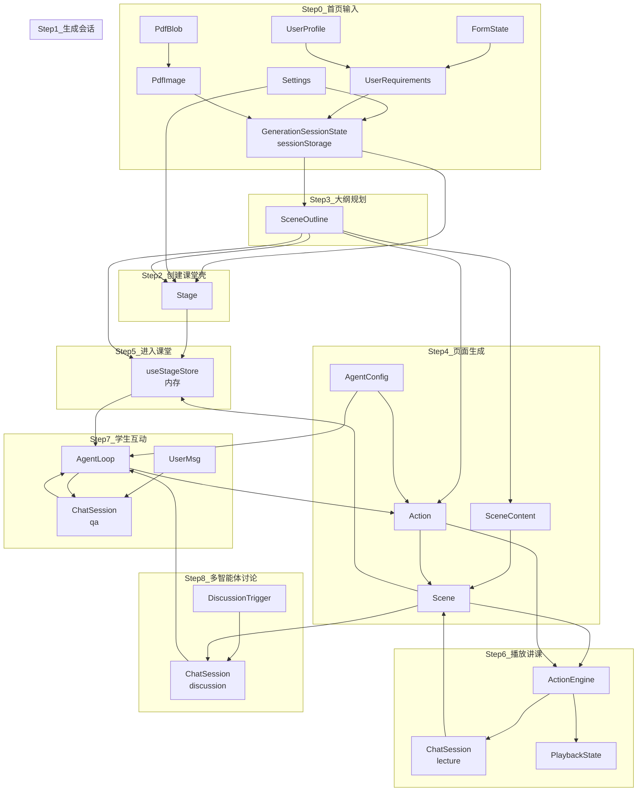
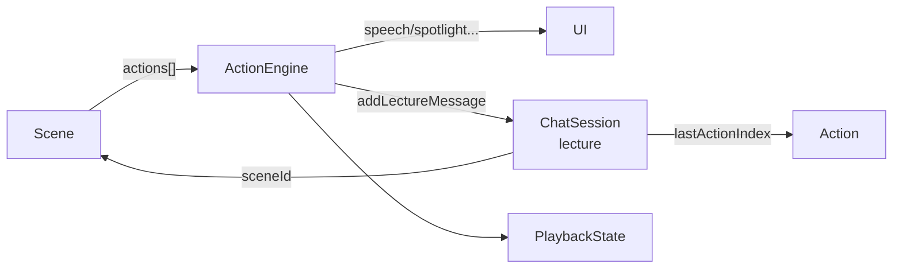
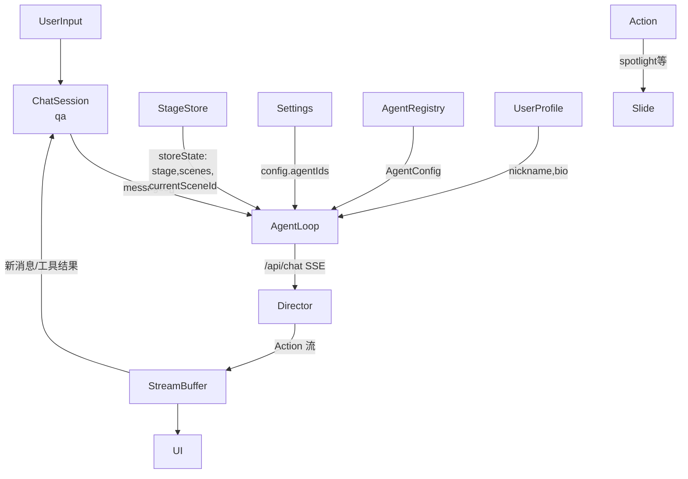
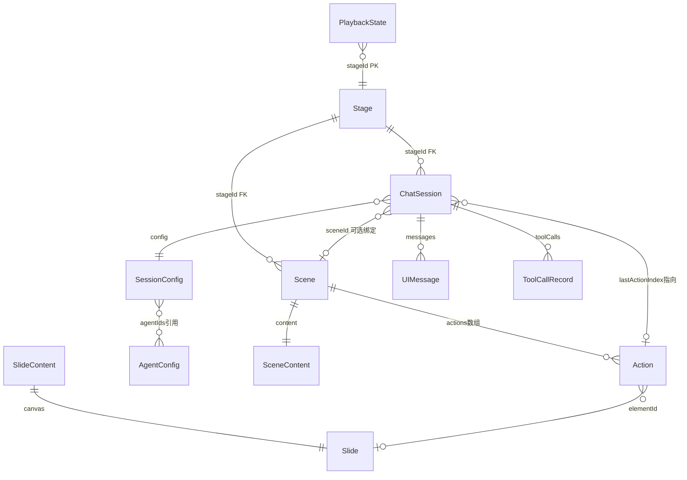
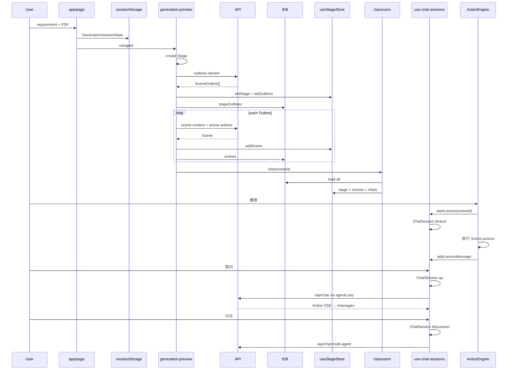
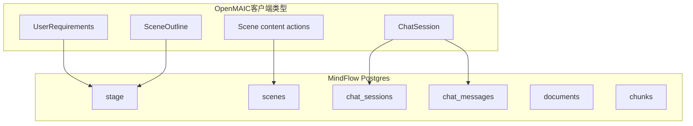

# OpenMAIC 原项目数据结构全景（从用户输入开始）

> OpenMAIC 0.2.2 数据结构说明。按时间顺序梳理主要类型、重要字段、存储位置，以及 `ChatSession` 与 `Stage` / `Scene` / `Action` / `Agent` 的完整关系链。

## 一、按逻辑顺序：系统每一步的数据结构关系

以下按**时间顺序**串联全部主要结构。箭头表示「产出 / 引用 / 挂载」关系。



### Step 0 — 首页输入（尚未有课堂）

| 结构 | 定义位置 | 存什么 | 下一步 |
|------|----------|--------|--------|
| **FormState** | `app/page.tsx` 组件 state | `requirement`、`pdfFile`、`webSearch`、`interactiveMode` | 点击生成 → 组装 `UserRequirements` |
| **UserProfile** | `lib/store/user-profile.ts` | `nickname`、`bio` | 写入 `UserRequirements` |
| **Settings** | `lib/store/settings.ts` | Provider、模型、`selectedAgentIds` | 生成 API 请求头；课堂内 QA/讨论选 agent |

**关系**：此阶段**没有** `Stage` / `Scene` / `ChatSession`。

---

### Step 1 — 生成会话（临时载体）

首页 `handleGenerate` 写入 **sessionStorage** `generationSession`：

```typescript
// app/generation-preview/types.ts — GenerationSessionState
{
  sessionId: string,
  requirements: UserRequirements,   // ← Step0 汇总
  pdfText, pdfImages, imageStorageIds,
  sceneOutlines: null,              // ← Step3 填充
  languageDirective?: string,         // ← Step3 大纲 API 推断
  researchContext?: string,           // 可选联网搜索
  previewPhase?: 'preparing' | 'outline-ready' | 'review' | ...
}
```

| 上游 | 本结构 | 下游 |
|------|--------|------|
| `UserRequirements` + PDF | `GenerationSessionState` | `Stage`、`SceneOutline[]` |

**关系**：`GenerationSessionState` 是**一次生成任务**的临时上下文，不等于 `Stage`；生成完成后用户进入 `/classroom/{stageId}`，长期数据落在 IndexedDB。

---

### Step 2 — 创建 `Stage`（课堂壳，先于大纲）

在 `app/generation-preview/page.tsx` 调用大纲 API **之前**创建：

```typescript
const stage: Stage = {
  id: nanoid(10),           // 全局主键，路由 /classroom/{id}
  name: extractTopicFromRequirement(...),
  style: 'professional',
  interactiveMode: boolean,
  createdAt, updatedAt,
  // 后续补充：
  agentIds?: string[],              // ← Settings.selectedAgentIds 或 AI 生成
  languageDirective?: string,       // ← 大纲 API 返回
  videoManifest?: VideoManifest,    // ← 从 SceneOutline.mediaGenerations 汇总
};
```

| 上游 | 本结构 | 下游 |
|------|--------|------|
| `UserRequirements`（主题/模式） | `Stage` | `Scene[]`、`ChatSession[]`、`stageOutlines` |

**存放**：IndexedDB `stages` + `useStageStore.stage`

**关键关系**：

- `Stage` = 课程**容器**，不含每页内容
- `Stage.agentIds` → 引用 `AgentConfig.id`（Registry / generatedAgents）
- 1 个 Stage → N 个 Scene、N 个 ChatSession、0~1 条 stageOutlines

---

### Step 3 — 生成 `SceneOutline[]`（页面规划）

API：`POST /api/generate/scene-outlines-stream`

| 字段 | 含义 |
|------|------|
| `id`, `order`, `type` | 页序、类型 slide/quiz/interactive/pbl |
| `title`, `description`, `keyPoints[]` | 意图与要点（**无画布、无 actions**） |
| `quizConfig` / `widgetOutline` | 测验/交互页规划 |
| `mediaGenerations[]` | 待生成的图/视频请求 |

| 上游 | 本结构 | 下游 |
|------|--------|------|
| `UserRequirements` + PDF/搜索上下文 | `SceneOutline[]` | 每个 outline → 一个 `Scene`；`videoManifest` 写回 `Stage` |

**存放**：

- 生成中：`GenerationSessionState.sceneOutlines` + `useStageStore.outlines`
- 断点恢复：IndexedDB **`stageOutlines`**（FK `stageId`，与 `scenes` **分开存**）

**与 Scene 的对应**：通过 `order`（及 `type`/`title`）一一对应，不是嵌套关系。

---

### Step 4 — 由 Outline 生成 `Scene`（成品页）

每个 `SceneOutline` 两步 API：

```
SceneOutline
  → scene-content  → SceneContent（页面本体）
  → scene-actions  → Action[]（讲课剧本） + 组装 Scene
  → 可选 TTS       → audioFiles（FK audioId 写在 Action.speech 里）
```

**`Scene` 完整字段**（`lib/types/stage.ts`）：

| 字段 | 来源 | 含义 |
|------|------|------|
| `id`, `stageId`, `order` | 组装时生成 / 来自 outline.order | 页身份 |
| `type`, `title` | 通常来自 `SceneOutline` | 页类型与标题 |
| **`content: SceneContent`** | scene-content API | 页面本体（见下） |
| **`actions: Action[]`** | scene-actions API | 播放/讲课剧本 |
| `whiteboards?` | 生成或运行时 | 深度讲解白板 Slide |
| `multiAgent?` | 配置 | 本页讨论用哪些 agent |

**`SceneContent` 多态**（只属于 `Scene`，**不是** Outline 的类型）：

```
SceneContent
├── SlideContent       → canvas: Slide
├── QuizContent        → questions: QuizQuestion[]
├── InteractiveContent → url/html, widgetType
└── PBLContent         → projectConfig: PBLProjectConfig
```

**`Slide`**（`lib/types/slides.ts`）：`elements: PPTElement[]`（text/image/shape/chart/video…）

**`Action`**（`lib/types/action.ts`）与 Slide 的关系：

```
Scene.actions[i]
  ├── speech        → 文本旁白；audioId → audioFiles 表
  ├── spotlight/laser → elementId → Slide.elements[].id
  ├── wb_draw_*     → 写入 Scene.whiteboards / 白板 Slide
  └── discussion    → 可触发 ChatSession(discussion)
```

| 上游 | 本结构 | 下游 |
|------|--------|------|
| `SceneOutline` + `AgentConfig[]` | `Scene` | ActionEngine 播放；lecture ChatSession；QA 时的 storeState |

**存放**：IndexedDB `scenes`（FK `stageId`）

---

### Step 5 — 进入课堂（加载到内存）

`app/classroom/[id]/page.tsx` 调用 `useStageStore.loadFromStorage(stageId)`：

```
IndexedDB                    useStageStore（Zustand）
├── stages        →  stage
├── scenes        →  scenes[]
├── stageOutlines →  outlines[]（生成未完成时用于恢复）
├── chatSessions  →  chats[]      ← ChatSession 首次从 DB 进入内存
└── playbackState →  （播放组件读取）
```

| 结构 | 在 store 中的字段 |
|------|------------------|
| `Stage` | `stage` |
| `Scene[]` | `scenes`, `currentSceneId` |
| `SceneOutline[]` | `outlines`, `generatingOutlines` |
| `ChatSession[]` | `chats` |

**关系**：`useStageStore` 是课堂页的**单一事实来源**；`use-chat-sessions` 的 sessions 与 `stage.chats` **双向同步**（变更后 `setChats` → `saveStageData` → IndexedDB）。

---

### Step 6 — 播放讲课：`ChatSession(lecture)` + `ActionEngine`

**触发**：用户播放某一页 → `startLecture(sceneId)`（`components/chat/use-chat-sessions.ts`）



| 关系 | 说明 |
|------|------|
| `ChatSession.sceneId` | 绑定**正在播放的那一页** `Scene.id` |
| `ChatSession.lastActionIndex` | 记录已追加到聊天气泡的 `Scene.actions` 下标；重进不重复 append |
| `ChatSession.messages` | **单条** assistant 消息；`speech` 文本通过 StreamBuffer 逐段写入 |
| `ChatSession.config` | lecture 会话通常不驱动多 agent 调度 |
| `Scene.actions` | **数据源**；lecture 会话是 actions 的**展示副本**，不修改 Scene |
| `PlaybackState` | 并行记录 `sceneIndex` / `actionIndex`（整课播放进度） |

**与 QA/讨论的区别**：lecture **不调用** `/api/chat`；只是把预生成的 `Action` 渲染进聊天气泡。

---

### Step 7 — 学生提问：`ChatSession(qa)` + Agent 循环

**触发**：用户在对话框输入 → `sendMessage` → 若无活跃 qa 会话则 `createSession('qa')`



| 关系 | 说明 |
|------|------|
| `ChatSession` ← `Stage` | 通过 `chatSessions.stageId` 外键；内存里在 `useStageStore.chats[]` |
| `ChatSession.config.agentIds` | 来自 **Settings.selectedAgentIds**（非 Stage.agentIds，除非用户改过） |
| `ChatSession.messages` | 用户消息 + 多轮 assistant 回复（qa 可能多 agent 轮流发言） |
| `ChatSession.toolCalls` | Agent 请求客户端执行的工具（如画板操作）及结果 |
| `storeState.scenes` + `currentSceneId` | 告诉 Director **当前看到哪一页**，用于 prompt 里的 slide 上下文 |
| `storeState.stage` | 课程名、语言等元信息注入 prompt |
| 产出 `Action` | 在线生成，**不写回** `Scene.actions`（与 lecture 预生成剧本不同） |

**与 Scene 的绑定**：qa 会话通常**不强制**设 `sceneId`；上下文通过 `currentSceneId` 动态传递。

---

### Step 8 — 多智能体讨论：`ChatSession(discussion)`

**触发**：播放中遇到 `Action(type=discussion)` 或用户主动发起 → `startDiscussion`

| 关系 | 说明 |
|------|------|
| `ChatSession.type` | `'discussion'` |
| `ChatSession.config.triggerAgentId` | 第一个发言的 agent |
| `ChatSession.config.agentIds` | Settings 中选中的一组 agent |
| `ChatSession.title` | 讨论主题（来自 discussion action 或用户输入） |
| `Scene.multiAgent` | **页级配置**：该页是否允许多人讨论、用哪些 agent |
| Agent 循环 | 同 qa，但 `sessionType: 'discussion'`，Director 按轮次调度多 agent |

**与 qa 的共性**：都走 `runAgentLoop` → `/api/chat`；都可能在 `messages` 里积累多 agent 气泡；同时只能有一个活跃的 qa/discussion 会话。

---

### Step 9 — 持久化回写（任意课堂操作后）

`useStageStore.saveToStorage()` → `lib/utils/stage-storage.ts`：

```
saveStageData(stageId, {
  stage,           → db.stages
  scenes,          → db.scenes
  currentSceneId,
  chats,           → db.chatSessions（含所有 ChatSession）
})
```

`setOutlines()` 单独写 → `db.stageOutlines`（不经过 saveStageData）

---

## 二、ChatSession 专题：与其他结构的完整关系图



### 三种 ChatSession 对比

| 维度 | `lecture` | `qa` | `discussion` |
|------|-----------|------|--------------|
| **数据从哪来** | `Scene.actions[]`（预生成） | 用户输入 + LLM 实时生成 | discussion 触发 + LLM 多轮 |
| **是否调 /api/chat** | 否 | 是 | 是 |
| **绑定 Scene** | `sceneId` 必填 | 通常靠 `currentSceneId` 传上下文 | 可有 `sceneId`；常配合 `Scene.multiAgent` |
| **messages 形态** | 单条 assistant，追加 speech | 多轮 user/assistant | 多 agent 轮流 assistant |
| **Action 写回 Scene** | 否（只读剧本） | 否（在线临时 Action） | 否 |
| **agentIds 来源** | 不重要 | Settings.selectedAgentIds | Settings + triggerAgentId |
| **lastActionIndex** | 有（防重复 append） | 一般不用 | 一般不用 |

### ChatSession 字段与关联结构

| ChatSession 字段 | 关联的结构 | 作用 |
|------------------|-----------|------|
| `id` | — | 会话主键 |
| （隐式）`stageId` | `Stage.id` | DB 外键；切换课堂时 sessions 整体替换 |
| `type` | — | 决定走播放链还是 Agent 链 |
| `messages` | `UIMessage` + `ChatMessageMetadata` | UI 气泡；metadata 含 senderName、actions 徽章 |
| `config.agentIds` | `AgentConfig.id[]` | qa/discussion 参与角色 |
| `config.defaultAgentId` | `AgentConfig` | qa 默认回答者 |
| `config.triggerAgentId` | `AgentConfig` | discussion 首个发言者 |
| `sceneId` | `Scene.id` | lecture 绑定页；讨论可能绑定页 |
| `lastActionIndex` | `Scene.actions[index]` | lecture 播放进度（会话内） |
| `toolCalls` / `pendingToolCalls` | Action 执行 / 白板 API | Agent 工具调用审计 |
| `status` | — | active / completed / interrupted；影响能否复用会话 |

### ChatSession 在系统中的位置（与生成链并列）

```
生成链（一次性）:
  UserRequirements → SceneOutline → Scene(content+actions)
                           ↓
                    不再参与 ChatSession 创建

运行时链（可反复）:
  Stage + Scene + AgentConfig
       ↓
  ChatSession(lecture|qa|discussion)
       ↓
  messages / toolCalls / StreamBuffer / ActionEngine
```

**要点**：`ChatSession` 与 `SceneOutline` **无直接关系**；它只依赖已生成的 `Stage` + `Scene`，以及 Registry 里的 `AgentConfig`。

---

## 三、核心数据结构速查（字段摘要）

### `UserRequirements` — `lib/types/generation.ts`

`requirement`, `userNickname`, `userBio`, `webSearch`, `interactiveMode` → 仅生成阶段使用。

### `SceneOutline` — 轻量规划

无 `SceneContent`、无 `Action` → 存 `stageOutlines` 表。

### `Stage` — 课堂壳

`id`, `name`, `style`, `agentIds`, `languageDirective`, `videoManifest`, `interactiveMode` → 存 `stages` 表。

### `Scene` — 成品页

`content` + `actions` + 可选 `multiAgent` → 存 `scenes` 表。

### `SceneContent` / `Slide` / `Action`

见 Step 4；Slide.elements ← Action.elementId。

### `AgentConfig` — `lib/orchestration/registry/types.ts`

`persona`, `allowedActions`, `voiceConfig` → Registry 内存 + 可选 `generatedAgents` 表；被 `Stage.agentIds`、`ChatSession.config.agentIds`、生成 API 引用。

### `ChatSession` — `lib/types/chat.ts`

见第二节专题；存 `chatSessions` 表，同步 `useStageStore.chats`。

---

## 四、补充：Settings / PBL / 导出

### Settings（全局配置，localStorage）

定义于 `lib/store/settings.ts` 的 `SettingsState`，持久化键名 `openmaic-settings`。

| 分组 | 主要字段 | 影响的数据流 |
|------|----------|--------------|
| **LLM** | `providerId`, `modelId`, `providersConfig`, `thinkingConfigs` | 生成 API、QA/讨论 `/api/chat` 请求头 |
| **Agent 选择** | `selectedAgentIds` | `ChatSession.config.agentIds`；生成时 `Stage.agentIds` |
| **TTS/ASR** | `ttsProviderId`, `ttsVoice`, `asrProviderId`, `*ProvidersConfig` | `Action.speech` 的 TTS；语音输入转写 |
| **PDF** | `pdfProviderId`, `pdfProvidersConfig` | 首页 PDF 解析 → `PdfImage` |
| **图像/视频** | `imageProviderId`, `videoProviderId`, `*GenerationEnabled` | `SceneOutline.mediaGenerations` → `mediaFiles` |
| **网页搜索** | `webSearchProviderId` | `GenerationSessionState.researchContext` |

**关系**：Settings **不挂在 Stage 下**，是跨课堂的全局状态；但会注入生成请求与 Agent 循环。

### PBL 子结构（嵌在 Scene 内）

当 `Scene.type === 'pbl'` 时，`Scene.content` 为 `PBLContent`，挂载 `PBLProjectConfig`（`lib/pbl/types.ts`）：

```
PBLProjectConfig
├── projectInfo: PBLProjectInfo     // 项目标题与描述
├── agents: PBLAgent[]              // PBL 专用角色（与课堂 AgentConfig 独立）
├── issueboard: PBLIssueboard       // 任务看板
│     ├── issues: PBLIssue[]
│     └── current_issue_id
└── chat: PBLChat                   // PBL 内消息
      └── messages: PBLChatMessage[]
```

| 与主模型的关系 | 说明 |
|----------------|------|
| `Scene.content.projectConfig` | PBL 数据的唯一持久化入口（在 `scenes` 表 JSON 内） |
| `AgentConfig` | **不直接用于** PBL；PBL 用 `PBLAgent`（另一套 persona/role） |
| `ChatSession` | **不用于** PBL 内聊天；PBL 用 `PBLChat.messages` |
| 学习进度 | 部分状态在 localStorage（按 sceneId 的 quiz/PBL 键） |

PBL 运行时通过 `/api/pbl/chat` 与 MCP 工具交互，与主课堂 `ChatSession` 链路分离。

### 导出结构（`.maic.zip`）

定义于 `lib/export/classroom-zip-types.ts`：

```
ClassroomManifest
├── formatVersion, exportedAt, appVersion
├── stage: ManifestStage          // Stage 元信息快照（不含 interactiveMode）
├── agents: ManifestAgent[]       // 来自 generatedAgents 或 stage.generatedAgentConfigs
├── scenes: ManifestScene[]       // Scene 序列化（content + actions + whiteboards）
└── mediaIndex: Record<id, MediaIndexEntry>  // 媒体文件索引
```

| 上游 | 导出 | 下游 |
|------|------|------|
| `Stage` + `Scene[]` + `generatedAgents` + `mediaFiles` | `ClassroomManifest` ZIP | 导入时重建 IndexedDB `stages`/`scenes`/媒体 |

导出**不包含** `ChatSession`、`stageOutlines`、`playbackState`——这些是运行时/生成期数据，不随课堂包迁移。

---

## 五、IndexedDB 表关系（持久化层）

```
MAIC-Database
├── stages           ← Stage
├── scenes           ← Scene[] (FK stageId)
├── stageOutlines    ← SceneOutline[] (FK stageId)
├── chatSessions     ← ChatSession (FK stageId)  ★ 运行时对话
├── playbackState    ← 播放进度 (PK stageId)
├── generatedAgents  ← AgentConfig 快照 (FK stageId)
├── mediaFiles       ← 图/视频 Blob (FK stageId)
├── audioFiles       ← TTS ← Action.speech.audioId
├── imageFiles       ← PDF 提取图
└── voiceProfiles    ← 克隆音色
```

**服务端**（API 生成）：`data/classrooms/{id}.json` = `{ stage, scenes }`，无 outline、无 chatSessions。

**localStorage / sessionStorage**（非 IndexedDB）：

| 键 | 结构 |
|----|------|
| `openmaic-settings` | `SettingsState` |
| `user-profile-storage` | `UserProfile` |
| `generationSession` | `GenerationSessionState`（单次生成，关闭标签页可丢） |

---

## 六、完整时序（含 ChatSession 分支）



---

## 七、常见误解纠正

| 误解 | 正确理解 |
|------|----------|
| SceneContent 是 Outline 的类型 | SceneContent 只属于 Scene |
| ChatSession 只有 QA | lecture / qa / discussion 三种，职责不同 |
| ChatSession 参与生成 | 生成链结束才有 ChatSession；与 SceneOutline 无直接关系 |
| qa 的 Action 会写回 Scene.actions | 在线 Action 是临时的，不改 Scene |
| lecture 会调 LLM | lecture 只读 Scene.actions，不调 /api/chat |
| Outline 和 Scene 存一起 | `stageOutlines` vs `scenes` 分开存 |
| PBL 聊天走 ChatSession | PBL 用 `PBLChat`，与主课堂 ChatSession 分离 |
| 导出 ZIP 含对话记录 | 导出只有 stage/scenes/agents/media，不含 chatSessions |

---

## 八、记忆口诀

1. **生成链**：`UserRequirements` → `SceneOutline[]` → `Scene(content + actions)` → 落 IndexedDB
2. **容器链**：`Stage` → 多 `Scene`；`Scene.content` 是页面，`Scene.actions` 是剧本
3. **幻灯片链**：`Slide.elements[].id` ← `Action.elementId`
4. **对话链**：`Stage` → 多 `ChatSession`；lecture 读 actions，qa/discussion 走 Agent 循环
5. **Agent 链**：`ChatSession.config.agentIds` → `AgentConfig`；`storeState.scenes` + `currentSceneId` → Director 上下文
6. **配置链**：`Settings` 全局注入生成与 Agent；不存入 `stages` 表
7. **PBL 链**：`Scene(PBL).content.projectConfig` 自包含；不走 `ChatSession`

---

## 相关源码索引

| 主题 | 文件 |
|------|------|
| 类型定义 | `lib/types/stage.ts`, `generation.ts`, `chat.ts`, `action.ts`, `slides.ts` |
| IndexedDB | `lib/utils/database.ts`, `stage-storage.ts`, `chat-storage.ts` |
| 生成入口 | `app/page.tsx`, `app/generation-preview/page.tsx` |
| 课堂加载 | `app/classroom/[id]/page.tsx`, `lib/store/stage.ts` |
| 对话运行时 | `components/chat/use-chat-sessions.ts`, `lib/chat/agent-loop.ts` |
| Agent 定义 | `lib/orchestration/registry/types.ts` |
| PBL | `lib/pbl/types.ts`, `app/api/pbl/chat/route.ts` |
| 导出 | `lib/export/classroom-zip-types.ts`, `lib/export/use-export-classroom.ts` |
| 设置 | `lib/store/settings.ts`, `lib/types/settings.ts` |

---

## 九、MindFlow PRD 数据模型映射（Postgres）

> MindFlow v1.6 定稿：6 张表，大纲存 `stage` JSONB，不建 `outlines` 表。详见 [DATA-MODEL.md](./DATA-MODEL.md) 与 [PRD.md §6](./PRD.md#6-数据模型)。

### 9.1 OpenMAIC → MindFlow 持久化对照

| OpenMAIC（IndexedDB / 内存） | MindFlow（Postgres） |
|------------------------------|----------------------|
| `Stage` | `stage` 表一行 |
| `stageOutlines`（生成会话） | `stage.scene_outlines` JSONB（Phase 2 Plan 蓝图） |
| `SceneOutline[]`（确认前） | `stage.outlines` JSONB（执行稿） |
| `Scene` + `content` + `actions` | `scenes` 表 |
| `ChatSession` + 内嵌 messages | `chat_sessions` + `chat_messages` |
| 无服务端 PDF/RAG | `documents` + `chunks`（含 `embedding`） |
| `Settings` / Agent 配置 | `localStorage` + `config/agents.json`（不建表） |
| `GenerationSessionState`（sessionStorage） | 确认后写入 `stage`；中间态仍用 sessionStorage |

### 9.2 双层大纲与生命周期（不建 outlines 表）

| JSONB 列 | 对应 OpenMAIC 概念 | 生命周期 |
|----------|-------------------|----------|
| `stage.scene_outlines` | Phase 2 Plan 蓝图 | L0 sessionStorage → L1 落库；冻结后**长期保留** |
| `stage.outlines` | `SceneOutline[]` 执行稿 | L0 sessionStorage → SSE `done` 写 L1 → 生成 `scenes`（L2）；**默认保留**供续生成 |

`outlines_status`：`draft` → `confirmed` → `scenes_ready` → `archived`（可选）。详见 PRD [§6.1.4](./PRD.md#614-大纲与-plan-生命周期)。

`scenes.outline_id`（text）逻辑关联 `stage.outlines[].id`，非 FK。

### 9.3 各里程碑读写表

| 阶段 | 主要表 / 列 |
|------|-------------|
| M0 | 6 表 schema + pgvector |
| M1 | `stage`, `documents`, `chunks`, `chat_sessions`, `chat_messages.sources` |
| M2 | `stage.outlines`, `scenes`, lecture `chat_sessions` |
| M2+ | `session_type=outline`, `chat_messages.metadata`, `PATCH stage.outlines` |
| M3 | quiz `scenes`, discussion + RAG |
| M4 | `scenes.status`, `stage.current_scene_id` |
| P2a～P2c | `scene_outlines`, 冻结字段, `last_critic_report` |

### 9.4 数据流（MindFlow）


