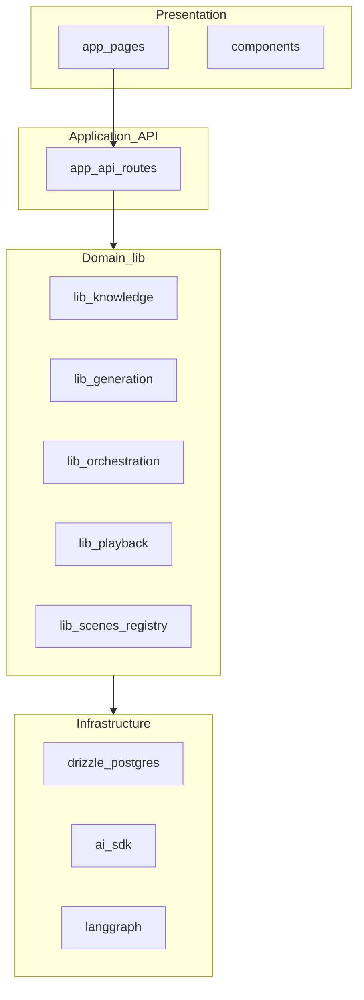
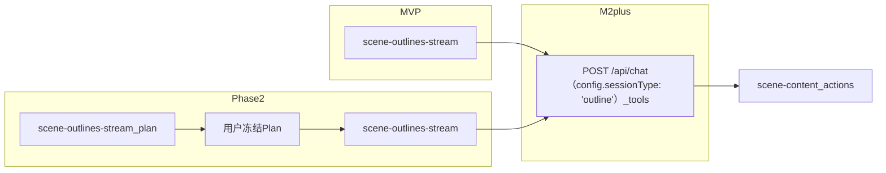
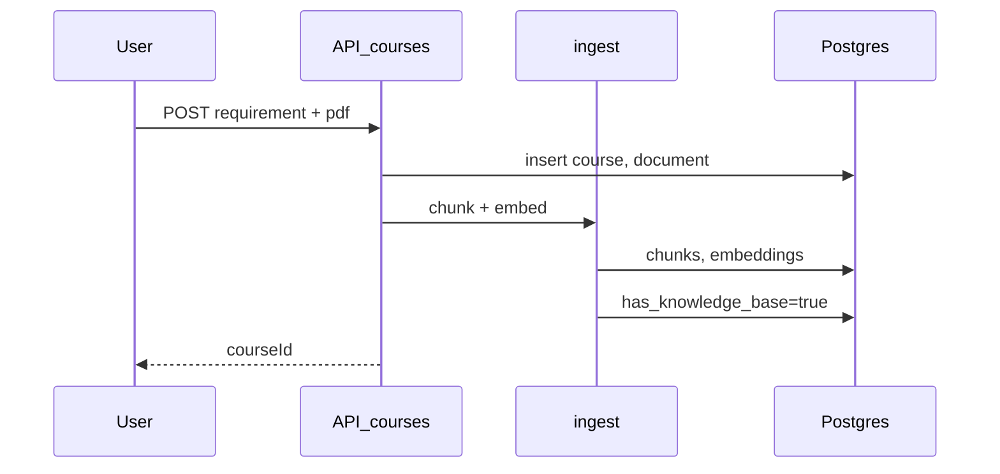
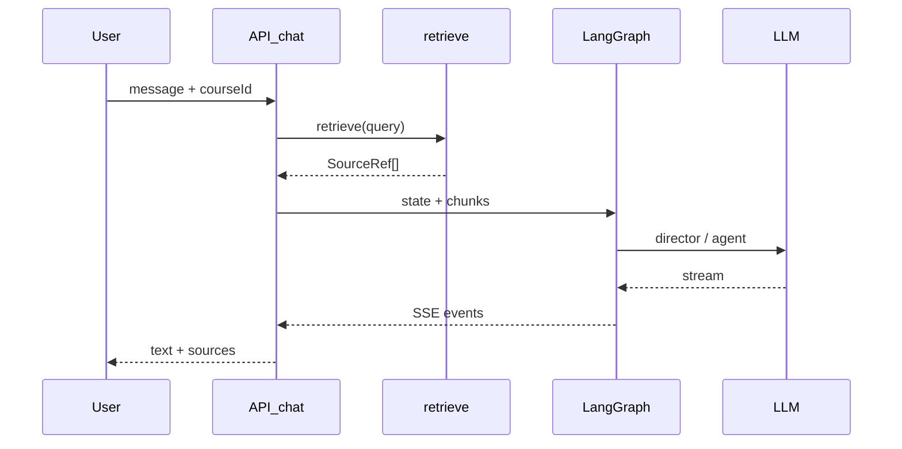
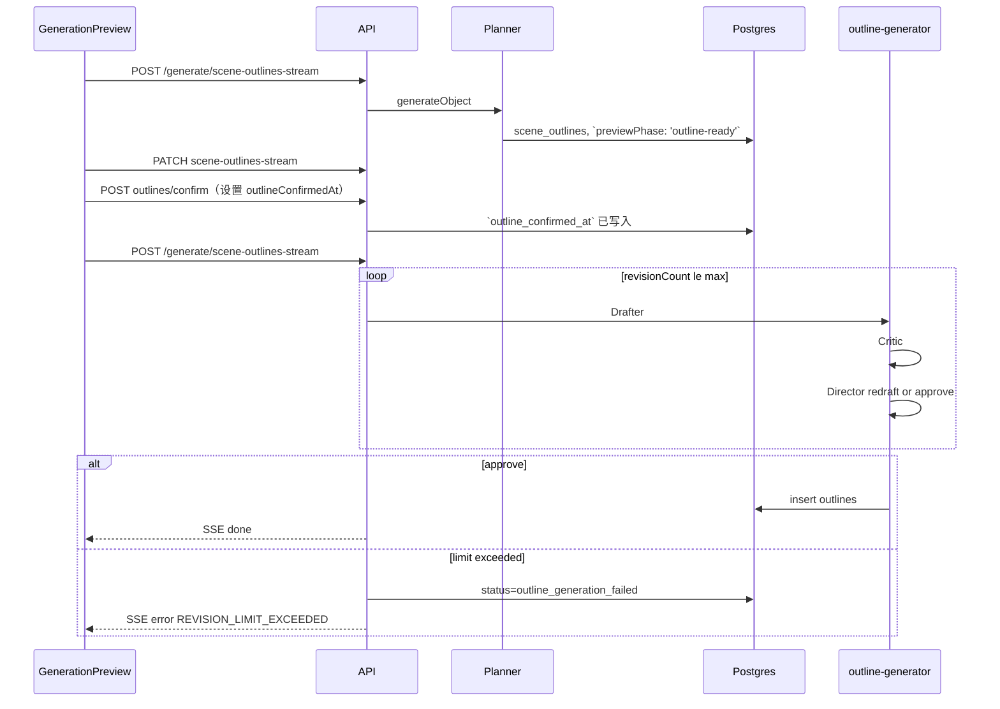
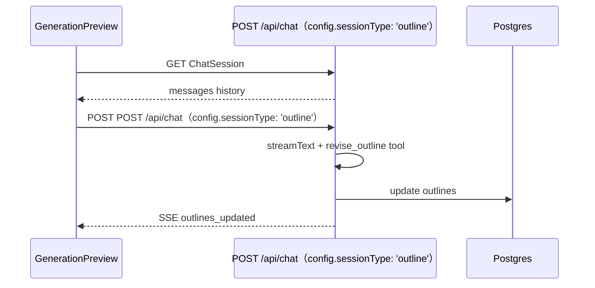

# MindFlow 架构说明

本文档是 [PRD.md](./PRD.md) 的技术补充，描述 MVP 及拓展阶段（M2+ 大纲编辑助手、Phase 2 冻结 Plan 编排）的模块划分、目录建议与关键数据流。实施步骤见 [DEV_GUIDE.md](./DEV_GUIDE.md)。实现时可参考 OpenMAIC **经典路径**对应模块，**不**引入 OpenMAIC Pro Agent Runtime。

---

## 1. 设计原则

1. **薄壳 + 厚 lib**：页面与 API Route 只做编排，业务逻辑放在 `lib/`。
2. **插件化场景类型**：`slide` / `quiz` 通过 `lib/scenes/registry` 注册，便于扩展 `interactive`。
3. **条件 RAG**：`has_knowledge_base` 为唯一开关；无 PDF 时不走向量检索。
4. **无状态 Chat API**：课堂讨论每轮请求携带 `messages` + `directorState` + `courseId`（与 OpenMAIC 经典路径一致）；**不**为课堂引入服务端 Agent Session。
5. **功能开关**：`lib/config/features.ts` 控制 `outlineOrchestration`、`outlineAssistant` 等，避免半成品入口暴露。
6. **双编排域**：**生成域**（Plan / Outline / scene 生成）与 **课堂讨论域**（Director + 3 Agent）分离，各自 LangGraph 或流水线，不共用图状态。
7. **蓝图与执行稿分层**：`courses.scene_outlines`（`SceneOutline[]` 蓝图，可冻结）与 `outlines` 表（执行稿）分字段存储；Phase 2 冻结后 Agent **不可**改 Plan。
8. **有界 Agent 循环**：Phase 2 评审循环 `revisionCountMax` 默认 3，超限 **报错退出**，不 silent retry。

---

## 2. 逻辑分层



| 层 | 职责 |
|----|------|
| Presentation | 页面、PlaybackShell、DiscussionPanel、只读 Slide/Quiz 渲染 |
| Application | HTTP/SSE 入口、鉴权、请求校验、DTO 转换 |
| Domain | 生成流水线、RAG、Agent 图、播放状态机 |
| Infrastructure | Postgres、pgvector、LLM 调用 |

---

## 3. 推荐目录结构

```
mindflow/
├── app/
│   ├── page.tsx                          # 首页（对齐 OpenMAIC app/page.tsx）
│   ├── generation-preview/page.tsx       # 生成预览
│   ├── classroom/
│   │   └── [id]/page.tsx                 # 课堂播放
│   └── api/
│       ├── courses/route.ts
│       ├── courses/[id]/route.ts         # GET/PATCH sceneOutlines + previewPhase
│       ├── courses/[id]/ingest/route.ts
│       ├── courses/[id]/replan/route.ts  # Phase 2：重新规划
│       ├── courses/[id]/outlines/route.ts
│       ├── courses/[id]/chat-sessions/route.ts  # M2+ outline session 续跑
│       ├── parse-pdf/route.ts            # 对齐 OpenMAIC
│       ├── generate/
│       │   ├── scene-outlines-stream/route.ts   # MVP + Phase 2（plan/execute 分支）
│       │   ├── scene-content/route.ts
│       │   └── scene-actions/route.ts
│       ├── chat/route.ts                 # 课堂讨论 + M2+ 大纲助手（sessionType）
│       └── quiz-grade/route.ts
├── components/
│   ├── settings/                         # SettingsDialog
│   ├── playback/PlaybackShell.tsx
│   ├── discussion/DiscussionPanel.tsx
│   ├── generation/
│   │   ├── OutlinesEditor.tsx            # 对齐 OpenMAIC components/generation/outlines-editor.tsx
│   │   ├── OutlineReviewRounds.tsx       # Phase 2：Critic/Director Round UI
│   │   └── OutlineAssistantPanel.tsx     # M2+：侧栏聊天
│   └── scenes/SlideView.tsx, QuizView.tsx
├── config/
│   └── agents.json
├── lib/
│   ├── config/features.ts
│   ├── db/
│   ├── knowledge/                        # MindFlow 扩展：RAG
│   ├── generation/
│   │   ├── outline-generator.ts          # generateSceneOutlinesFromRequirements
│   │   ├── outline-tools.ts              # M2+ 大纲编辑助手 tools
│   │   ├── scene-content.ts
│   │   ├── scene-actions.ts
│   │   └── prompts/                      # requirements-to-outlines 等
│   ├── orchestration/
│   │   ├── director-graph.ts             # 课堂讨论 LangGraph
│   │   └── stateless-generate.ts
│   ├── chat/agent-loop.ts
│   ├── hooks/use-scene-generator.ts      # generateRemaining / fetchSceneContent
│   ├── playback/
│   └── scenes/
├── uploads/
└── docker-compose.yml
```

---

## 4. 核心模块说明

### 4.1 `lib/knowledge`

| 文件 | 职责 |
|------|------|
| `chunk.ts` | 按 token/字符切分，保留 `page` 元数据 |
| `embed.ts` | 调用 embedding API，批量写入 |
| `ingest.ts` | parse 后 orchestrate：chunk → embed → DB |
| `retrieve.ts` | `courseId` + `query` → topK `SourceRef[]` |

**扩展点**：Phase 2 可换 reranker、混合检索（BM25 + vector）。

### 4.2 `lib/generation`

**生成域三轨**（PRD §2.1.1、§3.1.1、§3.1.2、§3.5）：



两阶段 scene 生成（与 OpenMAIC 经典路径一致）：

```
SceneOutline → scene-content → scene-actions → Scene
```

| 输入模式 | 大纲 prompt 输入 |
|----------|------------------|
| 仅提示词 | `requirement` |
| 仅 PDF | `pdfExcerpt`（截断）+ 自动 title |
| 二者 | `requirement` + retrieve topK |

首屏策略：只生成 `sort_order=1` 的 scene，其余在 `generateRemaining` 串行完成。

#### MVP（`outlineOrchestration=false`）

- `outline-generator.ts` + `POST /api/generate/scene-outlines-stream`：单次 LLM + SSE。
- 见 PRD [3.1.1](./PRD.md#311-生成流水线策略mvp-固定流程--phase-2-可切换)。

#### M2+（`outlineAssistant=true`）

- `outline-tools.ts`：`list_outlines`、`revise_outline`、`insert_outline`、`delete_outline`。
- `POST /api/chat`：AI SDK `streamText` + tools，**非**独立 Agent Runtime。
- Session：`chat_sessions.session_type='outline'` + `messages` 续跑。
- **策略 A**：助手可改 Outline 至与冻结 Plan 不一致；确认大纲前可选警告，不阻断（PRD §3.1.2.2）。

#### Phase 2（`outlineOrchestration=true`）

**阶段 A — Plan（人可改）**

1. `outline-generator.ts` → `POST /api/generate/scene-outlines-stream（body: `{ outlineOrchestration: true, phase: 'plan' }`）`
2. 用户 `PATCH /api/courses/[id]`（仅 ``previewPhase: 'outline-ready'``）
3. `POST .../outlines/confirm（设置 outlineConfirmedAt）` → ``outline_confirmed_at` 已写入`

**阶段 B — 评审循环（Plan 只读）**

```
Drafter(frozenSceneOutlines) → Critic → Director
  → redraft → Drafter（循环，revisionCountMax 默认 3）
  → approve → 写入 outlines
  → 超限 → outline_generation_failed + SSE error
```

- `outline-generator.ts + scene-outlines-stream/route.ts`：LangGraph；Director **仅** `redraft` | `approve`，**无** `replan`。
- `lib/orchestration/outline-generator.ts + scene-outlines-stream/route.ts（critic 节点）`：校验 Outline 与 `sceneOutlines` 对齐（页数、order、type、教学目标、quiz 约束）；`requiresReplan` 仅 UI 提示。
- `outline-generator.ts（`applyOutlineFallbacks`）`：规则预检（代码），减少 LLM 误判。
- API：`POST /api/generate/scene-outlines-stream（body: `{ outlineOrchestration: true, phase: 'execute' }`）`（SSE 事件见 PRD §7.1）。

完整规格：PRD [3.5 节](./PRD.md#35-phase-2-拓展冻结-plan--大纲评审闭环非-mvp)。

### 4.3 `lib/orchestration`

LangGraph 拓扑（MVP）：

```
START → director → agent_generate → END
```

- **director**：多 Agent 路由；单 Agent fast-path。
- **agent_generate**：流式 JSON 文本（MVP 可仅 text，不执行白板 action）。

请求体携带：`messages`、`storeState`（当前 scene）、`retrievedChunks`、`requirement`。

客户端 `agent-loop.ts` 多轮调用 `/api/chat` 直到 `cue_user` 或 `done`。

### 4.4 `lib/playback`

`TimelinePlayer`（类）：

- 输入：`Scene.actions[]`
- 输出回调：`onSpeech`、`onDiscussion`、`onComplete`
- 无 TTS：用 `pacing.estimateReadDuration`

`PlaybackShell` 订阅 player 状态，驱动字幕 UI。

### 4.5 `lib/scenes/registry`

```typescript
interface SceneTypeHandler {
  type: 'slide' | 'quiz';
  generateContent(outline, ctx): Promise<unknown>;
  generateActions(outline, content, ctx): Promise<Action[]>;
  Renderer: ComponentType<{ scene: Scene }>;
}
```

MVP 注册 `slide`、`quiz`；未注册类型在大纲阶段 fallback 为 slide。

---

## 5. 数据流时序

### 5.1 创建课程（有 PDF）



### 5.2 课堂讨论（RAG）



### 5.3 Phase 2：冻结 Plan → 评审大纲（有 PDF 可选）



### 5.4 M2+：大纲编辑助手



---

## 6. 数据库与 pgvector

- 使用 **Neon**、**Supabase** 或 Docker 本地 Postgres，需启用 `vector` 扩展。
- Drizzle schema 与 PRD [§6.1](./PRD.md#61-表结构mvp--phase-2--m2-扩展字段) 对齐（含 Plan 冻结字段、`outline` session）。
- 迁移：`drizzle-kit push` 或版本化 migration。

**相似度查询示例**（概念）：

```sql
SELECT c.id, c.content, c.page,
       1 - (e.embedding <=> $query_embedding) AS score
FROM chunks c
JOIN chunk_embeddings e ON e.chunk_id = c.id
WHERE c.course_id = $course_id
ORDER BY e.embedding <=> $query_embedding
LIMIT 8;
```

---

## 7. 环境与配置

| 变量 | 说明 |
|------|------|
| `DATABASE_URL` | Postgres 连接串 |
| `OPENAI_API_KEY` | LLM + embedding（可拆） |
| `OPENAI_BASE_URL` | 可选，兼容 API |
| `LLM_MODEL` | 如 `gpt-4o-mini` |
| `EMBEDDING_MODEL` | 如 `text-embedding-3-small` |
| `UPLOAD_DIR` | 本地 PDF 目录，默认 `./uploads` |

用户可在 **`SettingsDialog`**（顶栏按钮）覆盖部分配置（存 `localStorage` 或 Zustand store，MVP 二选一）；服务端默认读 `.env`。

---

## 8. 与 OpenMAIC 的差异摘要

| 维度 | OpenMAIC 经典路径 | OpenMAIC 1.0 Pro | MindFlow |
|------|-------------------|------------------|----------|
| 页面路由 | `/`、`/generation-preview`、`/classroom/[id]` | + `/workspace` | **相同三条**（无 Workbench） |
| 生成大纲 | 单次 `scene-outlines-stream` | Agent tools `generate_scene` | MVP 同左；Phase 2 冻结 Plan + 评审循环 |
| Plan 冻结 / Critic | 无 | 隐式在 Pro 对话中 | **显式** Plan 表 + 有界 redraft 循环 |
| 大纲助手 | 无 | Pro 聊天改课 | M2+ `POST /api/chat（config.sessionType: 'outline'）` + AI SDK tools |
| 课堂讨论 | 无状态 `/api/chat` | 同左 | 同左 |
| Agent Runtime | 无 | pi-agent + Postgres Session | **不做** |
| 持久化 | IndexedDB / 可选 PG | Postgres | Postgres + pgvector |
| RAG | 1.0 有模块未接线 | 素材字面搜索 | pgvector retrieve |
| 场景类型 | 多种 | 多种 | slide + quiz |
| 播放 | TTS + Pro | 同左 | TimelinePlayer + 字幕 |

**参考来源**：OpenMAIC `0.2.x` 经典三页 + `director-graph`；**不参考** `lib/server/agent-runtime/`。

---

## 9. 部署建议（MVP）

**Docker Compose**（本地/demo）：

- `app`：Next.js
- `db`：`pgvector/pgvector:pg16`

**生产**：

- Vercel（前端 + API）+ Neon（Postgres + pgvector）
- PDF 上传：Vercel Blob 或 S3；大文件注意 serverless 超时，ingest 可拆为后台 job（Phase 2）。

---

## 10. 相关文档

- [PRD.md](./PRD.md) — 产品需求 v1.5：命名对齐 OpenMAIC、冻结蓝图、M2+ 助手、API、数据模型
- [DEV_GUIDE.md](./DEV_GUIDE.md) — 里程碑 M0～M4、M2+、P2a～P2d
- OpenMAIC 经典参考：`lib/orchestration/director-graph.ts`、`app/api/generate/scene-outlines-stream/route.ts`

---

*文档版本：v1.3 | 2026-09-08 | 对齐 PRD v1.5（OpenMAIC 命名）*
