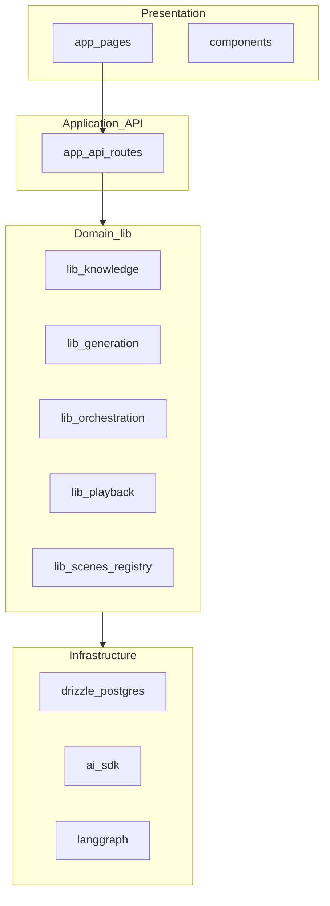
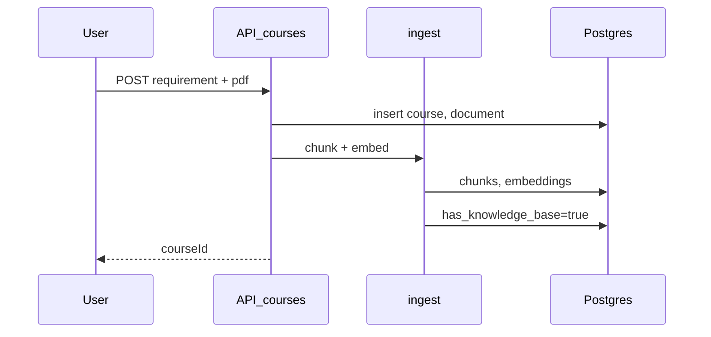
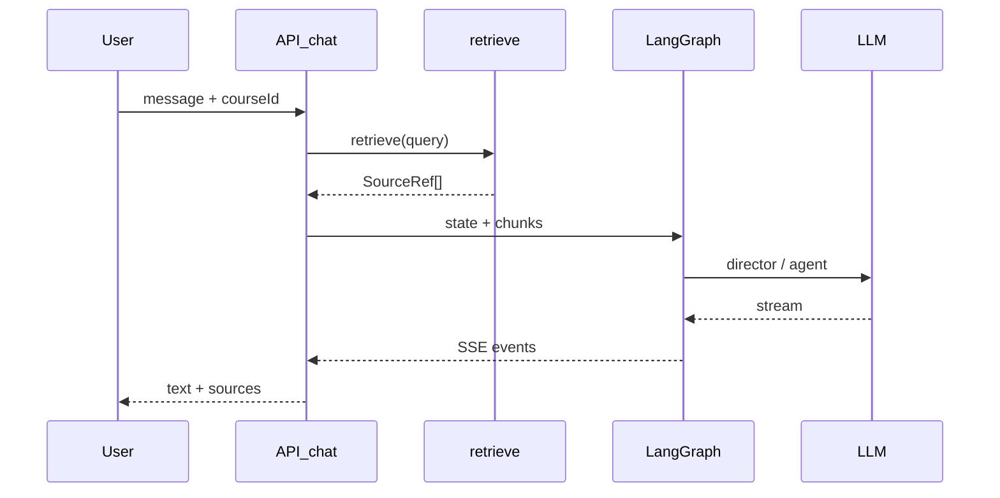

# MindFlow 架构说明

本文档是 [PRD.md](./PRD.md) 的技术补充，描述 MVP 阶段的模块划分、目录建议与关键数据流。实施步骤见 [DEV_GUIDE.md](./DEV_GUIDE.md)。实现时可参考 OpenMAIC 对应模块，但 MindFlow 为独立代码库。

---

## 1. 设计原则

1. **薄壳 + 厚 lib**：页面与 API Route 只做编排，业务逻辑放在 `lib/`。
2. **插件化场景类型**：`slide` / `quiz` 通过 `lib/scenes/registry` 注册，便于 Phase 2 扩展 `interactive`。
3. **条件 RAG**：`has_knowledge_base` 为唯一开关；无 PDF 时不走向量检索。
4. **无状态 Chat API**：每轮请求携带 `messages` + `directorState` + `courseId`（与 OpenMAIC 一致）。
5. **功能开关**：`lib/config/features.ts` 控制未实现能力，避免半成品入口暴露。

---

## 2. 逻辑分层



| 层 | 职责 |
|----|------|
| Presentation | 页面、PlaybackShell、DiscussionPanel、只读 Slide/Quiz 渲染 |
| Application | HTTP/SSE 入口、鉴权、请求校验、DTO 转换 |
| Domain | 生成流水线、RAG、Agent 图、播放状态机 |
| Infrastructure | Postgres、pgvector、LLM 调用 |

---

## 3. 推荐目录结构

```
mindflow/
├── app/
│   ├── page.tsx                          # 首页
│   ├── generation-preview/page.tsx       # 生成预览（ingest + 大纲 + 首屏）
│   ├── classroom/
│   │   └── [id]/page.tsx                 # 课堂播放
│   └── api/
│       ├── courses/route.ts
│       ├── courses/[id]/route.ts
│       ├── courses/[id]/ingest/route.ts
│       ├── courses/[id]/generate-remaining/route.ts
│       ├── generate/outlines-stream/route.ts
│       ├── generate/scene-content/route.ts
│       ├── generate/scene-actions/route.ts
│       ├── chat/route.ts
│       └── quiz/grade/route.ts
├── components/
│   ├── settings/                         # SettingsDialog（顶栏按钮，无独立路由）
│   ├── playback/PlaybackShell.tsx
│   ├── discussion/DiscussionPanel.tsx
│   ├── generation/OutlineStreamList.tsx
│   └── scenes/SlideView.tsx, QuizView.tsx
├── config/
│   └── agents.json                       # 固定 3 Agent
├── lib/
│   ├── config/features.ts
│   ├── db/
│   │   ├── schema.ts                     # Drizzle 表定义
│   │   └── client.ts
│   ├── knowledge/
│   │   ├── ingest.ts
│   │   ├── chunk.ts
│   │   ├── embed.ts
│   │   └── retrieve.ts
│   ├── generation/
│   │   ├── outline-generator.ts
│   │   ├── scene-content.ts
│   │   ├── scene-actions.ts
│   │   └── prompts/                      # 或 lib/prompts/
│   ├── orchestration/
│   │   ├── director-graph.ts
│   │   ├── stateless-generate.ts
│   │   └── prompt-builder.ts
│   ├── chat/agent-loop.ts
│   ├── playback/
│   │   ├── timeline-player.ts
│   │   └── pacing.ts
│   └── scenes/
│       ├── registry.ts
│       └── handlers/
│           ├── slide.ts
│           └── quiz.ts
├── uploads/                              # MVP 本地 PDF 存储
└── docker-compose.yml                    # postgres + pgvector
```

---

## 4. 核心模块说明

### 4.1 `lib/knowledge`

| 文件 | 职责 |
|------|------|
| `chunk.ts` | 按 token/字符切分，保留 `page` 元数据 |
| `embed.ts` | 调用 embedding API，批量写入 |
| `ingest.ts` | parse 后 orchestrate：chunk → embed → DB |
| `retrieve.ts` | `courseId` + `query` → topK `SourceRef[]` |

**扩展点**：Phase 2 可换 reranker、混合检索（BM25 + vector）。

### 4.2 `lib/generation`

两阶段生成（与 OpenMAIC 一致）：

```
SceneOutline → scene-content → scene-actions → Scene
```

| 输入模式 | 大纲 prompt 输入 |
|----------|------------------|
| 仅提示词 | `requirement` |
| 仅 PDF | `pdfExcerpt`（截断）+ 自动 title |
| 二者 | `requirement` + retrieve topK |

首屏策略：只生成 `sort_order=1` 的 scene，其余在 `generate-remaining` 串行完成。

### 4.3 `lib/orchestration`

LangGraph 拓扑（MVP）：

```
START → director → agent_generate → END
```

- **director**：多 Agent 路由；单 Agent fast-path。
- **agent_generate**：流式 JSON 文本（MVP 可仅 text，不执行白板 action）。

请求体携带：`messages`、`storeState`（当前 scene）、`retrievedChunks`、`requirement`。

客户端 `agent-loop.ts` 多轮调用 `/api/chat` 直到 `cue_user` 或 `done`。

### 4.4 `lib/playback`

`TimelinePlayer`（类）：

- 输入：`Scene.actions[]`
- 输出回调：`onSpeech`、`onDiscussion`、`onComplete`
- 无 TTS：用 `pacing.estimateReadDuration`

`PlaybackShell` 订阅 player 状态，驱动字幕 UI。

### 4.5 `lib/scenes/registry`

```typescript
interface SceneTypeHandler {
  type: 'slide' | 'quiz';
  generateContent(outline, ctx): Promise<unknown>;
  generateActions(outline, content, ctx): Promise<Action[]>;
  Renderer: ComponentType<{ scene: Scene }>;
}
```

MVP 注册 `slide`、`quiz`；未注册类型在大纲阶段 fallback 为 slide。

---

## 5. 数据流时序

### 5.1 创建课程（有 PDF）



### 5.2 课堂讨论（RAG）



---

## 6. 数据库与 pgvector

- 使用 **Neon**、**Supabase** 或 Docker 本地 Postgres，需启用 `vector` 扩展。
- Drizzle schema 与 PRD [第 6 节](./PRD.md#6-数据模型) 对齐。
- 迁移：`drizzle-kit push` 或版本化 migration。

**相似度查询示例**（概念）：

```sql
SELECT c.id, c.content, c.page,
       1 - (e.embedding <=> $query_embedding) AS score
FROM chunks c
JOIN chunk_embeddings e ON e.chunk_id = c.id
WHERE c.course_id = $course_id
ORDER BY e.embedding <=> $query_embedding
LIMIT 8;
```

---

## 7. 环境与配置

| 变量 | 说明 |
|------|------|
| `DATABASE_URL` | Postgres 连接串 |
| `OPENAI_API_KEY` | LLM + embedding（可拆） |
| `OPENAI_BASE_URL` | 可选，兼容 API |
| `LLM_MODEL` | 如 `gpt-4o-mini` |
| `EMBEDDING_MODEL` | 如 `text-embedding-3-small` |
| `UPLOAD_DIR` | 本地 PDF 目录，默认 `./uploads` |

用户可在 **`SettingsDialog`**（顶栏按钮）覆盖部分配置（存 `localStorage` 或 Zustand store，MVP 二选一）；服务端默认读 `.env`。

---

## 8. 与 OpenMAIC 的差异摘要

| 维度 | OpenMAIC | MindFlow MVP |
|------|----------|--------------|
| 页面路由 | `/`、`/generation-preview`、`/classroom/[id]` | **相同三条** |
| 设置 | `SettingsDialog` 组件 | 精简版 `SettingsDialog`，无 `/settings` 路由 |
| 持久化 | IndexedDB 为主 | Postgres + pgvector |
| 输入 | requirement + 可选 PDF | 同等，但 PDF-only 为一等路径 |
| RAG | 无 | 有，讨论必接（有 PDF 时） |
| 场景类型 | slide/quiz/interactive/pbl | slide + quiz |
| Agent | 可动态生成 | 固定 3 个 |
| 播放 | PlaybackEngine + TTS + Roundtable | TimelinePlayer + 字幕 |
| 编辑 | Pro 编辑器 | 无 |

---

## 9. 部署建议（MVP）

**Docker Compose**（本地/demo）：

- `app`：Next.js
- `db`：`pgvector/pgvector:pg16`

**生产**：

- Vercel（前端 + API）+ Neon（Postgres + pgvector）
- PDF 上传：Vercel Blob 或 S3；大文件注意 serverless 超时，ingest 可拆为后台 job（Phase 2）。

---

## 10. 相关文档

- [PRD.md](./PRD.md) — 产品需求、API 列表、用户故事
- [DEV_GUIDE.md](./DEV_GUIDE.md) — 里程碑实施、移植矩阵、验收清单
- OpenMAIC 参考：`lib/orchestration/director-graph.ts`、`app/api/generate/scene-outlines-stream/route.ts`

---

*文档版本：v1.0 | 2026-09-02*
