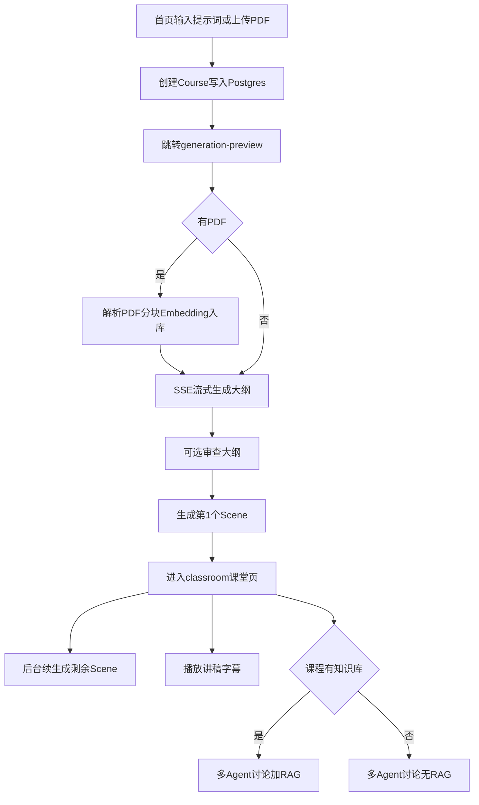
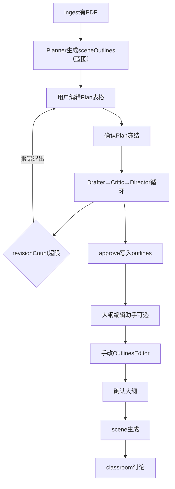
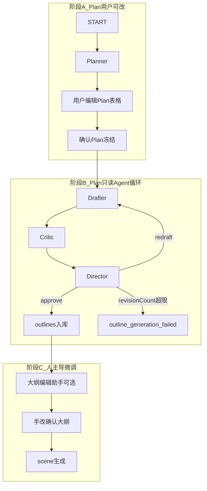
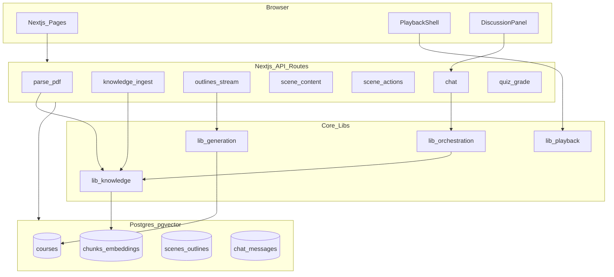
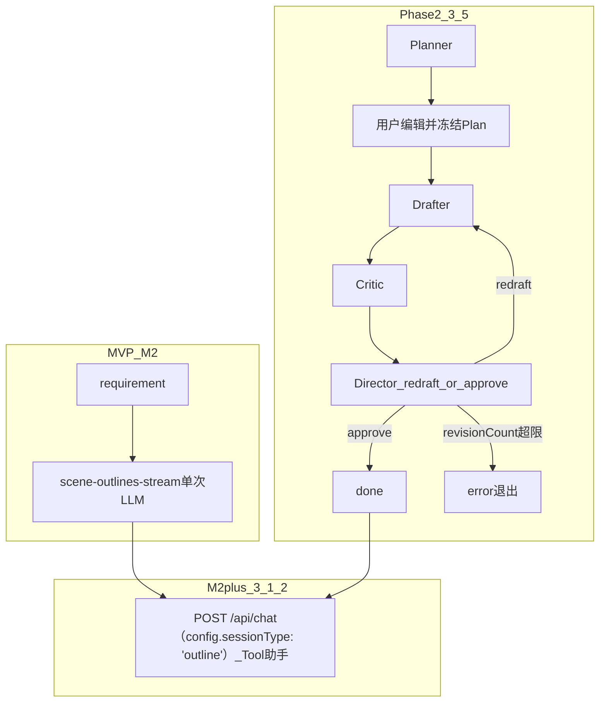

# MindFlow 产品需求文档（PRD）

**产品全称**：MindFlow — AI 知识库驱动的互动课堂生成系统  
**版本**：v1.5  
**状态**：MVP 定义（含 M2+ 大纲助手、Phase 2 冻结 Plan 编排规格）  
**最后更新**：2026-09-08  

---

## 目录

- [修订记录](#修订记录)
- [1. 产品概述](#1-产品概述)
- [2. 用户故事与核心流程](#2-用户故事与核心流程)
- [3. 功能范围](#3-功能范围)
  - [3.1.1 生成流水线策略（MVP 固定流程 → Phase 2 可切换）](#311-生成流水线策略mvp-固定流程--phase-2-可切换)
  - [3.1.2 大纲编辑助手（M2+，非独立 Agent 系统）](#312-大纲编辑助手m2非独立-agent-系统)
  - [3.5 Phase 2 拓展：冻结 Plan + 大纲评审闭环（非 MVP）](#35-phase-2-拓展冻结-plan--大纲评审闭环非-mvp)
- [4. 信息架构与页面](#4-信息架构与页面)
- [5. 技术架构](#5-技术架构)
- [6. 数据模型](#6-数据模型)
- [7. API 规格](#7-api-规格)
- [8. RAG 规格](#8-rag-规格)
- [9. 播放模块](#9-播放模块)
- [10. 非功能需求](#10-非功能需求)
- [11. 里程碑](#11-里程碑)
- [12. 风险与缓解](#12-风险与缓解)
- [13. 附录](#13-附录)

相关文档：[ARCHITECTURE.md](./ARCHITECTURE.md)（v1.3） · [DEV_GUIDE.md](./DEV_GUIDE.md)（v1.2，实施手册）

---

## 修订记录

| 版本 | 日期 | 说明 |
|------|------|------|
| v1.0 | 2026-09-02 | 初稿：MVP 范围、双通道输入、Postgres+pgvector、slide+quiz |
| v1.1 | 2026-09-02 | 路由对齐 OpenMAIC：`/`、`/generation-preview`、`/classroom/[id]`；设置改为 `SettingsDialog` 组件；新增 [DEV_GUIDE.md](./DEV_GUIDE.md) |
| v1.2 | 2026-09-02 | 新增 Phase 2 规格：大纲多 Agent 编排（Planner → Drafter → Critic → Director 自主循环） |
| v1.3 | 2026-09-07 | 明确 MVP 固定生成流水线及 `outlineOrchestration` 切换策略（[3.1.1 节](#311-生成流水线策略mvp-固定流程--phase-2-可切换)） |
| v1.4 | 2026-09-07 | 定稿生成域三阶段：冻结 Plan → Agent 评审循环 → 大纲编辑助手 |
| v1.5 | 2026-09-08 | **命名对齐 OpenMAIC 0.2.x**：API/类型/模块名与 `lib/types/generation.ts`、`scene-outlines-stream`、`use-scene-generator` 等一致；见 [§13.11](#1311-openmaic-命名对齐表) |

---

## 1. 产品概述

### 1.1 一句话描述

MindFlow 允许用户通过 **提示词** 和/或 **PDF** 创建课程——二者至少提供其一；系统自动生成结构化互动课程（幻灯片 + 测验），在课堂中通过多 Agent 讨论进行问答。**有 PDF 时启用 RAG 引用原文；仅提示词时由 LLM 按需求生成；仅 PDF 时从文档推断主题并生成课程。**

### 1.2 目标用户

| 用户类型 | 场景 |
|----------|------|
| 自学者 | 输入「我想学 XX」直接生成课；有教材 PDF 时附带 RAG 问答 |
| 教师/培训者 | 提示词定教学目标 + 可选上传讲义 PDF 生成带测验课程 |
| 开发者（简历/demo） | 展示全栈 + LLM + Agent + RAG 能力 |

### 1.3 与 OpenMAIC 的关系

- **架构借鉴**：大纲 → 场景内容 → 动作脚本 两阶段生成；LangGraph Director 多 Agent 讨论；SSE 流式大纲；Phase 2 **冻结 Plan + Critic 评审闭环**；M2+ **AI SDK Tool 大纲编辑助手**。
- **非 fork 声明**：MindFlow 为独立产品，实现代码与仓库独立；参考开源课堂类产品的流水线设计，不照搬 OpenMAIC Pro Agent Runtime。
- **刻意不做**：Pro 编辑、TTS/ASR、AI 图视频、interactive/PBL、复杂 Roundtable、多 Provider 配置面板等（见 [3.4 节](#34-明确不做mvp--第二期)）。

### 1.4 产品目标（MVP）

1. **仅提示词**、**仅 PDF** 或 **二者组合**，均可在 **10 分钟内** 得到可播放的首屏课程。
2. 用户上传 PDF 时，讨论回答 **应优先引用** 文档片段（RAG）；无 PDF 时基于课程内容与提示词回答，并明确标注「无文档引用」。
3. 固定 3 个 Agent 角色可完成基础多轮课堂讨论。
4. 数据持久化在 **PostgreSQL + pgvector**，支持部署与演示。

### 1.5 成功指标（MVP）

| 指标 | 目标 |
|------|------|
| 仅提示词 → 首屏可播放 | < 2 分钟（视模型） |
| 仅 PDF → 首屏可播放 | < 3 分钟（含 ingest） |
| 提示词 + PDF → 首屏可播放 | < 3 分钟（含 ingest） |
| RAG 回答含引用（有 PDF 时） | > 80% 讨论轮次展示 source |
| 课程生成完成率 | > 90%（slide + quiz 全页） |
| 核心路径可用性 | 无 Pro 编辑亦可完整走通 |

### 1.6 输入模式（双通道，任选或组合）

**总则**：`提示词` 与 `PDF` **均可独立使用，也可同时使用**；创建课程时 **至少提供其中一种**。

| 模式 | 提示词 | PDF | 生成依据 | 讨论 / RAG |
|------|--------|-----|----------|------------|
| **A. 仅提示词** | 有 | 无 | LLM 根据 requirement 推断主题、结构、讲稿 | 无向量检索；上下文 = requirement + 当前 scene + 聊天 |
| **B. 仅 PDF** | 无 | 有 | 从 PDF 全文/摘要推断主题与大纲；`title` 可由文件名或 LLM 摘要生成 | ingest 后 RAG；讨论优先引用文档 |
| **C. 提示词 + PDF** | 有 | 有 | requirement 定教学目标与风格，PDF 作素材与事实依据 | ingest + RAG；生成与讨论均 grounded |

**校验规则（MVP）**：

- `requirement` 与 `pdf` **不可同时为空**。
- 仅有提示词：`requirement` ≥ 10 字符。
- 仅有 PDF：文件有效且解析后文本 ≥ 200 字符（否则提示用户补充提示词）。
- 二者都有：以提示词为主导，PDF 为补充素材（与 OpenMAIC「需求文本 + 可选 pdfText」一致）。

**与 OpenMAIC 对齐**：`UserRequirements.requirement` 为自由文本；本项目将「仅 PDF、无 requirement」提升为 **一等路径**，而非降级方案。

---

## 2. 用户故事与核心流程

### 2.1 主流程（Happy Path）



### 2.1.1 完整生成域流程（M2+ / Phase 2 定稿）

> MVP 仅覆盖 §2.1 主流程（单次大纲 SSE）；下图为 **M2+ 大纲助手** 与 **Phase 2 冻结 Plan 编排** 启用后的完整链路。



**阶段划分**：

| 阶段 | 名称 | 驱动方 | 产出 |
|------|------|--------|------|
| A | Plan 规划 | Planner + **用户手改** | `sceneOutlines（蓝图）`（确认后 **冻结**） |
| B | 大纲评审循环 | **Agent 自主**（Plan 只读） | `SceneOutline[]`（须与 Plan 一致） |
| C | 大纲微调 | 大纲助手 + **用户手改** | 最终 `SceneOutline[]`（可偏离 Plan，策略 A） |
| D | 课件生成 | 固定 Pipeline | `scenes` |
| E | 课堂讨论 | LangGraph Director（**另一编排域**） | 聊天消息 |

---

### 2.2 用户故事

| ID | 作为 | 我想要 | 以便 |
|----|------|--------|------|
| US-01 | 用户 | 只输入提示词（主题、时长、风格等） | 无资料也能生成完整课程 |
| US-01b | 用户 | 只上传 PDF、不写提示词 | 系统从文档自动生成课程结构 |
| US-01c | 用户 | 同时提供提示词与 PDF | 目标由提示词定，内容 grounded 于文档 |
| US-02 | 用户 | 看到流式出现的大纲列表 | 在生成全文前了解课程结构 |
| US-03 | 用户 | 修改/确认大纲后生成 | 控制课程结构 |
| US-03a | 用户 | 在生成大纲前先看到并编辑课程蓝图 Plan | 控制页数、quiz 位置、知识点顺序（Phase 2） |
| US-03b | 用户 | 确认 Plan 后由 Agent 自动产出符合蓝图的大纲 | 减少单次 prompt 的不稳定（Phase 2） |
| US-03c | 用户 | 用对话方式微调已生成的大纲 | 不必逐项手改（M2+ 大纲编辑助手） |
| US-04 | 用户 | 首屏生成完即进入课堂 | 不必等待全部场景 |
| US-05 | 用户 | 观看幻灯片与讲稿字幕 | 理解内容 |
| US-06 | 用户 | 在课堂中向 Agent 提问 | 获得与当前课程相关的回答 |
| US-07 | 用户 | 有 PDF 时看到回答引用的文档片段 | 验证可信度 |
| US-07b | 用户 | 无 PDF 时仍能讨论当前页内容 | 不强制文档引用 |
| US-08 | 用户 | 完成 quiz 场景答题 | 检验学习效果 |

---

## 3. 功能范围

### 3.1 MVP 必做

| 模块 | 说明 | 借鉴 OpenMAIC | MVP 实现要点 |
|------|------|---------------|--------------|
| 提示词输入（可选） | 课程需求自由文本 | `UserRequirements.requirement` | 与 PDF 二选一或兼有；写入 `courses.requirement` |
| PDF 上传（可选） | 有文件时提取文本 + 页码 | `parse-pdf` | 与提示词二选一或兼有；仅 **unpdf** |
| 知识库 ingest（可选） | 有 PDF 时分块、embedding | 无（新增） | `lib/knowledge/`；`has_knowledge_base` 标记 |
| RAG 检索（条件） | 有 chunks 时讨论/大纲增强 | 无（新增） | 无知识库时 retrieve 返回空，不报错 |
| 大纲生成 | 流式输出 `SceneOutline[]` | `scene-outlines-stream` | 保留 SSE；Planner 拆分为 Phase 2 |
| 场景生成 | 内容 + 讲稿 actions | `scene-content` + `scene-actions` | 仅 **slide**、**quiz** 两种 type |
| 课堂壳 | 场景列表 + 播放 + 聊天 | `classroom` + `Stage` | **单播放模式**，无 Pro 编辑 |
| 多 Agent 讨论 | Director 路由 + SSE | `director-graph` + `/api/chat` | **固定 3 Agent**，无 `agent-profiles` |
| 状态持久化 | 课程/场景/聊天/RAG | `stage` store | **Postgres 为主**；IndexedDB 仅可选 UI 缓存 |
| 设置 | 模型密钥 | `SettingsDialog` | `.env` 默认 + 顶栏按钮打开弹窗（API Key、模型名）；**无独立路由** |

#### 3.1.1 生成流水线策略（MVP 固定流程 → Phase 2 可切换）

**MVP 采用写死的固定生成流水线**，不实现大纲侧多 Agent 自主规划；Phase 2 通过功能开关切换为 Agent 编排，**不推翻** scene 生成与课堂播放链路。

**MVP 固定顺序**（`features.outlineOrchestration === false`，默认）：

```
ingest?（有 PDF）
  → POST /api/generate/scene-outlines-stream（单次 LLM + SSE）
  → PATCH /api/courses/[id]/outlines（用户可编辑大纲）
  → scene-content → scene-actions（首屏，再续生成）
  → /classroom/[id]
```

**演进约定**：

| 项 | MVP | Phase 2（见 [3.5 节](#35-phase-2-拓展冻结-plan--大纲评审闭环非-mvp)） |
|----|-----|--------------------------------------------------------------|
| 大纲来源 | `lib/generation/outline-generator.ts` 单次调用 | 阶段 A：`Planner` 出 Plan → 用户冻结；阶段 B：`Drafter → Critic → Director` 循环 |
| 切换方式 | — | `features.outlineOrchestration: true` |
| API 入口 | 同一 `POST /api/generate/scene-outlines-stream` 内分支（MVP）；Phase 2 增加 Plan 与执行分步 API（见 §7） | 同上 |
| 下游不变 | `SceneOutline[]` 入库、`scene-content` / `scene-actions`、课堂只读播放 | 共用 |
| 大纲微调 | 手改 `OutlinesEditor` | 叠加 M2+ [大纲编辑助手](#312-大纲编辑助手m2非独立-agent-系统)（`features.outlineAssistant`） |

**实现要求（便于迁移）**：

- 业务逻辑放在 `lib/generation/`；Route 仅编排与 `features` 分支。
- 大纲输出始终为 `SceneOutline[]` + `languageDirective`，与 Phase 2 一致。
- Phase 2 **不推翻** `generation-preview` 主流程，增量增加 Plan 表格、评审 Round UI、大纲助手侧栏。
- **Plan 与 Outline 分层**：`sceneOutlines（蓝图）`（蓝图）与 `SceneOutline[]`（执行稿）分表/分字段存储（见 §6）。

#### 3.1.2 大纲编辑助手（M2+，非独立 Agent 系统）

> **定位**：在 **阶段 B 评审循环 `approve` 之后**（Phase 2），或 **MVP 单次 `scene-outlines-stream` 完成之后**，与「手改大纲」并列的可选能力。不纳入 M0～M4 必交范围；建议在 M2 完成后、Phase 2 之前或并行交付（**M2+**）。

##### 3.1.2.1 产品定位

在「大纲已写入 `outlines` 表」与「用户点击确认大纲、开始 scene 生成」之间，增加 **可选聊天侧栏**，用 Vercel AI SDK **Tool Calling** 辅助修改大纲。

**不是**：

- OpenMAIC Pro 的 pi-agent-core / 持久化 Agent Runtime
- Phase 2 的 Planner / Critic / Director 自主编排（见 [3.5 节](#35-phase-2-拓展冻结-plan--大纲评审闭环非-mvp)）
- 首次大纲生成（仍由 MVP `scene-outlines-stream` 或 Phase 2 阶段 B 负责）

**是**：

- 用户说「把第 2 页改成 quiz」→ 调用 `revise_outline` 等 tool → 写 `outlines` 表 → 右侧 `OutlinesEditor` 刷新
- 轻量 API + 少量 tool，**不引入**独立 Worker / 事件溯源系统

##### 3.1.2.2 与冻结 Plan 的关系（策略 A：软约束）

| 层级 | 对 Plan 的约束 |
|------|----------------|
| 阶段 B（Agent 评审循环） | **硬约束**：Outline 必须与冻结 Plan 的 `sceneOutlines` 一致 |
| 阶段 C（大纲编辑助手 + 手改） | **软约束（策略 A）**：允许修改后的 Outline **偏离**冻结 Plan；确认大纲前 UI **可选**提示「与 Plan 不一致」，**不阻断**用户确认 |

用户主权：Plan 冻结后 Agent 不可改 Plan；用户若通过助手将大纲改到与 Plan 不一致，视为用户主动选择。

##### 3.1.2.3 Tool 定义（MVP 子集）

实现于 `lib/generation/outline-tools.ts`：

| Tool | 说明 |
|------|------|
| `list_outlines` | 读取当前课程 `outlines` 列表摘要 |
| `revise_outline` | 按 `order` 或 `id` 修改 title / description / keyPoints / type |
| `insert_outline` | 在指定 order 后插入一页 |
| `delete_outline` | 删除指定页并重排 order |

- 使用 `streamText({ tools, maxSteps: 3 })`；**不使用** pi-agent-core。
- Tool `execute` **仅写 `outlines` 表**，不调用 `scene-content`。

##### 3.1.2.4 Session 与续跑

复用 `chat_sessions` + `messages`（见 §6），不新建 `agent_events` 表：

- `chat_sessions.session_type = 'outline'`，`course_id` 关联课程
- 进入 `generation-preview` 时 `GET /api/courses/[id]/chat-sessions?sessionType=outline` 恢复历史消息
- `messages.metadata jsonb` 可选存 `{ toolName, toolArgs, outlineId }`

##### 3.1.2.5 API 与 SSE

| 方法 | 路径 | 说明 |
|------|------|------|
| GET | `/api/courses/[id]/chat-sessions?sessionType=outline` | 获取或创建 `session_type=outline` 的 session 及历史 |
| POST | `/api/chat` | 用户消息 → SSE 流式回复 + Tool 执行 |

**SSE 事件**（`/api/chat`，`config.sessionType: 'outline'`）：

| type | 载荷 | 说明 |
|------|------|------|
| `text_delta` | `{ delta: string }` | 助手文本流 |
| `tool_start` | `{ toolName, args }` | Tool 开始 |
| `tool_end` | `{ toolName, result }` | Tool 结束 |
| `outlines_updated` | `{ outlineIds?: string[] }` | 前端重新拉取 outlines |
| `done` | `{}` | 本轮结束 |
| `error` | `{ error: string }` | 错误 |

##### 3.1.2.6 页面（generation-preview 布局）

```
┌─────────────────────────────────────────────────────────┐
│ 步骤条：ingest → [Plan?] → 大纲 → 确认 → 首屏            │
├────────────────────┬────────────────────────────────────┤
│ 大纲编辑助手（可选） │ OutlinesEditor                      │
│ - 消息列表          │ - SSE / DB 加载的大纲列表            │
│ - 输入框            │ - 手改字段                          │
│ - tool 进度         │                                     │
├────────────────────┴────────────────────────────────────┤
│ [确认大纲，开始生成首屏]                                   │
└─────────────────────────────────────────────────────────┘
```

##### 3.1.2.7 功能开关

```typescript
// lib/config/features.ts
outlineAssistant: false,  // MVP 默认关；M2+ 完成后置 true
```

与 `outlineOrchestration` **独立**：可先开助手、后开 Phase 2 编排。

##### 3.1.2.8 里程碑

| 阶段 | 交付 |
|------|------|
| **M2+** | `outline-tools.ts` + `POST /api/chat（config.sessionType: 'outline'）` API + preview 侧栏 UI + outline session 续跑 |

---

### 3.2 场景类型（MVP）

#### slide

- **内容**：标题、要点、文本块、可选 PDF 页图引用。
- **actions**：`speech`（讲稿文本）为主；`discussion`（触发讨论）可选。
- **播放**：字幕区展示当前 `speech`；按阅读节奏自动推进（无 TTS）。

#### quiz

- **内容**：单选/多选/简答（MVP 至少支持单选 + 简答）。
- **actions**：`speech`（出题说明）+ 答题 UI；可选 `discussion`（错题讲解）。
- **批改**：调用 LLM 简答批改 API（参考 OpenMAIC `quiz-grade` 思路，可简化）。

**大纲约束**（写入 prompt）：

- 每门课 slide 为主，quiz 占 **1～2 页**，插在知识点讲解之后。
- 不允许 `interactive`、`pbl`（MVP prompt 不输出）。

### 3.3 固定 Agent 设定（MVP）

| ID | 角色 | 职责 |
|----|------|------|
| `teacher` | 教师 | 讲解、总结、引导讨论 |
| `student-a` | 学生 A | 提问、补充视角 |
| `student-b` | 学生 B | 质疑、类比、巩固 |

- Persona 写死在 `config/agents.json`，注册表只读。
- Director 负责轮询路由；单 Agent 时快速结束（沿用 OpenMAIC fast-path 思路）。

### 3.4 明确不做（MVP / 第二期）

| 功能 | 阶段 | 备注 |
|------|------|------|
| Pro 编辑 / 幻灯片编辑器 | Phase 2+ | 不做 `EditChromeRoot` |
| TTS / ASR / 音频指示器 | Phase 2+ | 播放纯文本节奏 |
| AI 图/视频生成 | Phase 2+ | 不做 `lib/media/` |
| interactive / PBL 场景 | Phase 2+ | 仅 slide + quiz |
| Agent 自动生成 | Phase 2+ | 不做 `agent-profiles` |
| 联网搜索 | Phase 2+ | 不做 `web-search` |
| 课堂 zip 导入导出 / PPTX | Phase 2+ | |
| 复杂 Roundtable UI | MVP 用简化 UI | 字幕条 + 聊天气泡 |
| 多 Provider 设置面板 | MVP 用 env | 不做大型 settings 面板 |
| autonomous 模式 / 跨 tab 编辑锁 | 不做 | |
| Curriculum Planner 独立节点 | Phase 2 | MVP 单次大纲 LLM；详见 [3.5 节](#35-phase-2-拓展冻结-plan--大纲评审闭环非-mvp) |
| 冻结 Plan + 大纲评审闭环 | Phase 2 | Planner → 用户冻结 Plan → Drafter / Critic / Director（**无 replan**）；非 MVP |
| 大纲编辑助手（Tool Chat） | M2+ | 见 [3.1.2 节](#312-大纲编辑助手m2非独立-agent-系统)；非 MVP 必交 |
| OpenMAIC Pro Agent Runtime | 不做 | 不引入 pi-agent-core / 持久化 Workbench Session |
| Director `replan` 自动改 Plan | 不做 | Plan 冻结后 Agent **不可**修改 Plan |

### 3.5 Phase 2 拓展：冻结 Plan + 大纲评审闭环（非 MVP）

> **定位**：在 MVP（及可选 M2+ 大纲编辑助手）全部完成并稳定后实施。本节为 **产品与技术规格**，不纳入 M0～M4 交付范围。  
> **核心定稿**：用户确认 Plan 后 **Plan 绝对冻结**；Agent 循环 **仅** 产出符合 Plan 的 `SceneOutline[]`；**禁止** Agent 在循环中 `replan` 修改 Plan。

#### 3.5.1 目标与动机

| 问题（MVP） | Phase 2 目标 |
|-------------|--------------|
| 页数、quiz 比例、知识点顺序在一次 prompt 中推断，不稳定 | 先 **Planner 出 Plan**，用户 **手改并冻结**，再 **执行 + 评审** |
| 全自动改 Plan 与用户意图冲突 | **Human-in-the-loop 冻结**：Plan 确认后人与 Agent 均不可改 Plan（除非用户主动「重新规划」） |
| 大纲与结构蓝图不一致 | **Critic 硬校验** Outline 与冻结 Plan 的 `sceneOutlines` 对齐 |
| 生成与讨论两套 Agent 能力不对等 | **双编排域**：生成流水线（本节）+ 课堂讨论（M3，§3.3） |

**成功标准（Phase 2）**：

- 同一 `requirement` 跑 10 次，**冻结 Plan** 后产出的 Outline 与 `sceneOutlines` 在页数、order、type 上一致率 ≥ 95%
- `revisionCount` 上限内（默认 3）`approve` 的比例 ≥ 70%
- 超限失败时正确进入 `outline_generation_failed` 并报错展示 Critic 报告

#### 3.5.2 三阶段生成域（与 §2.1.1 对齐）

```text
阶段 A — Plan 规划（人可改）
  ingest? → Planner → sceneOutlines（蓝图） → 用户编辑 Plan 表格
  → 【确认 Plan】→ `outline_confirmed_at` 已写入且蓝图只读

阶段 B — 大纲评审循环（Plan 只读，Agent 自主）
  Drafter(frozenSceneOutlines) → SceneOutline[]
  → Critic（是否符合 Plan？）
  → Director：redraft | approve（仅此二途 + 超限失败）
  → approve → 写入 outlines 表

阶段 C — 大纲微调（人主导，策略 A）
  大纲编辑助手（可选，§3.1.2）+ OutlinesEditor 手改
  → 【确认大纲】→ scene 生成 → classroom
```

**Plan 冻结规则（硬约束）**：

1. 用户点击「确认 Plan」后：`outline_confirmed_at 写入`，`outline_confirmed_at` 写入，`generation_session_id` 递增。
2. 冻结后 **用户不可再编辑 Plan 表格**（UI 只读），除非点击 **「重新规划」**。
3. 阶段 B 循环中 **Agent 不得修改 Plan**；**禁用** `replan`、`ask_user`（改 Plan）路径。
4. 「重新规划」：`previewPhase = 'outline-ready'` → 归档或清空当前 `outlines` → 回到阶段 A（新 `generation_session_id`）。

#### 3.5.3 Agent 角色

| Agent ID | 角色 | 职责 |
|----------|------|------|
| `planner` | 课程规划师 | **仅阶段 A**：输出 `sceneOutlines` 蓝图 + `languageDirective` |
| `drafter` | 大纲撰写员 | **阶段 B**：严格按 **冻结 Plan** 生成 / 修订 `SceneOutline[]`；收到 Critic issues 时 **只改 outline** |
| `critic` | 结构评审 | **阶段 B**：校验执行稿与冻结 `sceneOutlines` 一致性 + 文案质量 |
| `director` | 流水线总监 | **阶段 B**：仅输出 `redraft` \| `approve`；**不得**输出 `replan` |

Persona 与 prompt 独立于课堂 `teacher` / `student-a` / `student-b`（两套编排域）。

#### 3.5.4 编排拓扑（冻结 Plan 后的 Execute → Review 循环）



**模式**：Plan-and-Execute（冻结 Plan）+ Critic 闭环；LangGraph `StateGraph` + 条件边；**无** `Planner` 再入环边。

#### 3.5.5 参考循环（示例）

**前提**：用户已确认 Plan——12 页，quiz 在 order 4、10；`outline_confirmed_at` 已写入且蓝图只读。

**Round 1**

- Drafter → 生成 12 条 `SceneOutline`
- Critic → `pass = false`：「第 7 页 keyPoints 未覆盖 Plan 槽位 7 的 teachingObjective；第 4 页 type 应为 quiz 实为 slide」
- Director → `next = redraft`

**Round 2**

- Drafter → 注入 Critic issues，修订 outline
- Critic → `pass = false`：「第 7 页与第 3 页知识点表述重复」
- Director → `next = redraft`

**Round 3**

- Drafter → 修订 outline
- Critic → `pass = true`
- Director → `next = approve` → END，写入 `outlines`

**若 Round 3 仍 `pass = false`**（`revisionCount >= revisionCountMax`，默认 3）：

- 不再继续循环
- `courses.status = 'outline_generation_failed'`
- SSE 发送 `error`：`{ error, criticReport, revisionCount }`
- UI 展示失败态 + 最后一版 Critic 报告
- 用户可选：**重新规划**（解冻 Plan）/ 用大纲助手或手改当前 outline 后强制确认（需产品确认二次确认弹窗）

> **注意**：示例中 **不会出现** `replan` 将 quiz 从 order 10 调到 9——该调整应在 **阶段 A 用户编辑 Plan** 时完成，而非 Agent 循环中。

#### 3.5.6 Critic 一致性校验项（硬编码进 prompt + 可选规则预检）

Critic **必须**检查 Outline 与冻结 `sceneOutlines（蓝图）.sceneOutlines` 的对齐：

| 检查项 | 说明 |
|--------|------|
| 页数 | `outlines.length === sceneOutlines.length` |
| order | 每页 `order` 与 Plan 槽位一致 |
| type | 每页 `type`（slide \| quiz）与 Plan 一致 |
| 教学目标 | 每页 `teachingObjective` / `keyPoints` **覆盖** Plan 槽位要求 |
| quiz 约束 | 蓝图中带 `type: 'quiz'` 的 `order` 与执行稿一致 |

**实现建议**：

- **规则预检**（代码）：页数、order、type、quiz 位置——不通过则 Critic 直接 `pass = false` 并附 `code`（如 `TYPE_MISMATCH`）
- **LLM 复检**（`generateObject`）：语义重复、难度、要点覆盖度

**Critic 不得**因「quiz 应放到其他 order」类 **Plan 结构问题** 建议 `replan`；此类 issue 应标注为「需用户重新规划」，仅展示文案，**不触发** Agent 改 Plan。

#### 3.5.7 核心数据结构

**对齐 OpenMAIC**（`lib/types/generation.ts`、`app/generation-preview/types.ts`）：

```typescript
import type { SceneOutline, UserRequirements } from '@/lib/types/generation';

// 生成会话（客户端 sessionStorage；MindFlow 持久化映射 courses 表）
interface GenerationSessionState {
  sessionId: string;
  requirements: UserRequirements;
  pdfText?: string;
  sceneOutlines?: SceneOutline[] | null;
  previewPhase?: 'preparing' | 'outline-ready' | 'review' | 'generating-content';
  languageDirective?: string;
}
```

**Phase 2 蓝图**（Planner 输出，存 `courses.scene_outlines`；**仅** `previewPhase = 'outline-ready'` 且 `outline_confirmed_at` 为空时可 PATCH）：

- 类型仍为 `SceneOutline[]`，与 MVP 大纲一致（`order`、`type`、`title`、`description`、`keyPoints`、`teachingObjective` 等）
- 冻结标志：`outline_confirmed_at` 非空后蓝图只读（Agent 与用户均不可改，除非 `POST /api/courses/[id]/replan`）

**阶段 B SSE 载荷**（非独立 TypeScript 类型名，直接在事件中定义）：

```typescript
// critic 事件 data
{ pass: boolean; issues: Array<{ code: string; severity: string; message: string; affectedOrders?: number[] }>; summary: string }

// director 事件 data（仅二途）
{ next: 'redraft' | 'approve'; reason: string; focusOrders?: number[] }
```

**图状态**（Phase 2 在 `POST /api/generate/scene-outlines-stream` `phase: 'execute'` 单次请求内多轮）：

- `frozenSceneOutlines`（只读快照）、`sceneOutlines`、`criticReport`、`directorDecision`
- `revisionCount`（当前轮次）、`revisionCountMax`（默认 **3**，`features.revisionCountMax`）
- `requirements: UserRequirements`、`ragChunks`（有 PDF 时 Planner 阶段可 retrieve）


#### 3.5.8 与 MVP / M2+ 的差异

| 维度 | MVP（M2） | M2+（§3.1.2） | Phase 2（本节） |
|------|-----------|---------------|-----------------|
| Plan | 无 | 无 | Planner + 用户编辑 + **冻结** |
| 大纲生成 | 单次 LLM + SSE | 同 MVP | Drafter 按冻结 Plan + Critic/Director 循环 |
| 大纲微调 | 手改 | + 大纲编辑助手（策略 A） | 同 M2+ |
| Plan 能否被 Agent 改 | — | — | **否**（无 replan） |
| 循环失败 | jsonrepair 重试 | — | `revisionCount` 超限 → **报错退出** |
| 编排技术 | 无图 | AI SDK tools | `outline-generator.ts` + `scene-outlines-stream/route.ts` |

#### 3.5.9 API 与 SSE（Phase 2 扩展）

**阶段 A（蓝图规划）**——均复用 OpenMAIC 路由名，通过 body 分支：

| 方法 | 路径 | 说明 |
|------|------|------|
| POST | `/api/generate/scene-outlines-stream` | body `{ outlineOrchestration: true, phase: 'plan' }` → `generateSceneOutlinesFromRequirements` 变体写入 `courses.scene_outlines` |
| GET | `/api/courses/[id]` | 读取 `sceneOutlines`、`previewPhase`、`outlineConfirmedAt` |
| PATCH | `/api/courses/[id]` | **仅蓝图未冻结**时用户编辑 `sceneOutlines` |
| PATCH | `/api/courses/[id]` | 冻结蓝图：写入 `outlineConfirmedAt`，`generationSessionId++` |
| POST | `/api/courses/[id]/replan` | 解冻并回到阶段 A：清空 `outlineConfirmedAt`，`previewPhase: 'outline-ready'` |

**阶段 B（评审循环）**：

| 方法 | 路径 | 说明 |
|------|------|------|
| POST | `/api/generate/scene-outlines-stream` | body `{ outlineOrchestration: true, phase: 'execute' }` → Drafter→Critic→Director（SSE） |

MVP 路径 `POST /api/generate/scene-outlines-stream`（`outlineOrchestration=false`）保持不变。

**阶段 B SSE 事件**（`/api/generate/scene-outlines-stream`，`phase: 'execute'`）：

| type | 载荷 | 说明 |
|------|------|------|
| `phase` | `{ phase: 'drafting' \| 'critiquing' \| 'directing', round: number }` | 步骤与轮次 |
| `outline` | `{ data: SceneOutline, index: number }` | Drafter 流式条目 |
| `critic` | `{ data: critic SSE 载荷, round: number }` | 每轮评审 |
| `director` | `{ data: director SSE 载荷, round: number }` | 路由决策 |
| `done` | `{ outlines, languageDirective, revisionRounds }` | approve 成功 |
| `error` | `{ error, criticReport?, revisionCount, code?: 'REVISION_LIMIT_EXCEEDED' }` | 含超限失败 |


#### 3.5.10 页面（generation-preview 扩展）

| 模式 | 步骤 |
|------|------|
| MVP | `ingest?` → `大纲 SSE` → `确认大纲` → `首屏` |
| M2+ | MVP 大纲完成后 → **大纲编辑助手侧栏（可选）** → `确认大纲` → `首屏` |
| Phase 2 | `ingest?` → **`生成 Plan`** → **`编辑 Plan`** → **`确认 Plan（冻结）`** → **`生成与评审大纲（Round UI）`** → **大纲助手（可选）** → `确认大纲` → `首屏` |

**Phase 2 UI 要点**：

- Plan 表格：`sceneOutlines` 可增删改（**仅 draft**）；冻结后只读 + 「重新规划」按钮
- Round 卡片：展示每轮 Critic 摘要、Director 决策（`redraft` / `approve`）
- 失败态：`outline_generation_failed` 时展示 Critic 最后一版报告 + 「重新规划」

#### 3.5.11 技术栈与目录

| 项 | 选型 |
|----|------|
| 编排 | LangGraph `StateGraph`（阶段 B） |
| LLM | Vercel AI SDK（`generateObject` / `streamText`） |
| 模块 | `lib/generation/outline-generator.ts`（`generateSceneOutlinesFromRequirements`、Critic/Director 节点）；`app/api/generate/scene-outlines-stream/route.ts`（`phase: 'plan' \| 'execute'` 分支） |
| 大纲助手 | `outline-tools.ts`（§3.1.2，AI SDK tools，与 LangGraph **分离**） |
| Prompt | `requirements-to-outlines/`、`scene-outlines-stream/`、`outline-critic/`、`outline-director/` |
| 开关 | `outlineOrchestration: false`（默认）；`outlineAssistant: false`（默认） |

**刻意不做**（与 OpenMAIC Pro 区分）：

- pi-agent-core、Postgres Agent Event Log、独立 Worker Runner
- Director `replan`、循环中 `ask_user` 改 Plan
- 20+ 课程构建 Tool

#### 3.5.12 里程碑与依赖

| 阶段 | 依赖 | 交付 |
|------|------|------|
| **M2+** | M2 完成 | 大纲编辑助手（§3.1.2） |
| **P2a** | M4 完成 | Planner + Plan 表格 + 冻结 / 重新规划 API |
| **P2b** | P2a | Drafter + Critic + Director 循环 API（无 replan）+ SSE Round UI |
| **P2c** | P2b | `revisionCount` 超限失败态 + Critic 规则预检 |
| **P2d** | P2c | `eval/outline-orchestration`（10 主题通过率） |

**预估周期**：P2a～P2d 合计约 **1.5～2 周**（在 MVP 稳定后）；M2+ 约 **3～4 天**。

#### 3.5.13 风险与缓解

| 风险 | 缓解 |
|------|------|
| 多轮 LLM 成本与延迟 | `revisionCountMax` 默认 3；SSE 展示 round 进度 |
| Plan 冻结后结构不合理 | 阶段 A 充分编辑；Critic `requiresReplan` 提示 + 「重新规划」入口 |
| Director 输出非法 `next` | Zod 仅允许 `redraft` \| `approve`；非法则回退 `redraft` |
| 大纲助手改到与 Plan 不一致 | 策略 A：确认前可选警告，不阻断 |
| 与 MVP 代码分叉 | `features.outlineOrchestration` / `outlineAssistant` 双开关 |

---

## 4. 信息架构与页面

### 4.1 站点地图

与 OpenMAIC 一致，**仅三条页面路由**；设置不单独占路由。

```
/                       首页：需求输入 + PDF 上传 + 历史课程列表
/generation-preview     生成预览页：ingest / Plan? / 大纲 / 大纲助手? / 确认 / 首屏
/classroom/[id]         课堂页：侧栏场景 + 主舞台 + 字幕 + 讨论面板
```

**全局组件（非路由）**

```
SettingsDialog          顶栏设置按钮打开的弹窗（API Key、模型、embedding）
```

### 4.2 页面规格

#### 首页 `/`（`app/page.tsx`）

- 输入：**课程提示词（可选，多行）**——主题、受众、时长、风格等。
- 输入：**PDF 文件（可选，≤50MB）**——作为知识库与/或唯一素材。
- 校验：**提示词与 PDF 至少填一项**；UI 文案：「可只填需求、只上传 PDF，或两者都提供」。
- 操作：`POST /api/courses` 创建课程 → 将 `courseId`、`requirement`、PDF 元数据写入 `sessionStorage.generationSession`（与 OpenMAIC 模式一致）→ `router.push('/generation-preview')`。
- 列表：最近课程（标题、是否有知识库图标、状态、创建时间）；点击条目 → `router.push('/classroom/[id]')`。
- **顶栏**：`SettingsDialog` 触发按钮（齿轮图标）。

#### 生成预览页 `/generation-preview`（`app/generation-preview/page.tsx`）

- 从 `sessionStorage.generationSession` 读取 `courseId` 与输入；缺失时重定向 `/`。
- **布局**：左侧可选「大纲编辑助手」聊天侧栏（`features.outlineAssistant`）+ 右侧 `OutlinesEditor`（见 §3.1.2.6）；Phase 2 增加 Plan 表格步骤（见 §3.5.10）。

**步骤指示（按功能开关动态组合）**：

| 模式 | 步骤 |
|------|------|
| **MVP**（默认） | `ingest?` → `生成大纲（scene-outlines-stream）` → `确认大纲` → `生成首屏` |
| **M2+** | MVP 大纲完成后 → `大纲编辑助手（可选）` → `确认大纲` → `生成首屏` |
| **Phase 2** | `ingest?` → `生成 Plan` → `编辑 Plan` → `确认 Plan（冻结）` → `生成与评审大纲（Round UI）` → `大纲助手（可选）` → `确认大纲` → `生成首屏` |

**MVP / M2+ 子路径**：

- **仅有 PDF**：`解析入库` → `生成大纲` → …
- **仅有提示词**：`生成大纲` → …
- **二者都有**：`解析入库` → `生成大纲（requirement + RAG/PDF 摘要）` → …

**Phase 2 子路径（`outlineOrchestration=true`）**：

- ingest 后 `POST /api/generate/scene-outlines-stream（body: `{ outlineOrchestration: true, phase: 'plan' }`）` → 用户编辑 `sceneOutlines` 表格（``previewPhase: 'outline-ready'``）
- 「确认 Plan」→ `POST .../outlines/confirm（设置 outlineConfirmedAt）` 冻结 → `POST /api/generate/scene-outlines-stream（body: `{ outlineOrchestration: true, phase: 'execute' }`）`（SSE 展示 Round）
- `approve` 或失败后进入大纲区；失败态见 §3.5.5

**大纲区行为**：

- SSE 流式卡片列表或从 DB 加载；`OutlinesEditor` 可手改 title/description/keyPoints
- `features.outlineAssistant` 开启时：侧栏 `POST /api/chat（config.sessionType: 'outline'）`，`outlines_updated` 事件刷新列表
- 确认大纲：`PATCH /api/courses/[id]/outlines`；若 Outline 与冻结 Plan 不一致，**策略 A** 下仅可选警告，不阻断
- 首屏 scene 生成完成后：`router.push('/classroom/[id]')`
- **顶栏**：返回首页、「重新规划」（Phase 2 且已冻结时）、`SettingsDialog`

#### 课堂页 `/classroom/[id]`（`app/classroom/[id]/page.tsx`）

- 按 URL `id` 从 Postgres 加载课程与场景；无数据时展示错误态。
- **左栏**：场景列表（含生成中骨架、失败重试）。
- **中栏**：slide/quiz 渲染器（只读）。
- **底栏/侧栏**：讲稿字幕（当前 speech 文本）。
- **右栏**：讨论区（消息列表 + 输入框 + **引用来源**折叠块）。
- **顶栏**：播放/暂停、上一场景/下一场景（讨论进行中可禁用切换）、`SettingsDialog` 按钮。
- 后台：调用 ``useSceneGenerator().generateRemaining`（`lib/hooks/use-scene-generator.ts`）` 续生成剩余场景（与 OpenMAIC 课堂内续生成一致）。

#### 设置 `SettingsDialog`（`components/settings/`，非路由）

- 由首页 / 生成预览页 / 课堂页顶栏按钮打开，**不注册 `/settings` 路由**。
- 字段（MVP 精简版）：LLM API Key、Base URL、Model Name、Embedding 模型（或共用 OpenAI Key）。
- 持久化：`localStorage` 或 Zustand store（对齐 OpenMAIC `useSettingsStore`）；服务端仍以 `.env` 为默认。
- 无多厂商 Provider 切换 UI。

---

## 5. 技术架构

详见 [ARCHITECTURE.md](./ARCHITECTURE.md) 与 PRD [§5.3](./PRD.md#53-核心数据流)。

### 5.1 技术栈

| 层 | 选型 |
|----|------|
| 框架 | Next.js 15 App Router, TypeScript |
| UI | Tailwind + shadcn/ui |
| LLM | Vercel AI SDK |
| Agent 编排 | LangGraph（Director + agent_generate） |
| ORM | Drizzle（推荐）或 Prisma |
| 数据库 | **PostgreSQL + pgvector** |
| 文件 | PDF 存对象存储或 DB bytea（MVP 可用本地 `uploads/`） |
| 部署 | Docker Compose（app + postgres）或 Vercel + Neon |

### 5.2 系统架构图



### 5.3 核心数据流

**生成链路（MVP）**

1. 首页 `POST /api/courses`：body `{ requirement?, pdf? }`，**至少其一**；有 pdf 则存 `documents`；返回 `courseId`。
2. 首页写入 `sessionStorage.generationSession` → 导航 `/generation-preview`。
3. 生成预览页 **若有 PDF**：`POST /api/courses/[id]/ingest` → parse → chunk → embed → `has_knowledge_base=true`。
4. `POST /api/generate/scene-outlines-stream`（`outlineOrchestration=false`）：
   - 仅提示词：`requirement` → LLM 大纲；
   - 仅 PDF：`pdfExcerpt` + 自动 `languageDirective` → LLM 大纲；
   - 二者：`requirement` + RAG topK 或 pdf 摘要 → LLM 大纲。
5. **（M2+，可选）** `POST /api/chat`：大纲编辑助手 Tool 修改 `outlines`（§3.1.2）。
6. `PATCH /api/courses/[id]/outlines`：用户确认大纲。
7. 对每个 outline（首屏先 1 个）：`scene-content` → `scene-actions` → 写 `scenes`。
8. 首屏完成后导航 `/classroom/[id]`；课堂页轮询或 SSE 续生成剩余 scenes。

**生成链路（Phase 2，`outlineOrchestration=true`）**

1. 步骤 1～3 同 MVP。
2. `POST /api/generate/scene-outlines-stream（body: `{ outlineOrchestration: true, phase: 'plan' }`）` → Planner 写入 `courses.scene_outlines`，``previewPhase: 'outline-ready'``。
3. 用户 `PATCH /api/courses/[id]` 编辑 sceneOutlines 蓝图（OutlinesEditor）。
4. `PATCH /api/courses/[id]`（写入 `outlineConfirmedAt`）→ 蓝图冻结（此后 Agent 不可改 `sceneOutlines` 蓝图）。
5. `POST /api/generate/scene-outlines-stream（body: `{ outlineOrchestration: true, phase: 'execute' }`）`（SSE）：
   - Drafter 按冻结 Plan 生成 `SceneOutline[]`
   - Critic 校验与 Plan 一致性 → Director `redraft` \| `approve`
   - `revisionCount` 达上限仍失败 → `outline_generation_failed` + SSE `error`（§3.5.5）
6. `approve` 后写入 `outlines` 表；步骤 5～8 同 MVP（含可选大纲助手）。

**讨论链路**（与生成域独立，**无状态**，不引入 OpenMAIC Pro Session）

1. 用户消息 → `POST /api/chat`。
2. 若 `course.has_knowledge_base`：`retrieve(courseId, query)` → topK chunks；否则 `sources=[]`。
3. LangGraph：director → agent_generate（注入 chunks【可选】+ requirement + 当前 scene 上下文）。
4. SSE 返回 text；有 sources 时展示引用块，无则仅展示消息。

---

## 6. 数据模型

### 6.1 表结构（MVP + Phase 2 / M2+ 扩展字段）

```sql
-- 课程
courses (
  id uuid PK,
  title text,                    -- 可从 requirement 摘要或 PDF 文件名生成
  requirement text,              -- 用户提示词；仅 PDF 时可为空
  language_directive text,
  has_knowledge_base boolean DEFAULT false,
  status text,                   -- draft | generating | outline_generation_failed | ready | failed
  scene_outlines jsonb NULL,    -- Phase 2：sceneOutlines（蓝图） 全文
  preview_phase text DEFAULT 'preparing', -- `preparing` \| `outline-ready` \| `review` \| `generating-content`（对齐 `GenerationSessionState.previewPhase`）（Phase 2）
  generation_session_id int DEFAULT 0,    -- 每次「重新规划」递增
  outline_confirmed_at timestamptz NULL,
  created_at timestamptz,
  updated_at timestamptz
)

-- 文档
documents (
  id uuid PK,
  course_id uuid FK REFERENCES courses(id),
  filename text,
  page_count int,
  raw_text text,                 -- 可选，大文本可只存 chunks
  created_at timestamptz
)

-- RAG 分块
chunks (
  id uuid PK,
  course_id uuid FK,
  document_id uuid FK,
  content text,
  page int,
  metadata jsonb,
  created_at timestamptz
)

-- 向量（pgvector）
chunk_embeddings (
  chunk_id uuid PK FK REFERENCES chunks(id),
  embedding vector(1536)         -- 维度随 embedding 模型调整
)

-- 大纲
outlines (
  id uuid PK,
  course_id uuid FK,
  sort_order int,
  type text,                     -- slide | quiz
  payload jsonb                  -- SceneOutline 全文
)

-- 场景（生成结果）
scenes (
  id uuid PK,
  course_id uuid FK,
  outline_id uuid FK,
  sort_order int,
  type text,
  content jsonb,
  actions jsonb,
  status text,                   -- pending | generating | ready | failed
  created_at timestamptz
)

-- 聊天（课堂讨论 + 大纲编辑助手）
chat_sessions (
  id uuid PK,
  course_id uuid FK,
  scene_id uuid FK NULL,
  session_type text,             -- qa | discussion | lecture | outline（M2+ 大纲助手）
  created_at timestamptz
)

messages (
  id uuid PK,
  session_id uuid FK,
  role text,                     -- user | assistant | system | tool
  agent_id text NULL,
  content text,
  sources jsonb NULL,            -- RAG 引用 [{chunkId, page, excerpt}]
  metadata jsonb NULL,           -- M2+：{ toolName, toolArgs, outlineId }
  created_at timestamptz
)

-- Agent 配置（MVP 种子数据）
agents (
  id text PK,
  name text,
  role text,
  persona text,
  avatar text,
  color text,
  priority int
)
```

### 6.2 索引

- `chunks(course_id)`、`documents(course_id)`。
- `chunk_embeddings` 上 HNSW 或 IVFFlat 索引（`embedding vector_cosine_ops`）。
- `scenes(course_id, sort_order)`、`outlines(course_id, sort_order)`。
- `messages(session_id, created_at)`。

---

## 7. API 规格

| 方法 | 路径 | 说明 |
|------|------|------|
| POST | `/api/courses` | 创建课程：`requirement?` 与 `pdf?`（multipart）**至少其一** |
| GET | `/api/courses` | 课程列表 |
| GET | `/api/courses/[id]` | 详情：`sceneOutlines`、`previewPhase`、`outlines`、`scenes` 状态 |
| PATCH | `/api/courses/[id]` | 更新 `sceneOutlines` / `previewPhase`；冻结蓝图时写 `outlineConfirmedAt` |
| POST | `/api/courses/[id]/replan` | Phase 2：解冻蓝图，回到阶段 A |
| POST | `/api/courses/[id]/ingest` | 有 PDF 时解析并入库 RAG；无文档返回 400 |
| POST | `/api/parse-pdf` | 对齐 OpenMAIC PDF 解析 |
| POST | `/api/generate/scene-outlines-stream` | SSE 流式大纲（MVP；Phase 2 通过 body `phase` 分支） |
| PATCH | `/api/courses/[id]/outlines` | 用户确认/编辑执行稿大纲（`outlines` 表） |
| POST | `/api/generate/scene-content` | 单页内容生成 |
| POST | `/api/generate/scene-actions` | 单页 actions + 组装 scene |
| POST | `/api/chat` | 课堂多 Agent SSE；M2+ 大纲助手（`config.sessionType: 'outline'`） |
| GET | `/api/courses/[id]/chat-sessions` | M2+：获取 `sessionType=outline` 的历史消息 |
| POST | `/api/quiz-grade` | 简答题批改 |
| GET | `/api/health` | 健康检查 |

> **续生成**：无独立 API；课堂页调用 `useSceneGenerator().generateRemaining`（`lib/hooks/use-scene-generator.ts`），与 OpenMAIC 一致。

### 7.1 SSE 事件

**大纲流**（`/api/generate/scene-outlines-stream`）：

| type | 载荷 |
|------|------|
| `phase` | `{ phase: 'ingest' \| 'outline' }` |
| `languageDirective` | `{ data: string }` |
| `outline` | `{ data: SceneOutline, index: number }` |
| `done` | `{ outlines: SceneOutline[], languageDirective: string }` |
| `error` | `{ error: string }` |
| `retry` | `{ attempt, maxAttempts }` |

**大纲评审流**（`/api/generate/scene-outlines-stream`，Phase 2）：

| type | 载荷 |
|------|------|
| `phase` | `{ phase: 'drafting' \| 'critiquing' \| 'directing', round: number }` |
| `outline` | `{ data: SceneOutline, index: number }` |
| `critic` | `{ data: critic SSE 载荷, round: number }` |
| `director` | `{ data: director SSE 载荷, round: number }` |
| `done` | `{ outlines, languageDirective, revisionRounds }` |
| `error` | `{ error, criticReport?, revisionCount, code?: 'REVISION_LIMIT_EXCEEDED' }` |

**大纲编辑助手流**（`/api/chat`，M2+）：

| type | 载荷 |
|------|------|
| `text_delta` | `{ delta: string }` |
| `tool_start` | `{ toolName, args }` |
| `tool_end` | `{ toolName, result }` |
| `outlines_updated` | `{ outlineIds?: string[] }` |
| `done` | `{}` |
| `error` | `{ error: string }` |

**聊天流**（`/api/chat`）：

| type | 载荷 |
|------|------|
| `thinking` | `{ stage, agentId? }` |
| `agent_start` | `{ agentId, name }` |
| `text_delta` | `{ agentId, delta }` |
| `agent_end` | `{ agentId }` |
| `sources` | `{ chunks: SourceRef[] }` |
| `cue_user` | `{}` |
| `done` | `{ directorState? }` |
| `error` | `{ error: string }` |

### 7.2 创建课程请求示例

**仅提示词**：

```json
POST /api/courses
Content-Type: application/json

{
  "requirement": "用 20 分钟向初学者讲解 React Hooks，包含 useState 和 useEffect，最后有一道测验。"
}
```

**仅 PDF**（multipart）：

```
POST /api/courses
Content-Type: multipart/form-data

pdf: <file>
```

**二者都有**：

```
POST /api/courses
Content-Type: multipart/form-data

requirement: "重点讲第三章的算法复杂度"
pdf: <file>
```

---

## 8. RAG 规格

### 8.1 Ingest

- 触发：课程创建后，若存在 PDF 则自动或手动调用 ingest。
- Chunk size：500～800 tokens，overlap 80 tokens。
- 元数据：`page`、`document_id`、`course_id`。
- Embedding 默认：`text-embedding-3-small`（1536 维，可配置）。
- 完成后：`courses.has_knowledge_base = true`。

### 8.2 Retrieve

- 条件：仅当 `has_knowledge_base=true`。
- 触发：
  - 每次 `/api/chat` 用户消息；
  - 大纲生成时（模式 B/C）：对 `requirement` 或 PDF 主题做 retrieve；
  - Phase 2 Planner 阶段（可选）：为 `sceneOutlines（蓝图）.sourceHints` 提供素材引用。
- 无知识库：`retrieve` 返回 `[]`，不报错。
- topK：5～8；可选相似度阈值（如 cosine > 0.7）。
- 过滤：**必须**带 `course_id`，防止跨课程泄漏。

**Prompt 注入模板**（有知识库时）：

```markdown
## Reference Material
[1] (p.3) ...
[2] (p.7) ...
Prefer references when answering factual questions. Cite [n].
If the answer is not in references, say so and use course content.
```

### 8.3 前端展示

- **有引用**：助手消息下方「参考来源」——页码 + 片段摘要，可展开全文。
- **无知识库**：不展示引用区；可选角标「基于课程内容」。

### 8.4 SourceRef 结构

```typescript
interface SourceRef {
  chunkId: string;
  page?: number;
  excerpt: string;      // 展示用摘要，约 120 字
  score?: number;
}
```

---

## 9. 播放模块

### 9.1 行为

- 读取 `scenes[].actions`，按序执行。
- `speech`：更新字幕区；`estimateReadDuration(text)` 后自动下一步。
- `discussion`：暂停播放；弹「是否加入讨论」；确认后聚焦讨论面板。
- `quiz`：暂停自动播放；展示答题 UI；提交后可调 `/api/quiz-grade`。
- 场景切换：重置播放状态；可选结束当前 chat session。

### 9.2 阅读节奏（无 TTS）

```typescript
// 参考 OpenMAIC PlaybackEngine 的 reading timer
// CJK 约 150ms/字，英文约 240ms/词
function estimateReadDuration(text: string): number;
```

### 9.3 明确不做

- TTS、音频同步、`live` 引擎复杂态。
- 白板、聚光灯、激光笔等 action 在 MVP 可保留类型但 **no-op**（Phase 2 再接 ActionEngine）。

---

## 10. 非功能需求

| 类别 | 要求 |
|------|------|
| 性能 | 首屏 scene P95 < 60s（视模型） |
| 安全 | API Key 仅服务端；PDF ≤ 50MB；上传类型校验 |
| 隐私 | 课程数据按 `course_id` 隔离；RAG 检索强制 `course_id` 过滤 |
| 可观测 | 结构化日志：courseId、sceneId、retrieveMs、tokenUsage、`generation_session_id`、`revisionCount`、`directorDecision` |
| 可用性 | 生成失败可重试单页；ingest 失败可提示补提示词 |
| 许可 | 独立仓库；参考 OpenMAIC 架构须在 README 致谢 |

---

## 11. 里程碑

| 阶段 | 周期 | 交付 |
|------|------|------|
| M0 | 3 天 | 仓库脚手架、Postgres+pgvector、Drizzle schema、Docker Compose |
| M1 | 1 周 | 双路径：纯提示词聊天 + PDF ingest/retrieve/带引用 |
| M2 | 1 周 | 大纲 SSE + slide 生成 + 课堂播放壳 |
| M2+ | 3～4 天 | 大纲编辑助手（§3.1.2）：`POST /api/chat（config.sessionType: 'outline'）` + Tool + preview 侧栏 |
| M3 | 1 周 | quiz 场景 + 固定 3 Agent Director |
| M4 | 3 天 | 续生成、错误重试、`SettingsDialog`、README + 演示录屏 |

**Phase 2（MVP 完成后，非当前排期）**

| 阶段 | 周期 | 交付 |
|------|------|------|
| P2a | 1 周 | Planner + Plan 表格 + 冻结 / 重新规划 API |
| P2b | 3～4 天 | Drafter + Critic + Director 循环（**无 replan**）+ SSE Round UI |
| P2c | 2 天 | `revisionCount` 超限失败态 + Critic 规则预检 |
| P2d | 2 天 | `eval/outline-orchestration` + 文档 |

详见 [3.5 节](#35-phase-2-拓展冻结-plan--大纲评审闭环非-mvp)。

---

## 12. 风险与缓解

| 风险 | 缓解 |
|------|------|
| LLM 大纲 JSON 不稳定 | jsonrepair + 最多 2 次重试 |
| 仅 PDF 时主题漂移 | ingest 后先生成 2 句 `languageDirective` + title 供用户确认 |
| RAG 召回差 | 调 chunk/overlap；大纲阶段也 retrieve |
| 生成成本高 | 首屏优先；续生成串行；embedding 结果缓存 |
| 代码膨胀 | `lib/scenes/registry` 插件化；`lib/config/features.ts` 双开关：`outlineOrchestration`、`outlineAssistant` |
| Phase 2 评审死循环 | `revisionCountMax` 默认 3；超限 **报错退出**（§3.5.5）；Director 仅 `redraft` \| `approve` |
| Plan 冻结后结构不合理 | 「重新规划」解冻；Critic `requiresReplan` 仅提示，不自动改 Plan |
| 大纲助手与 Plan 不一致 | 策略 A：确认前可选警告，不阻断（§3.1.2.2） |

---

## 13. 附录

### 13.1 SceneOutline 类型（MVP 子集）

与 OpenMAIC `lib/types/generation.ts` 对齐，约束如下：

- `type` 仅允许 `"slide"` | `"quiz"`。
- 去掉 `interactiveConfig`、`pblConfig`、`widgetType`、`mediaGenerations`。
- 保留 `id`、`title`、`description`、`keyPoints`、`order`、`teachingObjective`、`estimatedDuration`、`languageNote`、`quizConfig`、`suggestedImageIds`（有 PDF 时）。

### 13.2 大纲响应 JSON 示例（完整课程）

```json
{
  "languageDirective": "全程使用简体中文授课。术语首次出现时可附英文原文。",
  "outlines": [
    {
      "id": "scene_1",
      "type": "slide",
      "title": "React Hooks 简介",
      "description": "介绍 Hooks 解决的问题与基本规则。",
      "keyPoints": [
        "类组件 vs 函数组件的状态管理痛点",
        "useState 的最小示例",
        "Hooks 调用规则（顶层、仅在 React 函数中）"
      ],
      "teachingObjective": "理解为何需要 Hooks",
      "estimatedDuration": 180,
      "order": 1
    },
    {
      "id": "scene_2",
      "type": "slide",
      "title": "useState 与 useEffect",
      "description": "讲解两个最常用 Hook 的用法与注意点。",
      "keyPoints": [
        "useState 更新是异步的",
        "useEffect 依赖数组的含义",
        "清理函数的使用场景"
      ],
      "order": 2
    },
    {
      "id": "scene_3",
      "type": "quiz",
      "title": "Hooks 小测验",
      "description": "检验对 useState 与 useEffect 的理解。",
      "keyPoints": [
        "单选：依赖数组为空时的行为",
        "简答：何时需要 useEffect 清理函数"
      ],
      "order": 3,
      "quizConfig": {
        "questionCount": 2,
        "difficulty": "medium",
        "questionTypes": ["single", "text"]
      }
    }
  ]
}
```

### 13.3 slide 场景 content + actions 示例（片段）

**content**（`GeneratedSlideContent` 简化）：

```json
{
  "elements": [
    {
      "id": "el_1",
      "type": "text",
      "left": 80,
      "top": 60,
      "width": 800,
      "height": 80,
      "content": "<h1>React Hooks 简介</h1>"
    },
    {
      "id": "el_2",
      "type": "text",
      "left": 80,
      "top": 160,
      "width": 800,
      "height": 300,
      "content": "<ul><li>解决类组件逻辑复用困难</li><li>useState 管理局部状态</li></ul>"
    }
  ],
  "background": { "type": "solid", "color": "#ffffff" }
}
```

**actions**（播放时间线）：

```json
[
  {
    "id": "action_1",
    "type": "speech",
    "text": "大家好，今天我们学习 React Hooks。它让函数组件也能使用状态……"
  },
  {
    "id": "action_2",
    "type": "discussion",
    "topic": "你在项目中用过哪些 Hooks？",
    "agentId": "student-a"
  }
]
```

### 13.4 quiz 场景 content 示例（片段）

```json
{
  "questions": [
    {
      "id": "q1",
      "type": "single",
      "stem": "useEffect 依赖数组为 [] 时，effect 何时执行？",
      "options": [
        { "id": "a", "text": "每次渲染后" },
        { "id": "b", "text": "仅挂载后一次" },
        { "id": "c", "text": "从不执行" }
      ],
      "answer": ["b"]
    },
    {
      "id": "q2",
      "type": "text",
      "stem": "简述什么情况下需要在 useEffect 中返回清理函数。",
      "answer": "订阅、定时器、手动 DOM 监听等需要在组件卸载或依赖变更前释放资源时。"
    }
  ]
}
```

### 13.5 固定 Agent 配置示例（`config/agents.json`）

```json
[
  {
    "id": "teacher",
    "name": "王老师",
    "role": "teacher",
    "persona": "耐心、结构化讲解，善于用类比。",
    "avatar": "/avatars/teacher.png",
    "color": "#4F46E5",
    "priority": 10
  },
  {
    "id": "student-a",
    "name": "小明",
    "role": "student",
    "persona": "好奇，爱问「为什么」。",
    "avatar": "/avatars/curious.png",
    "color": "#059669",
    "priority": 5
  },
  {
    "id": "student-b",
    "name": "小红",
    "role": "student",
    "persona": "严谨，喜欢举反例巩固理解。",
    "avatar": "/avatars/thinker.png",
    "color": "#D97706",
    "priority": 4
  }
]
```

### 13.6 OpenMAIC 参考实现映射

| MindFlow 模块 | OpenMAIC 参考路径 |
|---------------|-------------------|
| 首页 | `app/page.tsx` |
| 生成预览页 | `app/generation-preview/page.tsx` |
| PDF 解析 | `app/api/parse-pdf/route.ts` |
| 大纲流 | `app/api/generate/scene-outlines-stream/route.ts` |
| 场景生成 | `app/api/generate/scene-content/route.ts`、`app/api/generate/scene-actions/route.ts` |
| Director | `lib/orchestration/director-graph.ts` |
| Agent 循环 | `lib/chat/agent-loop.ts` |
| 课堂页 | `app/classroom/[id]/page.tsx`、`components/stage.tsx` |
| 设置弹窗 | `components/settings/index.tsx`（`SettingsDialog`） |
| 类型定义 | `lib/types/generation.ts`、`lib/types/action.ts` |

> **不参考**：OpenMAIC Pro 的 `lib/server/agent-runtime/`、pi-agent-core、Workbench Session（见 §3.4）。

### 13.7 Phase 2 / M2+ Backlog（摘录）

- **冻结 Plan + 大纲评审闭环**（§3.5）——Planner → 用户冻结 Plan → Drafter / Critic / Director（**无 replan**）
- **大纲编辑助手**（§3.1.2，M2+）——AI SDK Tool Calling，策略 A 软约束
- Agent 自动生成（`agent-profiles`）
- TTS 讲稿朗读
- `interactive` 场景类型
- 课堂导出、简易幻灯片编辑
- 浏览器 IndexedDB 离线缓存
- 联网搜索增强大纲

### 13.8 功能开关（`lib/config/features.ts` 建议）

```typescript
export const features = {
  editMode: false,
  tts: false,
  mediaGeneration: false,
  webSearch: false,
  agentAutoGenerate: false,
  outlineOrchestration: false, // Phase 2：冻结 Plan + 评审闭环；MVP 保持 false
  outlineAssistant: false,     // M2+：大纲编辑助手 Tool Chat
  revisionCountMax: 3,         // Phase 2：Critic 循环上限，超限报错退出
  sceneTypes: ['slide', 'quiz'] as const,
  rag: true,
};
```

### 13.9 生成域三轨示意（MVP / M2+ / Phase 2）



- MVP：`outlineOrchestration=false`，`outlineAssistant` 可选。
- Phase 2：`outlineOrchestration=true`；**无** Director→Planner `replan` 边。
- 课堂讨论（M3）为 **独立编排域**，不在上图。

### 13.10 Agent 能力映射（求职 / 实现对照）

| 能力 | 实现位置 | 技术 |
|------|----------|------|
| Plan-and-Execute | Phase 2 阶段 A→B | `generateObject` + 冻结 Plan |
| Critic 闭环 | Phase 2 阶段 B | `outline-generator.ts` + `scene-outlines-stream` SSE |
| 有界循环 | `revisionCountMax` | 超限 SSE `REVISION_LIMIT_EXCEEDED` |
| Tool Calling | M2+ 大纲助手 | AI SDK `streamText` + tools |
| 多 Agent 讨论 | M3 classroom | LangGraph Director + 无状态 `/api/chat` |
| RAG | M1 ingest + M3 chat | pgvector retrieve |
| Human-in-the-loop | Plan 冻结 + 策略 A | 用户确认 Plan；大纲可偏离 Plan |

---

### 13.11 OpenMAIC 命名对齐表

MindFlow 在 Postgres 持久化层扩展 OpenMAIC 客户端类型，**不另起模块名/类型名**：

| OpenMAIC（原项目） | MindFlow 持久化 / 用法 |
|--------------------|------------------------|
| `UserRequirements`（`lib/types/generation.ts`） | `courses.requirement` + 可选 `userNickname` 等字段 |
| `SceneOutline` | `outlines.payload`；Phase 2 蓝图存 `courses.scene_outlines` |
| `SceneOutline[]` / `sceneOutlines` | `GenerationSessionState.sceneOutlines`；API 字段名 `sceneOutlines` |
| `GenerationSessionState.previewPhase` | `courses.preview_phase`（枚举值完全一致） |
| `languageDirective` | `courses.language_directive` |
| `generateSceneOutlinesFromRequirements` | `lib/generation/outline-generator.ts` |
| `POST /api/generate/scene-outlines-stream` | 同路径；`outlineOrchestration` / `phase` 为 MindFlow body 扩展 |
| `POST /api/generate/scene-content` | 同路径 |
| `POST /api/generate/scene-actions` | 同路径 |
| `POST /api/chat` | 同路径；`config.sessionType` 扩展 `'outline'`（M2+） |
| `DirectorState`（`lib/types/chat.ts`） | 课堂讨论客户端维护；**不**用于大纲评审循环 |
| `useSceneGenerator().generateRemaining` | 客户端续生成；**无** `/api/.../generateRemaining` |
| `OutlinesEditor` | `components/generation/outlines-editor.tsx` |
| `lib/orchestration/director-graph.ts` | **仅**课堂讨论 LangGraph |
| Phase 2 大纲评审 | `outline-generator.ts` + `scene-outlines-stream/route.ts`（**不**新建 `outline-graph.ts`） |


---

*文档结束*
