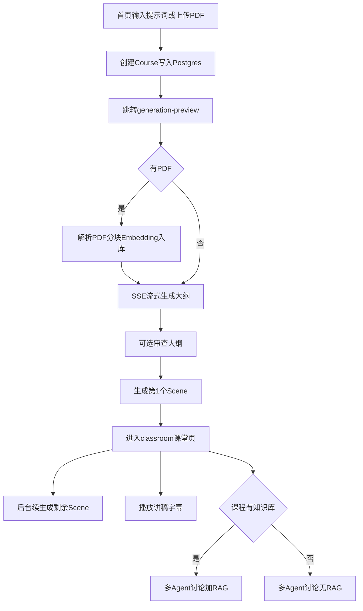
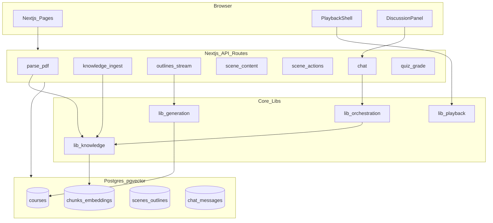

# MindFlow 产品需求文档（PRD）

**产品全称**：MindFlow — AI 知识库驱动的互动课堂生成系统  
**版本**：v1.1  
**状态**：MVP 定义  
**最后更新**：2026-09-02  

---

## 目录

- [修订记录](#修订记录)
- [1. 产品概述](#1-产品概述)
- [2. 用户故事与核心流程](#2-用户故事与核心流程)
- [3. 功能范围](#3-功能范围)
- [4. 信息架构与页面](#4-信息架构与页面)
- [5. 技术架构](#5-技术架构)
- [6. 数据模型](#6-数据模型)
- [7. API 规格](#7-api-规格)
- [8. RAG 规格](#8-rag-规格)
- [9. 播放模块](#9-播放模块)
- [10. 非功能需求](#10-非功能需求)
- [11. 里程碑](#11-里程碑)
- [12. 风险与缓解](#12-风险与缓解)
- [13. 附录](#13-附录)

相关文档：[ARCHITECTURE.md](./ARCHITECTURE.md) · [DEV_GUIDE.md](./DEV_GUIDE.md)（项目开发指南）

---

## 修订记录

| 版本 | 日期 | 说明 |
|------|------|------|
| v1.0 | 2026-09-02 | 初稿：MVP 范围、双通道输入、Postgres+pgvector、slide+quiz |
| v1.1 | 2026-09-02 | 路由对齐 OpenMAIC：`/`、`/generation-preview`、`/classroom/[id]`；设置改为 `SettingsDialog` 组件；新增 [DEV_GUIDE.md](./DEV_GUIDE.md) |

---

## 1. 产品概述

### 1.1 一句话描述

MindFlow 允许用户通过 **提示词** 和/或 **PDF** 创建课程——二者至少提供其一；系统自动生成结构化互动课程（幻灯片 + 测验），在课堂中通过多 Agent 讨论进行问答。**有 PDF 时启用 RAG 引用原文；仅提示词时由 LLM 按需求生成；仅 PDF 时从文档推断主题并生成课程。**

### 1.2 目标用户

| 用户类型 | 场景 |
|----------|------|
| 自学者 | 输入「我想学 XX」直接生成课；有教材 PDF 时附带 RAG 问答 |
| 教师/培训者 | 提示词定教学目标 + 可选上传讲义 PDF 生成带测验课程 |
| 开发者（简历/demo） | 展示全栈 + LLM + Agent + RAG 能力 |

### 1.3 与 OpenMAIC 的关系

- **架构借鉴**：大纲 → 场景内容 → 动作脚本 两阶段生成；LangGraph Director 多 Agent 讨论；SSE 流式大纲。
- **非 fork 声明**：MindFlow 为独立产品，实现代码与仓库独立；参考开源课堂类产品的流水线设计，不照搬全量功能。
- **刻意不做**：Pro 编辑、TTS/ASR、AI 图视频、interactive/PBL、复杂 Roundtable、多 Provider 配置面板等（见 [3.4 节](#34-明确不做mvp--第二期)）。

### 1.4 产品目标（MVP）

1. **仅提示词**、**仅 PDF** 或 **二者组合**，均可在 **10 分钟内** 得到可播放的首屏课程。
2. 用户上传 PDF 时，讨论回答 **应优先引用** 文档片段（RAG）；无 PDF 时基于课程内容与提示词回答，并明确标注「无文档引用」。
3. 固定 3 个 Agent 角色可完成基础多轮课堂讨论。
4. 数据持久化在 **PostgreSQL + pgvector**，支持部署与演示。

### 1.5 成功指标（MVP）

| 指标 | 目标 |
|------|------|
| 仅提示词 → 首屏可播放 | < 2 分钟（视模型） |
| 仅 PDF → 首屏可播放 | < 3 分钟（含 ingest） |
| 提示词 + PDF → 首屏可播放 | < 3 分钟（含 ingest） |
| RAG 回答含引用（有 PDF 时） | > 80% 讨论轮次展示 source |
| 课程生成完成率 | > 90%（slide + quiz 全页） |
| 核心路径可用性 | 无 Pro 编辑亦可完整走通 |

### 1.6 输入模式（双通道，任选或组合）

**总则**：`提示词` 与 `PDF` **均可独立使用，也可同时使用**；创建课程时 **至少提供其中一种**。

| 模式 | 提示词 | PDF | 生成依据 | 讨论 / RAG |
|------|--------|-----|----------|------------|
| **A. 仅提示词** | 有 | 无 | LLM 根据 requirement 推断主题、结构、讲稿 | 无向量检索；上下文 = requirement + 当前 scene + 聊天 |
| **B. 仅 PDF** | 无 | 有 | 从 PDF 全文/摘要推断主题与大纲；`title` 可由文件名或 LLM 摘要生成 | ingest 后 RAG；讨论优先引用文档 |
| **C. 提示词 + PDF** | 有 | 有 | requirement 定教学目标与风格，PDF 作素材与事实依据 | ingest + RAG；生成与讨论均 grounded |

**校验规则（MVP）**：

- `requirement` 与 `pdf` **不可同时为空**。
- 仅有提示词：`requirement` ≥ 10 字符。
- 仅有 PDF：文件有效且解析后文本 ≥ 200 字符（否则提示用户补充提示词）。
- 二者都有：以提示词为主导，PDF 为补充素材（与 OpenMAIC「需求文本 + 可选 pdfText」一致）。

**与 OpenMAIC 对齐**：`UserRequirements.requirement` 为自由文本；本项目将「仅 PDF、无 requirement」提升为 **一等路径**，而非降级方案。

---

## 2. 用户故事与核心流程

### 2.1 主流程（Happy Path）



### 2.2 用户故事

| ID | 作为 | 我想要 | 以便 |
|----|------|--------|------|
| US-01 | 用户 | 只输入提示词（主题、时长、风格等） | 无资料也能生成完整课程 |
| US-01b | 用户 | 只上传 PDF、不写提示词 | 系统从文档自动生成课程结构 |
| US-01c | 用户 | 同时提供提示词与 PDF | 目标由提示词定，内容 grounded 于文档 |
| US-02 | 用户 | 看到流式出现的大纲列表 | 在生成全文前了解课程结构 |
| US-03 | 用户 | 修改/确认大纲后生成 | 控制课程结构 |
| US-04 | 用户 | 首屏生成完即进入课堂 | 不必等待全部场景 |
| US-05 | 用户 | 观看幻灯片与讲稿字幕 | 理解内容 |
| US-06 | 用户 | 在课堂中向 Agent 提问 | 获得与当前课程相关的回答 |
| US-07 | 用户 | 有 PDF 时看到回答引用的文档片段 | 验证可信度 |
| US-07b | 用户 | 无 PDF 时仍能讨论当前页内容 | 不强制文档引用 |
| US-08 | 用户 | 完成 quiz 场景答题 | 检验学习效果 |

---

## 3. 功能范围

### 3.1 MVP 必做

| 模块 | 说明 | 借鉴 OpenMAIC | MVP 实现要点 |
|------|------|---------------|--------------|
| 提示词输入（可选） | 课程需求自由文本 | `UserRequirements.requirement` | 与 PDF 二选一或兼有；写入 `courses.requirement` |
| PDF 上传（可选） | 有文件时提取文本 + 页码 | `parse-pdf` | 与提示词二选一或兼有；仅 **unpdf** |
| 知识库 ingest（可选） | 有 PDF 时分块、embedding | 无（新增） | `lib/knowledge/`；`has_knowledge_base` 标记 |
| RAG 检索（条件） | 有 chunks 时讨论/大纲增强 | 无（新增） | 无知识库时 retrieve 返回空，不报错 |
| 大纲生成 | 流式输出 `SceneOutline[]` | `scene-outlines-stream` | 保留 SSE；Planner 拆分为 Phase 2 |
| 场景生成 | 内容 + 讲稿 actions | `scene-content` + `scene-actions` | 仅 **slide**、**quiz** 两种 type |
| 课堂壳 | 场景列表 + 播放 + 聊天 | `classroom` + `Stage` | **单播放模式**，无 Pro 编辑 |
| 多 Agent 讨论 | Director 路由 + SSE | `director-graph` + `/api/chat` | **固定 3 Agent**，无 `agent-profiles` |
| 状态持久化 | 课程/场景/聊天/RAG | `stage` store | **Postgres 为主**；IndexedDB 仅可选 UI 缓存 |
| 设置 | 模型密钥 | `SettingsDialog` | `.env` 默认 + 顶栏按钮打开弹窗（API Key、模型名）；**无独立路由** |

### 3.2 场景类型（MVP）

#### slide

- **内容**：标题、要点、文本块、可选 PDF 页图引用。
- **actions**：`speech`（讲稿文本）为主；`discussion`（触发讨论）可选。
- **播放**：字幕区展示当前 `speech`；按阅读节奏自动推进（无 TTS）。

#### quiz

- **内容**：单选/多选/简答（MVP 至少支持单选 + 简答）。
- **actions**：`speech`（出题说明）+ 答题 UI；可选 `discussion`（错题讲解）。
- **批改**：调用 LLM 简答批改 API（参考 OpenMAIC `quiz-grade` 思路，可简化）。

**大纲约束**（写入 prompt）：

- 每门课 slide 为主，quiz 占 **1～2 页**，插在知识点讲解之后。
- 不允许 `interactive`、`pbl`（MVP prompt 不输出）。

### 3.3 固定 Agent 设定（MVP）

| ID | 角色 | 职责 |
|----|------|------|
| `teacher` | 教师 | 讲解、总结、引导讨论 |
| `student-a` | 学生 A | 提问、补充视角 |
| `student-b` | 学生 B | 质疑、类比、巩固 |

- Persona 写死在 `config/agents.json`，注册表只读。
- Director 负责轮询路由；单 Agent 时快速结束（沿用 OpenMAIC fast-path 思路）。

### 3.4 明确不做（MVP / 第二期）

| 功能 | 阶段 | 备注 |
|------|------|------|
| Pro 编辑 / 幻灯片编辑器 | Phase 2+ | 不做 `EditChromeRoot` |
| TTS / ASR / 音频指示器 | Phase 2+ | 播放纯文本节奏 |
| AI 图/视频生成 | Phase 2+ | 不做 `lib/media/` |
| interactive / PBL 场景 | Phase 2+ | 仅 slide + quiz |
| Agent 自动生成 | Phase 2+ | 不做 `agent-profiles` |
| 联网搜索 | Phase 2+ | 不做 `web-search` |
| 课堂 zip 导入导出 / PPTX | Phase 2+ | |
| 复杂 Roundtable UI | MVP 用简化 UI | 字幕条 + 聊天气泡 |
| 多 Provider 设置面板 | MVP 用 env | 不做大型 settings 面板 |
| autonomous 模式 / 跨 tab 编辑锁 | 不做 | |
| Curriculum Planner 独立节点 | Phase 2 | MVP 单次大纲 LLM |

---

## 4. 信息架构与页面

### 4.1 站点地图

与 OpenMAIC 一致，**仅三条页面路由**；设置不单独占路由。

```
/                       首页：需求输入 + PDF 上传 + 历史课程列表
/generation-preview     生成预览页：ingest / 大纲 SSE / 确认 / 首屏生成
/classroom/[id]         课堂页：侧栏场景 + 主舞台 + 字幕 + 讨论面板
```

**全局组件（非路由）**

```
SettingsDialog          顶栏设置按钮打开的弹窗（API Key、模型、embedding）
```

### 4.2 页面规格

#### 首页 `/`（`app/page.tsx`）

- 输入：**课程提示词（可选，多行）**——主题、受众、时长、风格等。
- 输入：**PDF 文件（可选，≤50MB）**——作为知识库与/或唯一素材。
- 校验：**提示词与 PDF 至少填一项**；UI 文案：「可只填需求、只上传 PDF，或两者都提供」。
- 操作：`POST /api/courses` 创建课程 → 将 `courseId`、`requirement`、PDF 元数据写入 `sessionStorage.generationSession`（与 OpenMAIC 模式一致）→ `router.push('/generation-preview')`。
- 列表：最近课程（标题、是否有知识库图标、状态、创建时间）；点击条目 → `router.push('/classroom/[id]')`。
- **顶栏**：`SettingsDialog` 触发按钮（齿轮图标）。

#### 生成预览页 `/generation-preview`（`app/generation-preview/page.tsx`）

- 从 `sessionStorage.generationSession` 读取 `courseId` 与输入；缺失时重定向 `/`。
- 步骤指示（动态）：
  - **仅有 PDF**：`解析入库` → `生成大纲`（从文档推断主题）→ `确认大纲` → `生成首屏`
  - **仅有提示词**：`生成大纲` → `确认大纲` → `生成首屏`
  - **二者都有**：`解析入库` → `生成大纲`（requirement + RAG/PDF 摘要）→ `确认大纲` → `生成首屏`
- 大纲区：SSE 流式卡片列表；可编辑 title/description/keyPoints（简化版 outlines-editor）。
- 首屏场景生成完成后：`router.push('/classroom/[id]')`；可选将续生成参数写入 session，供课堂页后台拉取。
- **顶栏**：返回首页、`SettingsDialog` 按钮。

#### 课堂页 `/classroom/[id]`（`app/classroom/[id]/page.tsx`）

- 按 URL `id` 从 Postgres 加载课程与场景；无数据时展示错误态。
- **左栏**：场景列表（含生成中骨架、失败重试）。
- **中栏**：slide/quiz 渲染器（只读）。
- **底栏/侧栏**：讲稿字幕（当前 speech 文本）。
- **右栏**：讨论区（消息列表 + 输入框 + **引用来源**折叠块）。
- **顶栏**：播放/暂停、上一场景/下一场景（讨论进行中可禁用切换）、`SettingsDialog` 按钮。
- 后台：调用 `POST /api/courses/[id]/generate-remaining` 续生成剩余场景（与 OpenMAIC 课堂内续生成一致）。

#### 设置 `SettingsDialog`（`components/settings/`，非路由）

- 由首页 / 生成预览页 / 课堂页顶栏按钮打开，**不注册 `/settings` 路由**。
- 字段（MVP 精简版）：LLM API Key、Base URL、Model Name、Embedding 模型（或共用 OpenAI Key）。
- 持久化：`localStorage` 或 Zustand store（对齐 OpenMAIC `useSettingsStore`）；服务端仍以 `.env` 为默认。
- 无多厂商 Provider 切换 UI。

---

## 5. 技术架构

详见 [ARCHITECTURE.md](./ARCHITECTURE.md)。

### 5.1 技术栈

| 层 | 选型 |
|----|------|
| 框架 | Next.js 15 App Router, TypeScript |
| UI | Tailwind + shadcn/ui |
| LLM | Vercel AI SDK |
| Agent 编排 | LangGraph（Director + agent_generate） |
| ORM | Drizzle（推荐）或 Prisma |
| 数据库 | **PostgreSQL + pgvector** |
| 文件 | PDF 存对象存储或 DB bytea（MVP 可用本地 `uploads/`） |
| 部署 | Docker Compose（app + postgres）或 Vercel + Neon |

### 5.2 系统架构图



### 5.3 核心数据流

**生成链路**

1. 首页 `POST /api/courses`：body `{ requirement?, pdf? }`，**至少其一**；有 pdf 则存 `documents`；返回 `courseId`。
2. 首页写入 `sessionStorage.generationSession` → 导航 `/generation-preview`。
3. 生成预览页 **若有 PDF**：`POST /api/courses/[id]/ingest` → parse → chunk → embed → `has_knowledge_base=true`。
4. `POST /api/generate/outlines-stream`：
   - 仅提示词：`requirement` → LLM 大纲；
   - 仅 PDF：`pdfExcerpt` + 自动 `languageDirective` → LLM 大纲；
   - 二者：`requirement` + RAG topK 或 pdf 摘要 → LLM 大纲。
5. 对每个 outline（首屏先 1 个）：`scene-content` → `scene-actions` → 写 `scenes`。
6. 首屏完成后导航 `/classroom/[id]`；课堂页轮询或 SSE 续生成剩余 scenes。

**讨论链路**

1. 用户消息 → `POST /api/chat`。
2. 若 `course.has_knowledge_base`：`retrieve(courseId, query)` → topK chunks；否则 `sources=[]`。
3. LangGraph：director → agent_generate（注入 chunks【可选】+ requirement + 当前 scene 上下文）。
4. SSE 返回 text；有 sources 时展示引用块，无则仅展示消息。

---

## 6. 数据模型

### 6.1 表结构（MVP）

```sql
-- 课程
courses (
  id uuid PK,
  title text,                    -- 可从 requirement 摘要或 PDF 文件名生成
  requirement text,              -- 用户提示词；仅 PDF 时可为空
  language_directive text,
  has_knowledge_base boolean DEFAULT false,
  status text,                   -- draft | generating | ready | failed
  created_at timestamptz,
  updated_at timestamptz
)

-- 文档
documents (
  id uuid PK,
  course_id uuid FK REFERENCES courses(id),
  filename text,
  page_count int,
  raw_text text,                 -- 可选，大文本可只存 chunks
  created_at timestamptz
)

-- RAG 分块
chunks (
  id uuid PK,
  course_id uuid FK,
  document_id uuid FK,
  content text,
  page int,
  metadata jsonb,
  created_at timestamptz
)

-- 向量（pgvector）
chunk_embeddings (
  chunk_id uuid PK FK REFERENCES chunks(id),
  embedding vector(1536)         -- 维度随 embedding 模型调整
)

-- 大纲
outlines (
  id uuid PK,
  course_id uuid FK,
  sort_order int,
  type text,                     -- slide | quiz
  payload jsonb                  -- SceneOutline 全文
)

-- 场景（生成结果）
scenes (
  id uuid PK,
  course_id uuid FK,
  outline_id uuid FK,
  sort_order int,
  type text,
  content jsonb,
  actions jsonb,
  status text,                   -- pending | generating | ready | failed
  created_at timestamptz
)

-- 聊天
chat_sessions (
  id uuid PK,
  course_id uuid FK,
  scene_id uuid FK NULL,
  session_type text,             -- qa | discussion | lecture
  created_at timestamptz
)

messages (
  id uuid PK,
  session_id uuid FK,
  role text,                     -- user | assistant | system
  agent_id text NULL,
  content text,
  sources jsonb NULL,            -- RAG 引用 [{chunkId, page, excerpt}]
  created_at timestamptz
)

-- Agent 配置（MVP 种子数据）
agents (
  id text PK,
  name text,
  role text,
  persona text,
  avatar text,
  color text,
  priority int
)
```

### 6.2 索引

- `chunks(course_id)`、`documents(course_id)`。
- `chunk_embeddings` 上 HNSW 或 IVFFlat 索引（`embedding vector_cosine_ops`）。
- `scenes(course_id, sort_order)`、`outlines(course_id, sort_order)`。
- `messages(session_id, created_at)`。

---

## 7. API 规格

| 方法 | 路径 | 说明 |
|------|------|------|
| POST | `/api/courses` | 创建课程：`requirement?` 与 `pdf?`（multipart）**至少其一** |
| GET | `/api/courses` | 课程列表 |
| GET | `/api/courses/[id]` | 详情含 outlines/scenes 状态 |
| POST | `/api/courses/[id]/ingest` | 有 PDF 时解析并入库 RAG；无文档返回 400 |
| POST | `/api/generate/outlines-stream` | SSE 流式大纲 |
| PATCH | `/api/courses/[id]/outlines` | 用户确认/编辑大纲 |
| POST | `/api/generate/scene-content` | 单页内容生成 |
| POST | `/api/generate/scene-actions` | 单页 actions + 组装 scene |
| POST | `/api/courses/[id]/generate-remaining` | 触发或查询续生成 |
| POST | `/api/chat` | 多 Agent SSE 讨论 |
| POST | `/api/quiz/grade` | 简答题批改 |
| GET | `/api/health` | 健康检查 |

### 7.1 SSE 事件

**大纲流**（`/api/generate/outlines-stream`）：

| type | 载荷 |
|------|------|
| `phase` | `{ phase: 'ingest' \| 'outline' }` |
| `languageDirective` | `{ data: string }` |
| `outline` | `{ data: SceneOutline, index: number }` |
| `done` | `{ outlines: SceneOutline[], languageDirective: string }` |
| `error` | `{ error: string }` |
| `retry` | `{ attempt, maxAttempts }` |

**聊天流**（`/api/chat`）：

| type | 载荷 |
|------|------|
| `thinking` | `{ stage, agentId? }` |
| `agent_start` | `{ agentId, name }` |
| `text_delta` | `{ agentId, delta }` |
| `agent_end` | `{ agentId }` |
| `sources` | `{ chunks: SourceRef[] }` |
| `cue_user` | `{}` |
| `done` | `{ directorState? }` |
| `error` | `{ error: string }` |

### 7.2 创建课程请求示例

**仅提示词**：

```json
POST /api/courses
Content-Type: application/json

{
  "requirement": "用 20 分钟向初学者讲解 React Hooks，包含 useState 和 useEffect，最后有一道测验。"
}
```

**仅 PDF**（multipart）：

```
POST /api/courses
Content-Type: multipart/form-data

pdf: <file>
```

**二者都有**：

```
POST /api/courses
Content-Type: multipart/form-data

requirement: "重点讲第三章的算法复杂度"
pdf: <file>
```

---

## 8. RAG 规格

### 8.1 Ingest

- 触发：课程创建后，若存在 PDF 则自动或手动调用 ingest。
- Chunk size：500～800 tokens，overlap 80 tokens。
- 元数据：`page`、`document_id`、`course_id`。
- Embedding 默认：`text-embedding-3-small`（1536 维，可配置）。
- 完成后：`courses.has_knowledge_base = true`。

### 8.2 Retrieve

- 条件：仅当 `has_knowledge_base=true`。
- 触发：
  - 每次 `/api/chat` 用户消息；
  - 大纲生成时（模式 B/C）：对 `requirement` 或 PDF 主题做 retrieve。
- 无知识库：`retrieve` 返回 `[]`，不报错。
- topK：5～8；可选相似度阈值（如 cosine > 0.7）。
- 过滤：**必须**带 `course_id`，防止跨课程泄漏。

**Prompt 注入模板**（有知识库时）：

```markdown
## Reference Material
[1] (p.3) ...
[2] (p.7) ...
Prefer references when answering factual questions. Cite [n].
If the answer is not in references, say so and use course content.
```

### 8.3 前端展示

- **有引用**：助手消息下方「参考来源」——页码 + 片段摘要，可展开全文。
- **无知识库**：不展示引用区；可选角标「基于课程内容」。

### 8.4 SourceRef 结构

```typescript
interface SourceRef {
  chunkId: string;
  page?: number;
  excerpt: string;      // 展示用摘要，约 120 字
  score?: number;
}
```

---

## 9. 播放模块

### 9.1 行为

- 读取 `scenes[].actions`，按序执行。
- `speech`：更新字幕区；`estimateReadDuration(text)` 后自动下一步。
- `discussion`：暂停播放；弹「是否加入讨论」；确认后聚焦讨论面板。
- `quiz`：暂停自动播放；展示答题 UI；提交后可调 `/api/quiz/grade`。
- 场景切换：重置播放状态；可选结束当前 chat session。

### 9.2 阅读节奏（无 TTS）

```typescript
// 参考 OpenMAIC PlaybackEngine 的 reading timer
// CJK 约 150ms/字，英文约 240ms/词
function estimateReadDuration(text: string): number;
```

### 9.3 明确不做

- TTS、音频同步、`live` 引擎复杂态。
- 白板、聚光灯、激光笔等 action 在 MVP 可保留类型但 **no-op**（Phase 2 再接 ActionEngine）。

---

## 10. 非功能需求

| 类别 | 要求 |
|------|------|
| 性能 | 首屏 scene P95 < 60s（视模型） |
| 安全 | API Key 仅服务端；PDF ≤ 50MB；上传类型校验 |
| 隐私 | 课程数据按 `course_id` 隔离；RAG 检索强制 `course_id` 过滤 |
| 可观测 | 结构化日志：courseId、sceneId、retrieveMs、tokenUsage |
| 可用性 | 生成失败可重试单页；ingest 失败可提示补提示词 |
| 许可 | 独立仓库；参考 OpenMAIC 架构须在 README 致谢 |

---

## 11. 里程碑

| 阶段 | 周期 | 交付 |
|------|------|------|
| M0 | 3 天 | 仓库脚手架、Postgres+pgvector、Drizzle schema、Docker Compose |
| M1 | 1 周 | 双路径：纯提示词聊天 + PDF ingest/retrieve/带引用 |
| M2 | 1 周 | 大纲 SSE + slide 生成 + 课堂播放壳 |
| M3 | 1 周 | quiz 场景 + 固定 3 Agent Director |
| M4 | 3 天 | 续生成、错误重试、`SettingsDialog`、README + 演示录屏 |

---

## 12. 风险与缓解

| 风险 | 缓解 |
|------|------|
| LLM 大纲 JSON 不稳定 | jsonrepair + 最多 2 次重试 |
| 仅 PDF 时主题漂移 | ingest 后先生成 2 句 `languageDirective` + title 供用户确认 |
| RAG 召回差 | 调 chunk/overlap；大纲阶段也 retrieve |
| 生成成本高 | 首屏优先；续生成串行；embedding 结果缓存 |
| 代码膨胀 | `lib/scenes/registry` 插件化；`lib/config/features.ts` 功能开关 |

---

## 13. 附录

### 13.1 SceneOutline 类型（MVP 子集）

与 OpenMAIC `lib/types/generation.ts` 对齐，约束如下：

- `type` 仅允许 `"slide"` | `"quiz"`。
- 去掉 `interactiveConfig`、`pblConfig`、`widgetType`、`mediaGenerations`。
- 保留 `id`、`title`、`description`、`keyPoints`、`order`、`teachingObjective`、`estimatedDuration`、`languageNote`、`quizConfig`、`suggestedImageIds`（有 PDF 时）。

### 13.2 大纲响应 JSON 示例（完整课程）

```json
{
  "languageDirective": "全程使用简体中文授课。术语首次出现时可附英文原文。",
  "outlines": [
    {
      "id": "scene_1",
      "type": "slide",
      "title": "React Hooks 简介",
      "description": "介绍 Hooks 解决的问题与基本规则。",
      "keyPoints": [
        "类组件 vs 函数组件的状态管理痛点",
        "useState 的最小示例",
        "Hooks 调用规则（顶层、仅在 React 函数中）"
      ],
      "teachingObjective": "理解为何需要 Hooks",
      "estimatedDuration": 180,
      "order": 1
    },
    {
      "id": "scene_2",
      "type": "slide",
      "title": "useState 与 useEffect",
      "description": "讲解两个最常用 Hook 的用法与注意点。",
      "keyPoints": [
        "useState 更新是异步的",
        "useEffect 依赖数组的含义",
        "清理函数的使用场景"
      ],
      "order": 2
    },
    {
      "id": "scene_3",
      "type": "quiz",
      "title": "Hooks 小测验",
      "description": "检验对 useState 与 useEffect 的理解。",
      "keyPoints": [
        "单选：依赖数组为空时的行为",
        "简答：何时需要 useEffect 清理函数"
      ],
      "order": 3,
      "quizConfig": {
        "questionCount": 2,
        "difficulty": "medium",
        "questionTypes": ["single", "text"]
      }
    }
  ]
}
```

### 13.3 slide 场景 content + actions 示例（片段）

**content**（`GeneratedSlideContent` 简化）：

```json
{
  "elements": [
    {
      "id": "el_1",
      "type": "text",
      "left": 80,
      "top": 60,
      "width": 800,
      "height": 80,
      "content": "<h1>React Hooks 简介</h1>"
    },
    {
      "id": "el_2",
      "type": "text",
      "left": 80,
      "top": 160,
      "width": 800,
      "height": 300,
      "content": "<ul><li>解决类组件逻辑复用困难</li><li>useState 管理局部状态</li></ul>"
    }
  ],
  "background": { "type": "solid", "color": "#ffffff" }
}
```

**actions**（播放时间线）：

```json
[
  {
    "id": "action_1",
    "type": "speech",
    "text": "大家好，今天我们学习 React Hooks。它让函数组件也能使用状态……"
  },
  {
    "id": "action_2",
    "type": "discussion",
    "topic": "你在项目中用过哪些 Hooks？",
    "agentId": "student-a"
  }
]
```

### 13.4 quiz 场景 content 示例（片段）

```json
{
  "questions": [
    {
      "id": "q1",
      "type": "single",
      "stem": "useEffect 依赖数组为 [] 时，effect 何时执行？",
      "options": [
        { "id": "a", "text": "每次渲染后" },
        { "id": "b", "text": "仅挂载后一次" },
        { "id": "c", "text": "从不执行" }
      ],
      "answer": ["b"]
    },
    {
      "id": "q2",
      "type": "text",
      "stem": "简述什么情况下需要在 useEffect 中返回清理函数。",
      "answer": "订阅、定时器、手动 DOM 监听等需要在组件卸载或依赖变更前释放资源时。"
    }
  ]
}
```

### 13.5 固定 Agent 配置示例（`config/agents.json`）

```json
[
  {
    "id": "teacher",
    "name": "王老师",
    "role": "teacher",
    "persona": "耐心、结构化讲解，善于用类比。",
    "avatar": "/avatars/teacher.png",
    "color": "#4F46E5",
    "priority": 10
  },
  {
    "id": "student-a",
    "name": "小明",
    "role": "student",
    "persona": "好奇，爱问「为什么」。",
    "avatar": "/avatars/curious.png",
    "color": "#059669",
    "priority": 5
  },
  {
    "id": "student-b",
    "name": "小红",
    "role": "student",
    "persona": "严谨，喜欢举反例巩固理解。",
    "avatar": "/avatars/thinker.png",
    "color": "#D97706",
    "priority": 4
  }
]
```

### 13.6 OpenMAIC 参考实现映射

| MindFlow 模块 | OpenMAIC 参考路径 |
|---------------|-------------------|
| 首页 | `app/page.tsx` |
| 生成预览页 | `app/generation-preview/page.tsx` |
| PDF 解析 | `app/api/parse-pdf/route.ts` |
| 大纲流 | `app/api/generate/scene-outlines-stream/route.ts` |
| 场景生成 | `app/api/generate/scene-content/route.ts`、`app/api/generate/scene-actions/route.ts` |
| Director | `lib/orchestration/director-graph.ts` |
| Agent 循环 | `lib/chat/agent-loop.ts` |
| 课堂页 | `app/classroom/[id]/page.tsx`、`components/stage.tsx` |
| 设置弹窗 | `components/settings/index.tsx`（`SettingsDialog`） |
| 类型定义 | `lib/types/generation.ts`、`lib/types/action.ts` |

### 13.7 Phase 2 Backlog（摘录）

- Curriculum Planner 独立 Agent 节点
- Agent 自动生成（`agent-profiles`）
- TTS 讲稿朗读
- `interactive` 场景类型
- 课堂导出、简易幻灯片编辑
- 浏览器 IndexedDB 离线缓存
- 联网搜索增强大纲

### 13.8 功能开关（`lib/config/features.ts` 建议）

```typescript
export const features = {
  editMode: false,
  tts: false,
  mediaGeneration: false,
  webSearch: false,
  agentAutoGenerate: false,
  sceneTypes: ['slide', 'quiz'] as const,
  rag: true,
};
```

---

*文档结束*
