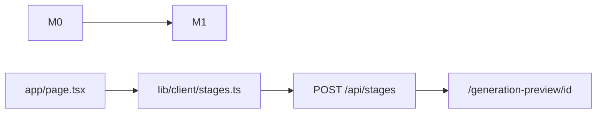

# 创建课堂（API + 首页）

目标：用户在首页提交 `requirements`（可选 PDF）后持久化草稿课堂，并导航至生成预览；建课过程不调用模型、不 ingest。后端以 `POST /api/stages` / `GET /api/stages/{id}` 为契约；前端经 `lib/client/stages.ts` 调用 API，**禁止** `sessionStorage` 假会话建课。

不调用 `POST /api/stages/{id}/ingest`。不新增 ADR。预览页内的大纲流式、入库、播放与讨论不在本计划。

## 实施顺序

| 模块 | 名称 | 状态 | 验收 |
|:---:|---|:---:|---|
| **M0** | 后端接口与存储 | 已实现，回归 | CC-1～CC-4（curl） |
| **M1** | 首页与跳转 | 进行中 | CC-1～CC-4（页面 + API） |



---

## M0 — 后端接口

`implements: CC-1, CC-2, CC-3, CC-4`　`governed_by: adr-002, adr-003, adr-004`

以下已落地，改动时只回归，不扩范围。

### 保持不变

- 提示词去空白后 10～10000 字。不合格在插入课堂之前返回 400。
- PDF 可选：类型为 PDF、非空、不超过 50MB。原件写入 `uploads/{stageId}/`，`documents` 只记文件名和路径。
- 创建成功为 201。`status` 为 `draft`，`previewPhase` 为 `preparing`，`hasKnowledgeBase` 为 `false`。
- 写文件或写文档失败时删除刚插入的课堂，不留半成品。
- 错误 JSON 只含可理解的 `error`，不含堆栈或密钥。500 仍用 `"Failed to create stage"`。
- 课程标题仍由 `deriveStageName(requirement)` 推导，不用昵称。

### 请求与响应

无 PDF 时 `Content-Type: application/json`：

```json
{
  "requirements": {
    "requirement": "必填",
    "userNickname": "可选",
    "userBio": "可选"
  }
}
```

有 PDF 时 `multipart/form-data` 两个字段：`requirements`（**整段** `CreateStageBody` 的 JSON 字符串，即 `{"requirements":{...}}`）和 `pdf`。不再读取平铺文本字段 `requirement`。

规范化后再入库、再回显：

- `requirement`：trim，长度 10～10000。
- `userNickname`、`userBio`：可省略。trim 后为空则视为未填，存 `NULL`，响应里省略该键。
- 未知字段（含 `interactiveMode`）丢掉，不入库。

201 响应含：`id`、`name`、`requirements`、`status`、`previewPhase`、`createdAt`、`hasKnowledgeBase`、可选 `document`。

`requirements` 缺失、不是对象、或 multipart 内 JSON 无法解析：400，且不插入 `stage`。只上传 PDF、没有合格提示词：同样 400。

### 存储与读取

- `stage` 上 `user_nickname`、`user_bio` 可空列；`requirement` 单独一列，无 `requirements` JSON 列。
- `GET /api/stages/{id}` 拼回同一份 `requirements`；有文档则带 `document` 摘要；课堂不存在 404。保留 `DELETE`。

### 分层

| 文件 | 职责 |
|---|---|
| `lib/types/stage.ts` | `CreateStageBody`、`StageResponse` |
| `lib/validators/stages.ts` | 请求/响应 Zod；`stageRequirementsSchema` 可供前端复用 |
| `lib/db/queries/stages.ts` | `insertStage`、`getStageById` |
| `lib/services/stages.ts` | 创建、按 id 读取；校验通过后写入 |
| `app/api/stages/route.ts` | JSON / multipart 编排 |
| `app/api/stages/[id]/route.ts` | GET、DELETE |

### M0 验证

仓库无自动化测试脚本。用本地 `POST` / `GET`（见 `.cursor/skills/mindflow-api-test`）：

- CC-1：合法提示词、无 PDF → 201，`hasKnowledgeBase` 为 `false`。
- CC-2：昵称/背景创建后 `GET` 读回；皆空则响应无对应键。
- CC-3：合法 PDF → 201，带 `document`，未调用 ingest。
- CC-4：过短提示词、坏 JSON、非法 PDF 等 → 400，无新 `stage` 行。

---

## M1 — 首页与跳转

`implements: CC-1, CC-2, CC-3, CC-4`

CC 中的「进入生成预览」= 前端在 201 成功后导航至 **`/generation-preview/{id}`**（`id` 来自响应体）。预览页本阶段仅为占位，不实现大纲 SSE 或 ingest。

### 数据流

1. 用户填写课程需求（必填）、可选昵称/背景、可选 PDF。
2. 提交前用 `stageRequirementsSchema.safeParse` 校验（与 M0 规则一致）；PDF 在前端先做类型/空文件/50MB 检查。
3. `createStage(requirements, pdf?)` → `POST /api/stages`。
4. 成功：`router.push(\`/generation-preview/${stage.id}\`)`。
5. 失败：展示 API 的 `error` 或校验文案；不导航。

**禁止**：`sessionStorage.generationSession`、`storePdfBlob`、仅 PDF 无提示词提交、建课请求体中的 `webSearch` / `interactiveMode`。

### 首页范围

| 区域 | 要求 |
|------|------|
| 品牌 | `public/mindflow-logo.svg`；中文文案（MVP 不引入 i18n） |
| 需求输入 | `textarea`；草稿键 `requirementDraft`（localStorage） |
| 学习者画像 | 昵称、背景；localStorage 持久化，提交并入 `requirements`；头像不进 API |
| PDF | 单文件选择；有文件时走 multipart |
| 顶栏 | 自定义 `ThemeProvider` + `use-theme`；设置入口可占位（toast「模型设置开发中」） |
| 提交按钮 | 测试阶段：`canSubmit` = 校验通过且非 loading；**暂不**接对话模型门禁 |
| 页脚 | MindFlow |

### 与开源首页的差异（勿回退）

从 OpenMAIC 拷贝的 `app/page.tsx` 仅作布局参考；M1 **不移植**：

- 历史课堂列表、`stage-storage`、缩略图 / `ThumbnailSlide`
- ZIP 导入、`useImportClassroom`
- 联网搜索、interactive 模式、语音输入、`AgentBar`
- `hasUsableLLMProvider` 卡按钮（全链路 + [[配置模型]] 后再加）
- `LanguageSwitcher`、完整 `SettingsDialog`、开源全套 `GenerationToolbar`（MVP 保留精简 `use-i18n` + 仅 PDF 工具栏）

视觉可保留渐变、motion、输入卡片等；**数据流必须以 M1 为准**。

### M1 文件

| 文件 | 改动 |
|---|---|
| `lib/client/stages.ts` | `createStage`：JSON / multipart、`apiErrorSchema` / `stageResponseSchema` |
| `app/page.tsx` | 瘦身为首页；调用 client；删除上表所列开源依赖 |
| `app/page.tsx` 内 `GreetingBar` | 昵称 + 背景 + 头像（头像仅本地） |
| `lib/store/user-profile.ts` | Zustand persist 学习者画像 |
| `lib/hooks/use-draft-cache.ts` | 需求草稿 `requirementDraft` |
| `components/generation/generation-toolbar.tsx` | PDF 选择（阶段 B 静态） |
| `components/providers/theme-provider.tsx`、`lib/hooks/use-theme.ts` | 主题 |
| `app/layout.tsx` | 包裹 `ThemeProvider` |
| `app/generation-preview/[id]/page.tsx` | 占位（展示 id；不做大纲业务） |

前端 **不** import `lib/services` / `lib/db`（见项目规范 types-first）。

### M1 验证

- `pnpm lint`
- 浏览器：无 PDF / 有 PDF 各提交一次 → 进入 `/generation-preview/{uuid}`；`GET /api/stages/{id}` 读回同一 `requirements`
- 不足 10 字、非法 PDF：页面错误，不应对数据库产生新课堂（或仅在后端 400 时提示）

### 后续（不在 M1）

- [[配置模型]]：精简设置弹窗；`canSubmit` 增加「已配置对话模型」；请求头供预览页大纲 / ingest 使用。
- 首页历史列表（需 list API 或本地 id 列表策略）。
- 预览页：[[文档入库]]、[[流式大纲与手改]]。

---

## 不做（全功能单元）

- 文档入库、大纲流式、场景生成、播放、讨论。
- 预览页业务（M1 仅占位路由）。
- 首页历史列表、ZIP/PPTX、interactive、联网搜索、TTS/ASR。
- 昵称与背景的最长/最短拒绝（除 trim 与省略外）。
- 配置模型门禁（另单元；M1 测试阶段不要求）。
