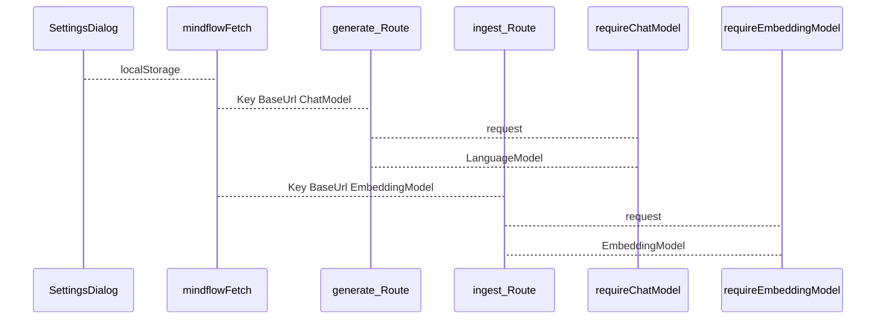

# MindFlow LLM 与 API 输入重构说明

**版本**：v2.3  
**最后更新**：2026-09-21  

**范围**：OpenAI 兼容 **语言模型**（生成）与 **向量模型**（RAG）分链路配置；创建课堂请求体形状。  
**状态**：规格定稿（代码按 §7 分步落地）。

> **本版废弃**：JSON body 中的 `llm` 字段；所有 **LLM 相关** `.env` 兜底；**合并解析**的 `requireLlmModels`（一次读四个头、同时返回 chat + embedding）。  
> **不含**：已删除的 M1 `POST /api/chat` JSON demo（见 [api.md](./api.md)）。

关联：[PRD.md](./PRD.md) · [api.md](./api.md) · [M2-GENERATION-PLAYBACK.md](./M2-GENERATION-PLAYBACK.md) · [PROJECT-BUILD-GUIDE.md](./PROJECT-BUILD-GUIDE.md) §9

---

## 0. 目标、边界、非目标

**目标**

- 设置页 → `localStorage`（`mindflow.llmSettings`）→ 按 **Route 类型** 附带不同的 `X-Mindflow-Llm-*` 子集。
- **语言模型链路**（生成）：[`lib/ai/openai-compat.ts`](../lib/ai/openai-compat.ts) 的 **`requireChatModel(request)`** → `LanguageModel`。
- **向量模型链路**（RAG）：[`lib/knowledge/embedding-config.ts`](../lib/knowledge/embedding-config.ts) 的 **`requireEmbeddingModel(request)`** → `EmbeddingModel`；`embed.ts` / `retrieve` / `ingest` **只**走此链路，**不**经 `lib/ai` 解析 embedding 头。
- **`POST /api/stages`**：嵌套 `requirements` + 可选 `pdf`；**不读、不校验** 任何 LLM 头。

**非目标**

- 用户登录 / JWT、服务端持久化 API Key、`NEXT_PUBLIC_*` 暴露 Key、多厂商 Provider 面板。
- `lib/ai` 内出现 `embeddingModel` 解析或 `requireLlmModels` 双返回。

**原则**

| 规则 | 说明 |
|------|------|
| 文本生成 | `requireChatModel` → [`lib/ai/llm.ts`](../lib/ai/llm.ts) 的 `callLLM` / `streamLLM` |
| 向量 | `requireEmbeddingModel` → [`lib/knowledge/embed.ts`](../lib/knowledge/embed.ts) 的 `embedTexts` / `embedQuery` |
| 共享连接校验 | `normalizeBaseUrl`、生产 SSRF、`LlmSettingsError` 可放在 [`lib/ai/llm-connection.ts`](../lib/ai/llm-connection.ts)，供 **两条链路** import；**不**在此文件创建 embedding/chat 实例 |
| 禁止 | `body.llm`、Route 内直接 `createOpenAI` + `generateText` / `streamText`（除 embed 内部 `embedMany`） |
| 禁止 | LLM 相关 `process.env` 回落 |

### 0.1 仓库现状 vs 目标

| 区域 | 当前 | 目标 |
|------|------|------|
| [`lib/ai/openai-compat.ts`](../lib/ai/openai-compat.ts) | `requireLlmModels`（四头合一） | 仅 **`requireChatModel`**；删除 embedding 相关逻辑 |
| [`lib/knowledge/embedding-config.ts`](../lib/knowledge/embedding-config.ts) | （无） | **`requireEmbeddingModel`**：读 Key / Base-Url / Embedding-Model |
| [`lib/knowledge/embed.ts`](../lib/knowledge/embed.ts) | `OPENAI_*` env | 接收注入的 `EmbeddingModel` |
| [`scene-outlines-stream/route.ts`](../app/api/generate/scene-outlines-stream/route.ts) | `requireLlmModels` | `requireChatModel` |
| [`app/api/stages/[id]/ingest/route.ts`](../app/api/stages/[id]/ingest/route.ts) | 未读 request | `requireEmbeddingModel` → `ingestStage` |
| [`app/api/stages/route.ts`](../app/api/stages/route.ts) | 扁平 `requirement` | 嵌套 `requirements` + `pdf`；不校验 LLM 头 |

---

## 1. 请求头契约（按链路拆分）

头名在实现中为小写常量（HTTP 不区分大小写）。**用户可在 Settings 存四项**，但 **各 Route 只校验本链路需要的头**。

### 1.1 共用（两条链路都需要）

| Header | 说明 |
|--------|------|
| `X-Mindflow-Llm-Api-Key` | OpenAI 兼容 API Key |
| `X-Mindflow-Llm-Base-Url` | 根 URL；`normalizeBaseUrl` → 含 `/v1` |

### 1.2 语言模型链路（生成类 API）

| Header | 必填（该链路） | 说明 |
|--------|----------------|------|
| `X-Mindflow-Llm-Chat-Model` | 是 | 用户填写的 chat 模型 id |

**不要求** `X-Mindflow-Llm-Embedding-Model`。

### 1.3 向量模型链路（RAG）

| Header | 必填（该链路） | 说明 |
|--------|----------------|------|
| `X-Mindflow-Llm-Embedding-Model` | 是 | 用户填写的 embedding 模型 id |

**不要求** `X-Mindflow-Llm-Chat-Model`。

**向量维度**：写入 pgvector 前校验 **1024 维**（与 `chunks.embedding` 列一致）。用户所选 embedding 模型必须产出 1024 维，否则 ingest 失败。

**生产 SSRF**：对 **Base-Url** 做 `assertSafeBaseUrl`（开发不拦内网；生产拦私网 / 元数据）。

**日志**：不得记录完整 Key。



---

## 2. 服务端 API

### 2.1 语言模型 — `lib/ai`

| 导出 | 模块 | 职责 |
|------|------|------|
| `LlmSettingsError` | `openai-compat.ts` 或 `llm-connection.ts` | 401 / 400 |
| `requireChatModel(request)` | [`openai-compat.ts`](../lib/ai/openai-compat.ts) | 读 Key + Base-Url + **Chat-Model** → `client.chat(...)` |

```typescript
const { chat, meta } = await requireChatModel(request);
await streamLLM({ model: chat, system, prompt }, "outline-stream");
```

内部可 `import { normalizeBaseUrl, assertSafeBaseUrl } from "./llm-connection"`。

**不要**在此文件读取 `X-Mindflow-Llm-Embedding-Model`。

### 2.2 向量模型 — `lib/knowledge`

| 导出 | 模块 | 职责 |
|------|------|------|
| `requireEmbeddingModel(request)` | [`embedding-config.ts`](../lib/knowledge/embedding-config.ts) | 读 Key + Base-Url + **Embedding-Model** → `client.embeddingModel(...)` |
| `embedTexts` / `embedQuery` | [`embed.ts`](../lib/knowledge/embed.ts) | 接收 **已解析** 的 `EmbeddingModel`，无 env |
| `retrieve` / `ingestStage` | `retrieve.ts` / `services/knowledge.ts` | 自 Route 注入 `embeddingModel` |

```typescript
const { model: embedding } = await requireEmbeddingModel(request);
await ingestStage(stageId, { embeddingModel: embedding });
// 或 embedTexts(texts, embedding)
```

**不要**在 `lib/ai` 解析或返回 embedding 实例。`lib/knowledge` **可**依赖 `lib/ai/llm-connection`（仅 URL/SSRF/Error），**不得**依赖 `requireChatModel`。

### 2.3 Route 错误映射（两条链路相同）

| 情况 | HTTP |
|------|------|
| 缺本链路必填头 | **401** |
| 非法 Url、SSRF | **400** |
| 上游 401/403 | **502**（不含 Key） |

### 2.4 会话内一致性

同一课堂：**ingest** 与后续 **retrieve**（及未来带 RAG 的 API）须使用 **相同的** Api-Key、Base-Url、Embedding-Model。生成类 API 的 Chat-Model 可与 embedding 模型不同，但 **连接信息（Key/Url）建议与 RAG 一致**，避免多网关混用。

---

## 3. 须携带 LLM 头的接口

| 方法 | 路径 | 解析入口 | 必填头 |
|------|------|----------|--------|
| POST | `/api/generate/scene-outlines-stream` 等 | `requireChatModel` | Key, Base-Url, **Chat-Model** |
| POST | `/api/stages/[id]/ingest` | `requireEmbeddingModel` | Key, Base-Url, **Embedding-Model** |
| （预留） | `scene-content`、`scene-actions`、`quiz-grade` | `requireChatModel` | 同生成 |
| （预留） | M3 讨论 + retrieve | `requireChatModel` + `requireEmbeddingModel` 或讨论 Route 只调 `retrieve` 时仅 embedding 链路 | 按实际 Route 拆分 |

**不读 LLM 头**：`POST /api/stages`、纯 CRUD。

---

## 4. 业务层传参

| 调用 | 约定 |
|------|------|
| 大纲 / 场景生成 Route | `requireChatModel` → `streamLLM` / `callLLM` |
| ingest Route | `requireEmbeddingModel` → `ingestStage(id, { embeddingModel })` |
| `embedTexts` / `embedQuery` | 第二参为 `EmbeddingModel` |
| `retrieve(stageId, query, { embeddingModel })` | 与 ingest 同源模型 |

---

## 5. 创建课堂输入（`POST /api/stages`）

与 LLM **解耦**：不调用模型，**不读、不校验** LLM 请求头。

### JSON（无 PDF）

```json
{
  "requirements": {
    "requirement": "……（≥10 字）",
    "userNickname": "可选",
    "userBio": "可选"
  }
}
```

### multipart/form-data

| 字段 | 说明 |
|------|------|
| `requirements` | JSON 字符串 |
| `pdf` | ≤50MB；PRD §1.6 |

校验：`userRequirementsSchema` 与大纲 SSE 共用。`requirement` 落 `stage.requirement`；nickname/bio 首版进 `sessionStorage.generationSession.requirements`。

兼容一轮：扁平 `{ "requirement": "..." }` normalize 为嵌套。

---

## 6. 客户端约定

| 项 | 约定 |
|----|------|
| 存储 | `mindflow.llmSettings`：apiKey、baseUrl、chatModel、embeddingModel |
| 生成请求 | `getMindflowChatHeaders()` → Key + Base-Url + Chat-Model |
| RAG 请求 | `getMindflowEmbeddingHeaders()` → Key + Base-Url + Embedding-Model |
| `mindflowFetch` | 按 URL 白名单合并 **对应** 头集；**不要**给 `POST /api/stages` 加 LLM 头 |
| SSE | `fetch` 流式；禁止无自定义头的 `EventSource` |

---

## 7. 实施计划（按步勾选）

### 步骤 1 — 连接层 + 语言模型

- [ ] 新增 [`lib/ai/llm-connection.ts`](../lib/ai/llm-connection.ts)（可选独立文件）：`normalizeBaseUrl`、`assertSafeBaseUrl`、`LlmSettingsError`。
- [ ] 改 [`openai-compat.ts`](../lib/ai/openai-compat.ts)：导出 **`requireChatModel`**；**删除** `requireLlmModels` 与 embedding 头逻辑。
- [ ] 大纲 Route：`requireChatModel`。

### 步骤 2 — 向量链路（全部在 `lib/knowledge`）

- [ ] 新增 [`lib/knowledge/embedding-config.ts`](../lib/knowledge/embedding-config.ts)：`requireEmbeddingModel(request)`。
- [ ] 改 [`embed.ts`](../lib/knowledge/embed.ts)、[`retrieve.ts`](../lib/knowledge/retrieve.ts)、[`lib/services/knowledge.ts`](../lib/services/knowledge.ts)。
- [ ] ingest Route：`requireEmbeddingModel(request)`。

### 步骤 3 — 创建课堂 `requirements` + `pdf`

- [ ] 与 v2.2 步骤 4 相同（validators、stages Route、skill）。

### 步骤 4 — 设置页 + `getMindflowChatHeaders` / `getMindflowEmbeddingHeaders`

### 步骤 5 — 文档与清理

- [ ] 删除 `requireLlmModels`、`body.llm`、LLM `.env` 示例。

---

## 8. 附录

### 8.1 curl（ingest — 仅向量链路三头 + Key/Url）

```bash
curl -s -X POST "http://localhost:3001/api/stages/<stageId>/ingest" \
  -H "X-Mindflow-Llm-Api-Key: sk-..." \
  -H "X-Mindflow-Llm-Base-Url: https://api.example.com/v1" \
  -H "X-Mindflow-Llm-Embedding-Model: BAAI/bge-m3"
```

（**不需要** Chat-Model 头。）

### 8.2 curl（大纲 SSE — 仅语言链路三头 + Key/Url）

```bash
curl -s -N -X POST "http://localhost:3001/api/generate/scene-outlines-stream" \
  -H "Content-Type: application/json" \
  -H "X-Mindflow-Llm-Api-Key: sk-..." \
  -H "X-Mindflow-Llm-Base-Url: https://api.example.com/v1" \
  -H "X-Mindflow-Llm-Chat-Model: deepseek-chat" \
  -d "{\"requirements\":{\"requirement\":\"用20分钟讲光合作用，面向高中生\"}}"
```

（**不需要** Embedding-Model 头；body **不得**含 `llm`。）

### 8.3 创建课堂

不带任何 LLM 头（见 v2.2 §8.3）。

### 8.4 修订记录

| 版本 | 日期 | 说明 |
|------|------|------|
| v2.0 | 2026-09-20 | 请求头唯一来源；`requirements` 嵌套 |
| v2.2 | 2026-09-20 | 四头全必填 + `requireLlmModels` 单文件（**v2.3 废弃合并解析**） |
| v2.3 | 2026-09-21 | **双链路**：`requireChatModel`（`lib/ai`）与 `requireEmbeddingModel`（`lib/knowledge`）；按 Route 校验头子集；向量相关解析与使用均在 `lib/knowledge` |

---

*文档结束*
