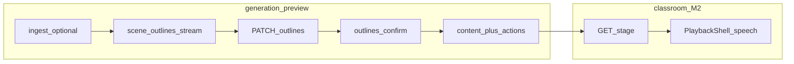
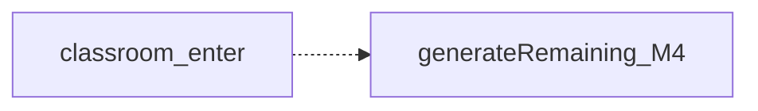

# MindFlow M2 实施手册（大纲 · 生成 · 播放）

**范围**：M2 — SSE 大纲、首屏 slide 生成、课堂播放壳（字幕随讲稿，无 TTS）  
**状态**：实施说明（生成/播放相关代码尚未全部落地）  
**主路径**：PRD [§2.1](PRD.md#21-主流程happy-path) 步骤 **S1～S8、S10**（不含 S9 续生成、S11/S12 讨论与 quiz）

关联：[PROJECT-BUILD-GUIDE.md](./PROJECT-BUILD-GUIDE.md) M2 · [PRD.md](./PRD.md) §4/§5.3/§6/§7/§9 · [RAG-IMPLEMENTATION.md](./RAG-IMPLEMENTATION.md)（ingest 在大纲前） · [LLM-IMPLEMENTATION.md](./LLM-IMPLEMENTATION.md)（大纲/生成走 callLLM/streamLLM） · [DATA-MODEL.md](./DATA-MODEL.md)

> **怎么读这份文档 **  
> 与 [RAG-IMPLEMENTATION.md](./RAG-IMPLEMENTATION.md) 相同：**§1～§6 按实施依赖排序**（types → API/库 → 播放库 → 再挂页面），**不要**从页面开写。  
> 用户动线（`/` → preview → classroom）见 §0.1；三页各自要接什么 API 见 **§7**。动手勾选顺序见 **§10**。

---


## 0. 目标与边界


### 0.1 用户可见交付

对齐 [PROJECT-BUILD-GUIDE §4 M2](./PROJECT-BUILD-GUIDE.md#m2--生成流水线--播放壳1-周)：

```
/  →  /generation-preview  →  /classroom/[id]
```

- 两种路径均可走通：**无附加 PDF** / **提示词 + 可选 PDF**（创建时 `requirement` 必填，见 PRD [§1.6](PRD.md#16-输入模式必填提示词--可选-pdf)）。
- 生成预览页：**SSE 流式大纲** → 可选手改 → **确认大纲** → **首屏 slide** 写入 DB。
- 课堂页：左栏大纲 + 场景状态；中栏 `SlideView`；底栏 **speech 字幕**（无 TTS）。


### 0.2 技术栈（M2）


| 环节        | 选型                                                                        |
| --------- | ------------------------------------------------------------------------- |
| 大纲 / 场景生成 | Vercel AI SDK（`streamObject` / `streamText` 或项目既有 `generateText` 模式）      |
| 生成域模块     | `lib/generation/*`、`lib/scenes/registry`（M2 仅 **slide** handler）          |
| 播放        | `lib/playback/*`（`TimelinePlayer` 或 `engine.ts` + `estimateReadDuration`） |
| UI 壳      | `PlaybackShell`、`SlideView`、`OutlinesEditor`                              |
| 持久化       | **Prisma** + `lib/db/queries/`*（向量/RAG 见 M1 手册）                           |
| 客户端草稿     | `sessionStorage.generationSession`                                        |


### 0.3 本阶段不做

- `features.outlineOrchestration`（Phase 2 Plan + Critic 闭环）
- M2+ 大纲助手（`POST /api/chat`，`sessionType: 'outline'`）
- **quiz** 场景生成与播放、`POST /api/quiz-grade`
- LangGraph Director、讨论区业务逻辑（见 [附录 A](#附录-a--m3m4-占位)）
- **M4** `useSceneGenerator().generateRemaining` 实现（附录仅规格引用）
- TTS/ASR、Pro 编辑器、白板/聚光灯等 action 的完整引擎（可 no-op 类型）


### 0.4 前置依赖


| 依赖         | 说明                                                                                                                               |
| ---------- | -------------------------------------------------------------------------------------------------------------------------------- |
| M0         | `stage` / `scenes` 表；`POST/GET /api/stages`                                                                                      |
| M1         | 有 PDF 时：**确认生成** → `POST /api/stages/[id]/ingest` 须在大纲 SSE **之前**（[RAG-IMPLEMENTATION §0.1](RAG-IMPLEMENTATION.md#01-解析时机先存后解析)） |
| Feature 开关 | `lib/config/features.ts`：`outlineOrchestration`、`outlineAssistant` 默认 `false`                                                    |


### 0.5 三态存储与 API 时间线

对齐 PRD [§6.1.4](PRD.md#614-大纲与-plan-生命周期) 与 [§2.1 逐步对照表](PRD.md#逐步对照表)：


| 层级     | 存放                                                            | M2 内容                                                                 |
| ------ | ------------------------------------------------------------- | --------------------------------------------------------------------- |
| **L0** | `sessionStorage.generationSession` + 前端 state                 | `stageId`、`requirement?`、`hasPdf?`；SSE 流式中 `SceneOutline[]` **不写 DB** |
| **L1** | `stage.outlines` JSONB、`language_directive`、`outlines_status` | SSE `done` → `draft`；`PATCH .../outlines`；`confirm` → `confirmed`     |
| **L2** | `scenes` 表                                                    | 首屏：`sort_order=1`、`status=ready`、`content` + `actions`                |


**推荐策略（与 PRD 一致）**：

- 流式期间：服务端 **禁止** 逐条写 `stage.outlines`；前端可只更新 L0。
- SSE 事件 `done`：服务端一次性写 L1（`outlines`、`language_directive`、`outlines_status=draft`），并可选更新 `preview_phase`（如 `outline-ready` / `review`）。




**M4 后台续生成**（本手册主路径不实现，虚线示意）：




---


## 0.6 仓库快照（撰写时）

便于对照「已有 / 待新增」。ORM 与查询层以 **Prisma** 为准（非 BUILD-GUIDE 表头 Drizzle）。


| 路径                                            | 状态     | 说明                                                      |
| --------------------------------------------- | ------ | ------------------------------------------------------- |
| `app/page.tsx`                                | **已有** | 首页壳；需接创建课堂、写 session、跳转 preview                         |
| `app/layout.tsx`、`app/globals.css`            | **已有** | —                                                       |
| `app/api/stages/route.ts`                     | **已有** | 创建 / 列表                                                 |
| `app/api/stages/[id]/route.ts`                | **已有** | 当前主要为 DELETE；M2 需 **GET** 详情（或独立 route）                 |
| `app/api/stages/[id]/ingest/route.ts`         | **已有** | M1 ingest                                               |
| `app/api/chat/route.ts`                       | **已有** | M1 最小 chat；M2 课堂讨论不在此阶段接 UI                             |
| `lib/types/stage.ts`                          | **已有** | `StageStatus`、`PreviewPhase`、`OutlinesStatus` 等         |
| `lib/services/knowledge.ts`、`lib/knowledge/*` | **已有** | parse / chunk / embed / retrieve                        |
| `app/generation-preview/page.tsx`             | **缺失** | 新增                                                      |
| `app/classroom/[id]/page.tsx`                 | **缺失** | 新增                                                      |
| `app/api/generate/*`                          | **缺失** | `scene-outlines-stream`、`scene-content`、`scene-actions` |
| `app/api/stages/[id]/outlines/*`              | **缺失** | PATCH + confirm                                         |
| `lib/types/generation.ts`                     | **缺失** | `SceneOutline`、`GenerationSessionState`                 |
| `lib/validators/generation.ts`                | **缺失** | 生成 API 请求校验                                             |
| `lib/generation/*`                            | **缺失** | outline / content / actions                             |
| `lib/scenes/registry.ts`、`handlers/slide.ts`  | **缺失** | M2 仅 slide                                              |
| `lib/playback/*`、`components/playback/*`      | **缺失** | 播放壳                                                     |
| `lib/db/queries/scenes.ts`                    | **缺失** | scenes CRUD                                             |
| `components/generation/OutlinesEditor.tsx`    | **缺失** | 大纲编辑                                                    |
| `components/scenes/SlideView.tsx`             | **缺失** | 幻灯片渲染                                                   |


**M1 降级说明**：若 ingest 尚未完整写入 embedding / `has_knowledge_base`，大纲「提示词 + PDF」分支应优先 `retrieve(stageId, …)`；不可用时降级为 `documents.raw_text` 或首页缓存的 `pdfExcerpt`（见 [RAG-IMPLEMENTATION](RAG-IMPLEMENTATION.md)）。

---


## 1. Types-first 契约

依赖方向：`lib/types/*` → `lib/validators/*` → `lib/generation|scenes|playback` → `lib/services/*` → `app/api/*` → `app/**/page.tsx`。

### 1.1 SceneOutline（MVP 子集）

与 PRD [§13.1](PRD.md#131-sceneoutline-类型mvp-子集) / OpenMAIC `lib/types/generation.ts` 对齐：

- `type` 仅 `"slide"` | `"quiz"`（**M2 生成路径仅处理 slide**；大纲可含 quiz 条目，首屏只生成 `order=1` 且 `type=slide`，或生成前过滤）。
- 字段：`id`、`title`、`description`、`keyPoints`、`order`、`teachingObjective`、`estimatedDuration`、`languageNote`、`quizConfig?`、`suggestedImageIds?`（有 PDF 时）。

建议新建 `lib/types/generation.ts`（或扩展 `lib/types/stage.ts`，但生成域类型独立更清晰）。

### 1.2 执行稿 PATCH

PRD [§6.3](PRD.md#63-执行稿大纲-patchstageoutlines-jsonb) — 手册 API 与类型须一致：

```typescript
type OutlinePatchRequest =
  | { op: "replace"; outlines: SceneOutline[]; expectedRevision?: number }
  | { op: "revise"; id: string; patch: Partial<SceneOutline> }
  | { op: "insert"; afterOrder?: number; outline: SceneOutline }
  | { op: "delete"; id: string }
  | { op: "reorder"; ids: string[] };
```

响应：`{ success: true, outlines: SceneOutline[], updatedOutlineIds?: string[] }`；并发可选 `409`（`expectedRevision`）。

### 1.3 sessionStorage.generationSession

对齐 PRD [§4.2](PRD.md#42-页面规格) / §6.1.4，建议字段：

```typescript
type GenerationSessionState = {
  stageId: string;
  requirement?: string;
  hasPdf?: boolean;
  previewPhase?: PreviewPhase; // 来自 lib/types/stage.ts
};
```

首页 `POST /api/stages` 成功后写入，再 `router.push('/generation-preview')`。预览页无 session 则重定向 `/`。

### 1.4 Scene content / actions

播放权威数据：`scenes.actions[]`。片段示例见 PRD [§13.3](PRD.md#133-slide-场景-content--actions-示例片段)（`speech.text` 驱动底栏字幕）。

### 1.5 Validators

`lib/validators/generation.ts` 建议覆盖：

- `POST /api/generate/scene-outlines-stream`：`{ stageId: uuid, requirement?: string }`（**无** `phase: plan|execute`）
- `POST /api/generate/scene-content` / `scene-actions`：`stageId`、`outlineId` 或内联 `SceneOutline`
- 与 `lib/validators/stages.ts` 不混写业务生成规则。

---


## 2. 大纲生成（SSE）


### 2.1 API

`POST /api/generate/scene-outlines-stream`

- Route **薄壳**：读 `features.outlineOrchestration`；为 `false` 时调用 `lib/generation/outline-generator.ts`。
- Phase 2 分支（`phase: plan|execute`）在 M2 **返回 400** 或明确错误文案（见 DEV_GUIDE / `features.ts`）。

**请求体**：

```json
{ "stageId": "<uuid>", "requirement": "<可选，覆盖 stage.requirement>" }
```


### 2.2 两种输入（PRD §5.3 步骤 4）


| 模式 | 生成依据 |
|------|----------|
| 无附加 PDF | `stage.requirement` |
| 有 PDF（已 ingest） | `requirement` + `retrieve(stageId, query)` 或文档摘要（`has_knowledge_base === true` 时） |


### 2.3 SSE 事件（与 PRD §7.1 一致）

大纲流 `/api/generate/scene-outlines-stream`（MVP）：


| type                | 载荷                                                        |
| ------------------- | --------------------------------------------------------- |
| `phase`             | `{ phase: 'ingest' | 'outline' }`                         |
| `languageDirective` | `{ data: string }`                                        |
| `outline`           | `{ data: SceneOutline, index: number }`                   |
| `done`              | `{ outlines: SceneOutline[], languageDirective: string }` |
| `error`             | `{ error: string }`                                       |
| `retry`             | `{ attempt, maxAttempts }`                                |


客户端：按 `outline` 追加卡片；`done` 后以服务端落库为准刷新 L1（或合并 L0）。

### 2.4 `done` 落库

更新 `stage`：

- `outlines` = `SceneOutline[]`
- `language_directive`
- `outlines_status` = `draft`
- 可选：`status` → `outline_ready`，`preview_phase` → `outline-ready` / `review`


### 2.5 手改与确认


| 操作  | API                                      | 效果                                        |
| --- | ---------------------------------------- | ----------------------------------------- |
| 手改  | `PATCH /api/stages/[id]/outlines`        | 原子更新 L1                                   |
| 确认  | `POST /api/stages/[id]/outlines/confirm` | `outlines_status=confirmed`，触发首屏 scene 生成 |


确认后生成可在 `lib/services/generation.ts` 内串行：`scene-content` → `scene-actions` → `INSERT scenes`，或由 preview 页连续调两个 generate API。

---


## 3. 课堂场景生成（首屏）


### 3.1 两阶段流水线

```
SceneOutline → POST /api/generate/scene-content → POST /api/generate/scene-actions → INSERT scenes
```


### 3.2 Registry（仅 slide）

- `lib/scenes/registry.ts` 注册 `slide` → `lib/scenes/handlers/slide.ts`
- M2 可对 `type=quiz` 的 outline 返回 **400** 或跳过，仅保证 **首屏** `sort_order=1` 的 slide ready


### 3.3 写库字段

`scenes`：`stage_id`、`outline_id`（对应 `outlines[].id`）、`sort_order`、`title`、`type`、`content`、`actions`、`status=ready`（首屏）。

`generating` / `pending` / `failed` 留给 M4 续生成与重试。

### 3.4 GET 课堂详情

`GET /api/stages/[id]` 响应须包含（camelCase API 字段对齐 PRD §6.3 末段）：

- `outlines` / `sceneOutlines`（M2 后者可为 null）
- `outlinesStatus`、`previewPhase`、`languageDirective`
- `scenes[]` 摘要：`id`、`outlineId`、`sortOrder`、`type`、`title`、`status`
- 播放页再按需拉取完整 `content` / `actions`（或 GET 一次带全量，M2 可简化）


### 3.5 客户端 Hook

`lib/hooks/use-scene-generator.ts`：

- M2 实现 `generateFirstScene(stageId, outline)`（或 confirm API 内服务端完成，Hook 仅轮询状态）。
- `generateRemaining`：见 [附录 A](#附录-a--m3m4-占位)。


### 3.6 事务与失败

`confirm` + 首屏生成失败时建议：

- 已插入的 `scenes` 行：`DELETE` 或 `status=failed` + `error_message`；
- `outlines_status` 保持 `confirmed` 或回滚 `draft`（产品二选一；推荐 **保留 confirmed**，允许 preview 重试生成首屏）。

---


## 4. 课堂播放（库与组件，先于页面联调）

对齐 PRD [§9 播放模块](PRD.md#9-播放模块) 与 BUILD-GUIDE [§6.1](PROJECT-BUILD-GUIDE.md#61-播放课堂lecture-链路m2-实现)。  
可在 **§3 curl 已有首屏 scene** 后，用 Storybook 或临时页验证 `PlaybackShell`；完整三页挂接在 **§7**。

### 4.1 M2 最小路径

- 权威数据：`scenes[].actions`
- `PlaybackShell` + `TimelinePlayer`（或 `lib/playback/engine.ts`）：
  - 仅处理 `speech` → 更新底栏字幕
  - 步进间隔：`estimateReadDuration(text)`（PRD [§9.2](PRD.md#92-阅读节奏无-tts)）


### 4.2 不实现（M3+）

- `discussion` 弹窗与暂停逻辑
- `quiz` 暂停与 `/api/quiz-grade`
- 完整 `lecture` ChatSession + `StreamBuffer`（OpenMAIC 对齐项；M2 字幕直连 player 即可）


### 4.3 场景切换

M2 通常仅 **1 条** `ready` scene：左栏展示全部 `outlines`，未生成页显示 pending；**仅** `status=ready` 可播放。用户点击其他页可提示「M4 续生成后可用」。

---


## 5. 分层与文件清单

```
lib/types/generation.ts
lib/validators/generation.ts
lib/generation/outline-generator.ts
lib/generation/scene-content.ts
lib/generation/scene-actions.ts
lib/generation/prompts/…
lib/scenes/registry.ts
lib/scenes/handlers/slide.ts
lib/playback/timeline-player.ts   # 或 engine.ts + pacing.ts
lib/services/generation.ts
lib/db/queries/scenes.ts
app/api/generate/scene-outlines-stream/route.ts
app/api/generate/scene-content/route.ts
app/api/generate/scene-actions/route.ts
app/api/stages/[id]/outlines/route.ts
app/api/stages/[id]/outlines/confirm/route.ts
app/generation-preview/page.tsx
app/classroom/[id]/page.tsx
components/generation/OutlinesEditor.tsx
components/scenes/SlideView.tsx
components/playback/PlaybackShell.tsx
```

扩展 `GET /api/stages/[id]`（若与 DELETE 同文件，增加 `GET` handler 或 `route.get.ts` 模式按项目约定）。

---


## 6. OpenMAIC 移植速查


| MindFlow                      | OpenMAIC 参考                                       | M2 策略                  |
| ----------------------------- | ------------------------------------------------- | ---------------------- |
| scene-outlines-stream         | `app/api/generate/scene-outlines-stream/route.ts` | 复制精简；jsonrepair + 重试   |
| outline-generator             | `lib/generation/…`                                | requirement 必填 + 可选 RAG 分支 |
| scene-content / scene-actions | 同名 routes                                         | **仅 slide**            |
| 播放                            | `playback/engine.ts`、`PlaybackChromeRoot.tsx`     | **重写** `PlaybackShell` |
| use-scene-generator           | `lib/hooks/use-scene-generator.ts`                | 仅首屏                    |


详读：[OPENMAIC-LEARNING-GUIDE.md](./OPENMAIC-LEARNING-GUIDE.md) 对应章节。

---


## 7. 三页挂接（API 打通后再做）

与 PRD [§4.2 页面规格](PRD.md#42-页面规格) 对齐；**实施顺序在 §2～§4 之后**（同 BUILD-GUIDE §7：先后端、再页面）。


| 页面                                | M2 必做                                                                           | 占位（可选 / 附录）                              |
| --------------------------------- | ------------------------------------------------------------------------------- | ---------------------------------------- |
| `app/page.tsx`                    | 创建课堂、写 session、跳转 preview；列表项进 classroom                                        | 顶栏 `SettingsDialog` 按钮占位                 |
| `app/generation-preview/page.tsx` | `ingest?` → SSE 大纲 → `OutlinesEditor` → confirm → 首屏生成 → `push /classroom/[id]` | —                                        |
| `app/classroom/[id]/page.tsx`     | 左栏 `outlines` + `scenes.status`；中栏 `SlideView`；底栏字幕；`GET /api/stages/[id]`      | 右栏讨论区壳；顶栏播放控制；**不接** `generateRemaining` |


**预览页步骤条（MVP）**：`ingest?` → 大纲 SSE →（可选手改）→ 确认大纲 → 首屏生成（PRD [§3.5.10](PRD.md#3510-页面generation-preview-扩展) 表格「MVP」行）。

---


## 8. 联调与验收


### 8.1 后端顺序（curl，先于 §7）

```
scene-outlines-stream → PATCH outlines → outlines/confirm → scene-content → scene-actions → GET stages/[id]
```

前置：M0 `stages`；有 PDF 时先 **ingest**（M1）。

### 8.2 Happy path

1. `POST /api/stages`（`requirement` 必填；可选 `pdf`）
2. `POST /api/stages/[id]/ingest`（仅当有 PDF）
3. `POST /api/generate/scene-outlines-stream`（读 SSE）
4. `PATCH /api/stages/[id]/outlines`（可选）
5. `POST /api/stages/[id]/outlines/confirm` + 首屏生成
6. 浏览器打开 `/classroom/[id]`：slide 可见，字幕随 `speech` 切换

PowerShell / curl 测 API 可参考 [.cursor/skills/mindflow-api-test](../.cursor/skills/mindflow-api-test/SKILL.md)。

### 8.3 验收勾选

- [ ] 两种路径贯通 preview → classroom（无 PDF / 含 PDF）
- [ ] SSE 大纲卡片流式展示；`done` 后刷新不丢大纲
- [ ] 首屏 scene `status=ready`，`actions` 含 `speech`
- [ ] 播放字幕与讲稿一致；无 TTS 亦可自动步进
- [ ] 首屏 P95 目标：PRD [§10](PRD.md#10-非功能需求)（视模型）


### 8.4 与 PRD 逐步对照（交叉核对）


| PRD §2.1 步骤 | 本手册章节     | API / 数据                                            |
| ----------- | --------- | --------------------------------------------------- |
| S1–S2       | §7、`§1.3` | `POST /api/stages`；`generationSession`              |
| S3          | §0.5、§8   | `POST .../ingest`                                   |
| S4          | §2        | `scene-outlines-stream`；PRD §7.1 SSE 表              |
| S5          | §2.5      | `PATCH .../outlines`；PRD §6.3 `OutlinePatchRequest` |
| S6          | §2.5      | `POST .../outlines/confirm`                         |
| S7          | §3        | `scene-content` + `scene-actions` → `scenes`        |
| S8、S10      | §7、§4     | `GET .../stages/[id]`；播放 `actions`                  |
| S9、S11、S12  | 附录 A      | 非 M2 主路径                                            |


---


## 10. 实现顺序（动手时按此勾）

对齐 [RAG-IMPLEMENTATION §13](./RAG-IMPLEMENTATION.md#13-实现顺序动手时按此勾) 与 BUILD-GUIDE **先后端、再页面**。

1. `lib/types/generation.ts` + `lib/validators/generation.ts`（§1）
2. `lib/db/queries/scenes.ts` + 扩展 stage 查询（写 `outlines` / 读详情）
3. `lib/generation/outline-generator.ts` + `POST /api/generate/scene-outlines-stream`（§2；curl 读 SSE）
4. `PATCH /api/stages/[id]/outlines` + `POST .../outlines/confirm`（§2.5）
5. `lib/scenes/*` + `scene-content` **/** `scene-actions` **routes** + `lib/services/generation.ts`（§3；confirm 后首屏落库）
6. `GET /api/stages/[id]` 带 `outlines` + `scenes`（§3.4）
7. `lib/playback/*` + `SlideView` **/** `PlaybackShell`（§4；可用假 `actions` 先测字幕步进）
8. **§8.1 curl 全链路**（无浏览器）
9. **§7 三页**：`page.tsx` → `generation-preview` → `classroom/[id]`
10. **§8.2～8.3** 浏览器 Happy path + 验收勾选

建议 PR：`feat(m2): outline SSE + slide generation + playback shell`

---


## 附录 A — M3/M4 占位


| 步骤   | 内容                                                                  | 文档                |
| ---- | ------------------------------------------------------------------- | ----------------- |
| S9   | `useSceneGenerator().generateRemaining`、列表 `pending` / `generating` | M4 / DEV_GUIDE    |
| S11  | `DiscussionPanel` + Director `POST /api/chat`（`sessionType: qa`）    | M3 / PRD §2.1 S11 |
| S12  | `QuizView` + `POST /api/quiz-grade`                                 | M3                |
| 课堂右栏 | 占位 UI + 文案「讨论区 M3 启用」                                               | 本附录               |


课堂页布局建议：三栏网格保留右栏宽度，M2 仅展示静态说明或 disabled 输入框，避免与 PRD 全量课堂信息架构冲突。

---


## 附录 B — 与 PRD / BUILD-GUIDE 差异说明


| 主题             | 说明                                                                                         |
| -------------- | ------------------------------------------------------------------------------------------ |
| ORM            | 仓库使用 **Prisma** + `lib/db/queries/`*；BUILD-GUIDE §1.2 仍写 Drizzle 时以本仓库为准                   |
| API 根路径        | 统一 `/api/stages`，不用 DEV_GUIDE 历史写法 `/api/courses`                                          |
| 播放 lecture 链路  | BUILD-GUIDE §6.1 含 `ChatSession(lecture)` + `StreamBuffer`；**M2 可省略**，字幕直连 `PlaybackShell` |
| Plan / Phase 2 | `scene_outlines`、`outline_confirmed_at` 列保留 NULL；不实现 `phase: plan|execute`                 |
| 创建输入           | PRD §1.6：`requirement` 必填，`pdf` 可选；`lib/services/stages.ts` 待对齐                          |


---

*文档结束*