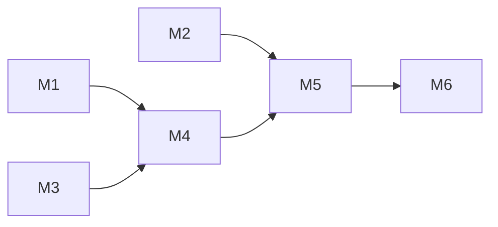

# 流式大纲生成（后端）

目标：在保留 `app/api/generate/scene-outlines-stream/route.ts` 的 SSE 编排前提下，对齐 [spec](./spec.md) 与 [adr-005](../../adr/adr-005.md)。按课堂 id 读取已保存的 `requirements` 流式生成大纲；确认前不写 `stage.outlines` / `languageDirective`。

不改动 `app/api/stages/route.ts`。不新增 ADR。不做 Prisma 迁移。OL-2 与 OL-6 手改仅前端，本计划无 PATCH 接口。

后端 M1–M6 已按下文落地。前端见 [tasks](./tasks.md)：先做静态（静态的第一步是删掉开源无关模块），再做联调。

## 实施顺序总览

按模块编号依次落地；后序模块依赖前序交付物。

| 模块 | 名称 | 交付物 | 验收映射 |
|:---:|---|---|---|
| **M1** | 大纲 Prompt 瘦身 | 仅 MindFlow 需要的 `requirements-to-outlines` 模板 | OL-1、OL-3 |
| **M2** | 类型与校验 | `SceneOutline`、Zod、`DEFAULT_LANGUAGE_DIRECTIVE` | OL-1、OL-5 |
| **M3** | 检索摘录格式化 | KB 就绪时生成 prompt 用摘录文本 | OL-3 |
| **M4** | Prompt 组装入口 | `buildOutlineGenerationPrompt(...)`，只传真实变量 | OL-1、OL-3 |
| **M5** | 流式 API Route | HTTP + SSE + 增量 JSON 解析（留在 route 内）+ 不入库 | OL-1、OL-4、OL-5 |
| **M6** | 手工验证 | 按文末清单打勾 | 全部 |



---

## M1 — 大纲 Prompt 瘦身

`implements: OL-1, OL-3`

**原则**：与本产品无关的能力从 **模板正文里删掉**，不要用 `buildPrompt` 传 `"None"` / 空字符串 / `false` 去「关掉」开源段落。`loader` 的 `{{#if flag}}` 只保留 **本产品有、且会真实为 true 的** 条件（例如有检索结果时才出现的块）。

**改动范围**：仅 `lib/prompts/templates/requirements-to-outlines/` 四个文件：`system.md`、`user.md`、`system.zh-CN.md`、`user.zh-CN.md`。

### M1.1 `system.md` / `system.zh-CN.md`

删除或改写：

- 「MAIC Platform」及 `interactive`、`pbl`、widget、PBL 配置整节。
- `{{#if imageEnabled}}` / `{{#if videoEnabled}}` / `{{#if mediaEnabled}}` 及对应 snippet（AI 图/视频）。
- 输出字段表里的 `suggestedImageIds`、`mediaGenerations`、`widgetType`、`pblConfig` 等行与示例 JSON。
- 示例 `outlines` 中含 `interactive` 的场景。

保留并改写为 **MindFlow**：

- 场景类型 **仅** `slide`、`quiz`。
- `quizConfig`（含 `short_answer`）、`languageDirective` 规则、教学设计默认值。
- 语言推断规则；其中「Cross-language PDF」改为「检索摘录语言不覆盖提示词授课语言」（与 OL-3 一致，不提 PDF 全文）。

### M1.2 `user.md` / `user.zh-CN.md`

删除整块 **Reference Materials** 中的：

- PDF Content Summary（`{{pdfContent}}`）
- Available Images（`{{availableImages}}`）
- Web Search Results 文案（联网搜索）
- `{{teacherContext}}`
- `{{#if hasSourceImages}}` 配图说明
- Interactive / PBL 的 Special Notes

保留结构：

1. `{{requirement}}`
2. `{{#if userProfile}}` … `{{userProfile}}` … `{{/if}}`（无昵称/背景时 **不传** `userProfile` 键，或传空且条件为假，整块不出现）
3. Language Context（可保留简短说明，指向 system 规则）
4. **新增**（仅此一处可选材料）：

```markdown
{{#if retrievalExcerpts}}
## Document excerpts (from knowledge base)

Use only to inform topic and keyPoints. Do not invent citations or page numbers.

{{retrievalExcerpts}}
{{/if}}
```

（中文版同步措辞。）

5. Output Requirements：`type` 仅 `slide` | `quiz`；其余 JSON 形状不变。

**不再使用的占位符**（模板中不得残留）：`pdfContent`、`availableImages`、`researchContext`、`teacherContext`、`hasSourceImages`、`mediaEnabled`、`imageEnabled`、`videoEnabled`。

### M1.3 测试模板加载

改完后本地 `buildPrompt('requirements-to-outlines', { requirement: 'test...' })`（或现有 `tests/prompts` 若有）确认无未替换的 `{{...}}` 泄漏到发给模型的字符串。

---

## M2 — 类型与校验

`implements: OL-1, OL-5`　`governed_by: adr-004`

| 文件 | 内容 |
|---|---|
| `lib/types/outline.ts` | `SceneOutline`（`type: 'slide' \| 'quiz'`）、`QuizConfig`、`DEFAULT_LANGUAGE_DIRECTIVE` |
| `lib/validators/outline.ts` | Zod：`sceneOutlineSchema`、`parseSceneOutline`；失败信息短句、无堆栈 |

Route 在 `done` 前对每条解析结果 `safeParse`；任一失败或最终 `length === 0` → SSE `error`（OL-5）。

---

## M3 — 检索摘录格式化

`implements: OL-3`

| 文件 | 内容 |
|---|---|
| `lib/knowledge/format-retrieval-excerpts.ts` | `formatRetrievalExcerpts(sources: SourceRef[]): string`：编号列表 + `excerpt` 文本；`[]` 时由调用方决定不传 prompt 变量 |

逻辑：

- `hasKnowledgeBase === false`：**不**调用 `retrieve`，**不**设置 `retrievalExcerpts`。
- `hasKnowledgeBase === true`：`requireEmbeddingModel(req)` 读取向量自己的 Key、端点与模型名 → `retrieve(stageId, requirement, { embeddingModel })` → 格式化；若结果为空白，同样不传 `retrievalExcerpts`（与无 KB 行为一致，不报错）。不读对话配置。

禁止：读 `rawText`、拼 PDF 全文、vision。

---

## M4 — Prompt 组装入口

`implements: OL-1, OL-3`

**不要**在 route 里手写一大表默认参数。新增薄封装，例如 `lib/prompts/build-outline-generation-prompt.ts`：

```ts
buildOutlineGenerationPrompt(input: {
  requirement: string;
  userNickname?: string;
  userBio?: string;
  retrievalExcerpts?: string;
}): { system: string; user: string }
```

内部：

1. `requirement` 必填，直接传入 `buildPrompt(PROMPT_IDS.REQUIREMENTS_TO_OUTLINES, vars)`。
2. **仅当** `userNickname` 或 `userBio` 存在时，拼 `userProfile` 字符串并传入；否则 **vars 不含 `userProfile` 键**（依赖 M1 的 `{{#if userProfile}}`）。
3. **仅当** `retrievalExcerpts` 非空时传入 `retrievalExcerpts`；否则 **vars 不含该键**（依赖 M1 的 `{{#if retrievalExcerpts}}`）。
4. 固定 `PROMPT_IDS.REQUIREMENTS_TO_OUTLINES`；不引用 `INTERACTIVE_OUTLINES`。

这样 `buildPrompt` 变量集与 MindFlow 能力一一对应，无「占位关闭」。

---

## M5 — 流式 API Route

`implements: OL-1, OL-3, OL-4, OL-5`　`governed_by: adr-005`

文件：`app/api/generate/scene-outlines-stream/route.ts`。

**增量 JSON 解析不单独抽模块**：保留 route 内现有的 `extractLanguageDirective`、`extractNewOutlines`（文件顶部私有函数）；解析结果用 M2 的 `SceneOutline` 类型标注，并在 `done` 前走 M2 校验。不新建 `lib/generation/outline-stream-parse.ts`。

### M5.1 开流前（JSON 响应）

| 步骤 | 行为 |
|:---:|---|
| 1 | 解析 body：`stageId` uuid，否则 400 |
| 2 | `requireChatModel(req)`；`LlmSettingsError` → 401 |
| 3 | `getStage(stageId)`；`StageNotFoundError` → 404 |
| 4 | 若 `hasKnowledgeBase` → `requireEmbeddingModel(req)`；失败 → 401 |

请求体 **仅** `{ "stageId" }`，不接受 `requirements`。

### M5.2 生成与 SSE

| 步骤 | 行为 |
|:---:|---|
| 5 | M3 得到可选 `retrievalExcerpts` |
| 6 | M4 `buildOutlineGenerationPrompt({ requirement, userNickname?, userBio?, retrievalExcerpts? })` |
| 7 | `streamLLM({ model: chat, system, prompt: user }, 'scene-outlines-stream')` |
| 8 | route 内增量解析 → 事件 `languageDirective`、`outline`（含 nanoid / order） |
| 9 | M2 校验；成功 → `done`；失败 → `error`；可保留 heartbeat / retry |
| 10 | **全程不** `update` `outlines`、`languageDirective`、`previewPhase`、`status` |

### M5.3 从开源 route 移除

- 所有 `@/lib/generation/generation-pipeline`、`outline-generator`、`constants/generation`、`types/generation` import。
- `interactiveMode`、`vision`、`pdfImages`、`media` 请求头、`agents`、`uniquifyMediaElementIds`、`streamLLM` 第三参、`apiError`（改用 `NextResponse.json`）。

### M5.4 OL-4

不修改 `GET /api/stages/{id}` 响应形状；回归确认仍无 `outlines` / `languageDirective`。

---

## M6 — 验证

仓库无自动化测试。实现后按项核对（可参考 `.cursor/skills/mindflow-api-test`）：

| ID | 检查 |
|---|---|
| OL-1 | 建课 + Chat 头 + `POST` 流式 → 逐条 `outline`，仅 slide/quiz；DB `outlines`/`language_directive` 未变 |
| OL-3a | ingest 后 + 对话配置 + 另一套向量配置 → 成功；prompt 含摘录块、无 PDF 全文占位 |
| OL-3b | 无 KB → 无 embedding 要求；user prompt 无 Document excerpts 段 |
| OL-4 | 生成后 `GET` 无大纲；刷新需重新 `POST` |
| OL-5 | 假 id 404；缺对话配置 401；知识库就绪但缺向量配置 401；坏模型输出 SSE `error` |
| M1 回归 | 打印一次完整 user prompt：无 `{{pdfContent}}` 等残留字面量 |

OL-2、OL-6：预览页手改字段、调整顺序、增删场景，无新 API。

---

## API 契约（摘要）

**`POST /api/generate/scene-outlines-stream`**

```json
{ "stageId": "<uuid>" }
```

对话头（必填）：`x-mindflow-llm-chat-api-key`、`x-mindflow-llm-chat-base-url`、`x-mindflow-llm-chat-model`。

向量头（仅 `hasKnowledgeBase === true` 时必填）：`x-mindflow-llm-embedding-api-key`、`x-mindflow-llm-embedding-base-url`、`x-mindflow-llm-embedding-model`。两套可以指向不同提供商，不能互相代替。无 PDF 或知识库未就绪时不读向量头，只凭对话配置生成。

SSE 事件：`languageDirective` | `outline` | `done` | `error`（可选 `retry`、`:heartbeat`）。

---

## 保持不变

- `GET /api/stages/{id}` 字段集不变。
- 建课路由不改。入库路由仍只调用 `requireEmbeddingModel`，不改入库流程；该函数改为读取向量自己的 Key、端点与模型名。
- `lib/prompts` 下 **其他** prompt id（`slide-content` 等）本计划不动，后续单元再接。

---

## 不做

- 确认大纲写库、场景生成、手改 API。
- `interactive` / PBL / 联网 / AI 媒体 / vision / 语音。
- 用默认参数掩盖未删除的模板段落（反模式，M1 必须删干净）。
- 将 `extractLanguageDirective` / `extractNewOutlines` 抽到 `lib/generation/`（解析逻辑留在 route 即可）。

---

## 前端实施顺序

后端保持不动。前端任务拆在 [tasks](./tasks.md)，分两次交付，不要跳步。

路由只有首页、生成页 `/generation-preview/[id]`、播放页。本单元不生成场景。后续在生成页只生成第 1 个场景（幻灯片内容 + 含 speech 的 actions，不含语音合成）；其余场景由播放页后台续生成。详见 [intent](../../intent.md) 的「页面」。

| 次序 | 阶段 | 做什么 | 验收映射 |
|:---:|---|---|---|
| 1 | 静态 · 删减 | 先把开源预览拷进参照目录，再从当前路由删掉无关模块 | 为静态清场 |
| 2 | 静态 · 页面 | 用本地假数据搭流式卡片和大纲编辑器，不发请求 | OL-2、OL-6 的界面 |
| 3 | 联调 | 接 `GET /api/stages/{id}` 与大纲 SSE | OL-1、OL-3、OL-4、OL-5；OL-2、OL-6 接上真实列表 |


| 验收 | 后端（M1–M5） | 前端 |
|---|---|---|
| OL-1 | SSE + 校验 | 联调：逐条展示 |
| OL-2 | — | 静态即可手改 title / description / keyPoints；联调接到真实列表 |
| OL-6 | — | 静态即可调序、新增或删除 slide / quiz；联调接到真实列表 |
| OL-3 | M3 + M4 + KB 时 Embedding 头 | 联调：按知识库是否就绪带齐请求头 |
| OL-4 | GET 不泄露大纲 | 联调：刷新后重新开流 |
| OL-5 | 404 / 401 / SSE error | 静态先有错误与重试界面；联调接上真实失败 |
