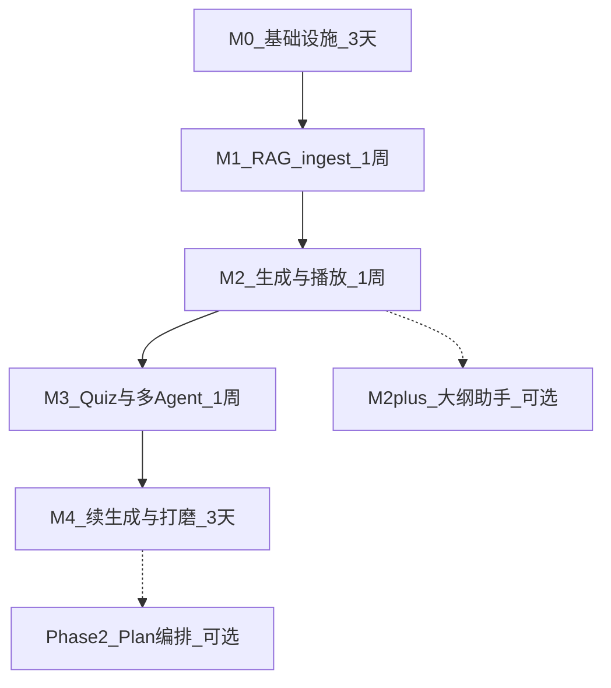
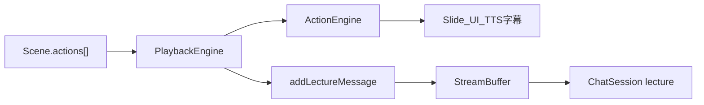
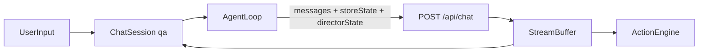
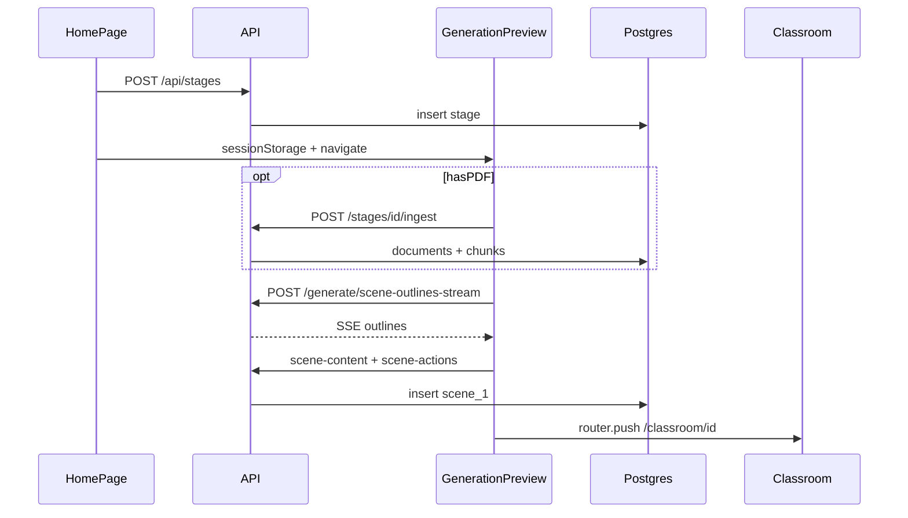

# MindFlow 项目开发指南（从零复刻实施版）

**版本**：v1.0  
**状态**：MVP 实施入口文档  
**最后更新**：2026-09-11  

> **本文定位**：回答「先做什么、后做什么、每阶段引入哪些数据结构」。详细任务勾选清单见 [DEV_GUIDE.md](./DEV_GUIDE.md)；产品规格见 [PRD.md](./PRD.md)；表结构见 [DATA-MODEL.md](./DATA-MODEL.md)。

---

## 目录

- [1. 导读](#1-导读)
- [2. 开发顺序总览](#2-开发顺序总览)
- [3. 为何是这个顺序](#3-为何是这个顺序)
- [4. 分阶段实施（M0～M4）](#4-分阶段实施m0m4)
- [5. 数据结构落地时间线](#5-数据结构落地时间线)
- [6. 两条运行时数据流](#6-两条运行时数据流)
- [7. 联调顺序](#7-联调顺序)
- [8. MVP 后拓展](#8-mvp-后拓展)
- [9. 文档地图](#9-文档地图)

---

## 1. 导读

### 1.1 读者与目标

面向个人全栈开发者，以 **MindFlow** 作为简历/demo 项目，在 **3～4 周**内交付可演示的 MVP：

- 必填提示词创建课堂，PDF 可选（RAG）
- 流式生成大纲 → slide/quiz 场景
- 课堂播放 + 固定 3 Agent 讨论
- 有 PDF 时 RAG 引用原文

### 1.2 技术栈

| 层 | 选型 |
|----|------|
| 框架 | Next.js App Router + TypeScript |
| 数据库 | PostgreSQL + pgvector（Docker 本地） |
| ORM | Drizzle |
| LLM | Vercel AI SDK（OpenAI 兼容 API） |
| Agent 编排 | LangGraph（课堂讨论 Director） |
| 客户端状态 | Zustand + sessionStorage（生成草稿） |

### 1.3 与 OpenMAIC 的关系

- **参考实现**：OpenMAIC 0.2.x **经典三页路径**（`/` → `/generation-preview` → `/classroom/[id]`），不 fork 全量代码。
- **独立仓库**：持久化改为 Postgres（OpenMAIC 用 IndexedDB）；RAG 为 MindFlow 扩展。
- **命名对齐**：`SceneOutline`、`scene-outlines-stream`、`DirectorState`、`useSceneGenerator().generateRemaining` 等与 OpenMAIC 一致（PRD [§13.11](./PRD.md#1311-openmaic-命名对齐表)）。
- **学习源码**：读 OpenMAIC 时配合 [OPENMAIC-LEARNING-GUIDE.md](./OPENMAIC-LEARNING-GUIDE.md)。
- **原项目演进**：OpenMAIC 如何一点点长成现在这样（推断搭建顺序），见 [OPENMAIC-BUILD-EVOLUTION.md](./OPENMAIC-BUILD-EVOLUTION.md)。

### 1.4 MVP 明确不做

详见 PRD [§3.4](./PRD.md#34-明确不做mvp--第二期)，摘要：

- Pro 编辑器、TTS/ASR、AI 图/视频、`interactive` / `PBL` 场景
- Agent 自动生成（`agent-profiles`）、联网搜索
- OpenMAIC Pro Agent Runtime（`pi-agent-core`）
- 独立 `/settings` 路由（用顶栏 `SettingsDialog`）

用 `lib/config/features.ts` 控制半成品入口：`outlineOrchestration`、`outlineAssistant` 默认 `false`。

### 1.5 三页路由

| 路由 | 职责 |
|------|------|
| `/` | 输入需求/PDF、课堂列表、`SettingsDialog` |
| `/generation-preview` | ingest、SSE 大纲、确认、首屏 scene 生成 |
| `/classroom/[id]` | 播放 + 讨论 + 后台续生成 |

---

## 2. 开发顺序总览



| 阶段 | 周期 | 用户可见交付 |
|------|------|-------------|
| **M0** | ~3 天 | 能创建/列出课堂，数据库就绪 |
| **M1** | ~1 周 | PDF ingest；chunks 向量入库；`has_knowledge_base`（无 chat HTTP） |
| **M2** | ~1 周 | 首页 → 生成预览 → 课堂播放第 1 页 slide + 字幕 |
| **M3** | ~1 周 | quiz 可答、3 Agent 讨论、RAG 引用 UI |
| **M4** | ~3 天 | 后台续生成、SettingsDialog、可演示 |
| **M2+** | 3～4 天 | 大纲编辑助手（可选） |
| **Phase 2** | 1.5～2 周 | 冻结 Plan + Critic 评审闭环（可选） |

每个阶段的 **任务 Checklist** 见 [DEV_GUIDE §4](./DEV_GUIDE.md#4-里程碑实施指南)。

---

## 3. 为何是这个顺序

1. **M0 先立数据壳**  
   `stage` 表 + `/api/stages` 是后续所有链路的 ID 锚点。无 LLM、无播放也能用 curl 验收 CRUD。

2. **M1 先打通 RAG 后端**  
   ingest + embedding 管道与生成、课堂讨论解耦；可用 ingest API + DB/脚本验证向量。`retrieve` 在 M3 讨论与有大纲 RAG 时接入。

3. **M2 打通主价值链**  
   `scene-outlines-stream` → `scene-content` → `scene-actions` → 首屏播放。此阶段结束即可 demo「生成一节课并播放」，**无需多 Agent**。

4. **M3 补全 MVP 差异**  
   quiz 场景 + Director LangGraph + 讨论 UI。与播放是**两条运行时链路**（见 §6），可并行理解但建议 M2 播放稳定后再做。

5. **M4 补体验与可靠性**  
   `generateRemaining`、失败重试、设置弹窗、端到端演示录屏。

**原则**：先后端、再页面；每个里程碑结束应能独立 demo，避免前后端同时大改难以定位问题。

---

## 4. 分阶段实施（M0～M4）

### M0 — 基础设施（~3 天）

| 维度 | 内容 |
|------|------|
| **用户可见交付** | Docker 起库；创建课堂；列表页可见记录 |
| **新增 API** | `GET /api/health`、`POST /api/stages`、`GET /api/stages` |
| **数据结构** | `stage` 表（6 表 schema 一次建好，M1+ 字段可先 nullable）；`config/agents.json`（**不进 DB**） |
| **OpenMAIC 参考** | 类型对齐 `lib/types/generation.ts`、`lib/types/stage.ts`；持久化层 **自研**（OpenMAIC 用 IndexedDB） |
| **验收** | migrate 无报错；两种路径（无 PDF / 含 PDF）均可 `POST /api/stages`（requirement 必填） |
| **本阶段不做** | 生成、播放、Chat、RAG |

**关键文件**：`lib/db/schema.ts`、`app/api/stages/route.ts`、`docker-compose.yml`

**建议 PR**：`feat(m0): drizzle schema + stages API + docker compose`

---

### M1 — RAG ingest（~1 周）

| 维度 | 内容 |
|------|------|
| **用户可见交付** | 上传 PDF → ingest → DB 中有 chunks + embedding；`has_knowledge_base=true` |
| **新增 API** | `POST /api/stages/[id]/ingest` |
| **数据结构** | `documents`、`chunks`（**embedding 在 `chunks.embedding` 列**，不建 `chunk_embeddings` 表）；`stage.has_knowledge_base` |
| **OpenMAIC 参考** | `app/api/parse-pdf/route.ts`（解析逻辑） |
| **验收** | ingest 后 `has_knowledge_base=true`；chunks 条数与维度正确；跨 `stage_id` 检索隔离（实现 `retrieve` 后单测或脚本） |
| **本阶段不做** | `POST /api/chat`、LangGraph、多 Agent、生成流水线、三页 UI |

**关键文件**：`lib/knowledge/*.ts`、`app/api/stages/[id]/ingest/route.ts`

**建议 PR**：`feat(m1): knowledge ingest + embed pipeline`

---

### M2 — 生成流水线 + 播放壳（~1 周）

| 维度 | 内容 |
|------|------|
| **用户可见交付** | 三页路由串通；SSE 流式大纲；首屏 slide 播放 + 字幕随讲稿切换 |
| **新增 API** | `POST /api/generate/scene-outlines-stream`、`POST /api/generate/scene-content`、`POST /api/generate/scene-actions`、`PATCH /api/stages/[id]/outlines`、`GET /api/stages/[id]` |
| **数据结构（三态）** | L0：`sessionStorage.generationSession`；L1：SSE `done` → `stage.outlines` JSONB，`outlines_status=draft`；L2：首屏 `scenes` 行（`content` + `actions`） |
| **页面** | `app/page.tsx`、`app/generation-preview/page.tsx`、`app/classroom/[id]/page.tsx`（仅 slide） |
| **OpenMAIC 参考** | 生成：`lib/generation/outline-generator.ts`、`app/api/generate/scene-outlines-stream/route.ts`；播放：`lib/playback/engine.ts`、`lib/action/engine.ts`、`components/edit/PlaybackChromeRoot.tsx`（精简为 `PlaybackShell`） |
| **验收** | 两种输入路径均可：首页 → preview → classroom（无 PDF / 含 PDF）；大纲 SSE 卡片流式展示；字幕随 `speech` action 切换 |
| **本阶段不做** | quiz、多 Agent 讨论、TTS、续生成、`features.outlineOrchestration` |

**流水线（MVP 固定）**：

```
ingest? → scene-outlines-stream → 手改大纲 → scene-content → scene-actions → /classroom/[id]
```

Route 内预留 `features.outlineOrchestration` 分支即可，不在此阶段实现 Phase 2。

**建议 PR**：`feat(m2): outline SSE + slide generation + playback shell`

---

### M3 — Quiz + 固定 3 Agent（~1 周）

| 维度 | 内容 |
|------|------|
| **用户可见交付** | quiz 页可答题；多 Agent 轮流发言；有 PDF 时展示引用来源 |
| **新增/升级 API** | `POST /api/quiz-grade`；升级 `POST /api/chat`（LangGraph Director + retrieve） |
| **数据结构** | `scenes` 增加 `type=quiz`；`chat_sessions` + `chat_messages`（qa / discussion 持久化） |
| **OpenMAIC 参考** | `lib/orchestration/director-graph.ts`（精简，固定 teacher/student-a/student-b）；`lib/chat/agent-loop.ts`；`components/chat/use-chat-sessions.ts`；`lib/buffer/stream-buffer.ts` |
| **验收** | quiz 单选/简答可交互；SSE 多 Agent 发言；>80% 讨论轮次展示 source（有 PDF）；讨论中禁用场景切换 |
| **本阶段不做** | Roundtable 复杂 UI、白板 action、TTS |

**建议 PR**：`feat(m3): quiz scene + director graph + discussion panel`

---

### M4 — 续生成与打磨（~3 天）

| 维度 | 内容 |
|------|------|
| **用户可见交付** | 进课堂后后台生成剩余页；失败可重试单页；SettingsDialog 可配模型 |
| **新增** | 客户端 `useSceneGenerator().generateRemaining`（**无独立 API**）；`components/settings/index.tsx` 精简版 |
| **数据结构** | `scenes.status` 流转：`pending` → `generating` → `ready`；`outlines_status` → `scenes_ready` |
| **OpenMAIC 参考** | `lib/hooks/use-scene-generator.ts` |
| **验收** | PRD [§1.5](./PRD.md#15-成功指标mvp) 成功指标走通；SettingsDialog 生效；README + 演示录屏 |
| **本阶段不做** | Phase 2 Plan 编排、M2+ 大纲助手 |

**建议 PR**：`feat(m4): generateRemaining + settings dialog + polish`

---

## 5. 数据结构落地时间线

对齐 [DATA-MODEL.md](./DATA-MODEL.md) 与 PRD [§6.1.4](./PRD.md#614-大纲与-plan-生命周期)。

| 阶段 | L0 sessionStorage | L1 stage JSONB | L2 scenes 表 | chat 表 |
|------|-------------------|----------------|--------------|---------|
| M0 | — | `stage` 元数据（name、requirement） | — | — |
| M1 | — | `has_knowledge_base` | — | — |
| M2 | `generationSession` | `outlines`、`outlines_status=draft` | 首屏 scene（slide） | `lecture` 可选 |
| M3 | 同 M2 | 同 M2 | + quiz scenes | `qa` / `discussion` |
| M4 | 同 M2 | `confirmed` → `scenes_ready` | 全量 scenes | 持久化完善 |

**6 张表一览**（M0 一次建好）：

| 表 | 职责 |
|----|------|
| `stage` | 课堂壳、双层大纲 JSONB、状态 |
| `scenes` | 已生成页：`content` + `actions` |
| `chat_sessions` | 会话元数据（qa / discussion / lecture / outline） |
| `chat_messages` | 消息行 + RAG 引用 |
| `documents` | PDF 元数据 |
| `chunks` | 分块 + `embedding` 向量 |

**不建表**：`users`、`agents`、`outlines`（独立表）、`chunk_embeddings`、`quiz_attempts`。

**核心类型关系**（与 OpenMAIC 对齐）：

```
Stage（DB: stage 行）
 └── Scene[]（DB: scenes 表）
       ├── content: SceneContent   ← slide / quiz / ...
       └── actions?: Action[]      ← 讲稿与视觉效果（播放源数据）

ChatSession（DB: chat_sessions + chat_messages）
 ├── type: lecture  ← 播放旁白展示（非讲稿源数据）
 ├── type: qa       ← 学生提问（对话 source of truth）
 └── sceneId?, lastActionIndex?  ← lecture 锚点
```

---

## 6. 两条运行时数据流

课堂阶段有两条**独立但共用底层类型**的通路：`Action`、`ActionEngine`、`StreamBuffer`。

### 6.1 播放课堂（lecture 链路，M2 实现）

讲稿**权威数据源**是 `Scene.actions`，不是 ChatSession。



| 步骤 | 说明 |
|------|------|
| 1 | `PlaybackEngine` 按 `actionIndex` 消费 `Scene.actions[]` |
| 2 | `ActionEngine` 执行 `speech` / `spotlight` 等，驱动 Slide |
| 3 | `onSpeechStart` 回调 `addLectureMessage`，写入 `ChatSession(lecture)` |
| 4 | `StreamBuffer` 控制聊天气泡打字节奏；`lastActionIndex` 防重复 |

### 6.2 学生提问（qa 链路，M3 实现）

对话**权威数据源**是 `ChatSession(qa).messages`。



| 步骤 | 说明 |
|------|------|
| 1 | 用户消息追加到 `ChatSession(qa).messages` |
| 2 | `AgentLoop` 携带 `storeState`（当前 scene）、`directorState` 调 `/api/chat` |
| 3 | SSE → `StreamBuffer` → 更新 assistant 消息 + 执行 spotlight 等 action |
| 4 | 服务端**无 session**；`DirectorState` 由客户端累积 |

**对比**：

| | 播放 lecture | 学生提问 qa |
|--|-------------|------------|
| 内容来源 | `Scene.actions`（预生成） | LLM 实时生成 |
| ChatSession 角色 | 展示旁白 | 存储 + 展示对话 |
| 引擎 | `PlaybackEngine` | `AgentLoop` |

---

## 7. 联调顺序

**先后端、再页面**（详见 [DEV_GUIDE §7.3](./DEV_GUIDE.md#73-推荐联调顺序)）。

1. `POST/GET /api/stages`（M0）
2. `ingest` + `retrieve` + `chat`（M1，curl 验证）
3. `scene-outlines-stream` → `scene-content` / `scene-actions`（M2 API）
4. 挂三页 UI（M2 页面）
5. `quiz-grade` + Director `chat` + DiscussionPanel（M3）
6. `generateRemaining` + SettingsDialog（M4）

**API 实施顺序**（与 PRD [§7](./PRD.md#7-api-规格) 一致）：

```
health → stages → ingest → scene-outlines-stream → outlines PATCH → scene-content/actions
→ stages/[id] GET → chat → quiz-grade
```

**生成 → 首屏播放序列图**：



---

## 8. MVP 后拓展

### M2+ — 大纲编辑助手（可选，M2 完成后）

- `features.outlineAssistant = true`
- `POST /api/chat`（`config.sessionType: 'outline'`）+ `lib/generation/outline-tools.ts`
- 规格：PRD [§3.1.2](./PRD.md#312-大纲编辑助手m2非独立-agent-系统)
- Checklist：[DEV_GUIDE M2+](./DEV_GUIDE.md#m2--大纲编辑助手34-天)

### Phase 2 — 冻结 Plan + 评审闭环（M4 完成后）

- `features.outlineOrchestration = true`
- 同一 `POST /api/generate/scene-outlines-stream`，body 区分 `phase: 'plan' | 'execute'`
- 规格：PRD [§3.5](./PRD.md#35-phase-2-拓展冻结-plan--大纲评审闭环非-mvp)
- Checklist：[DEV_GUIDE Phase 2](./DEV_GUIDE.md#phase-2--冻结-plan--评审闭环p2ap2d)

---

## 9. 文档地图

**推荐阅读顺序**：

```
PRD（做什么）
  → DATA-MODEL（表结构与三态存储）
  → PROJECT-BUILD-GUIDE（本文：开发顺序）
  → DEV_GUIDE（任务勾选、PR 命名、FAQ）
  → LLM-IMPLEMENTATION v2.3（Chat/Embedding 双链路 + stages requirements）
  → OPENMAIC-BUILD-EVOLUTION（OpenMAIC 如何搭起来）→ OPENMAIC-LEARNING-GUIDE（读源码）
  → PRD §5（模块划分与时序图）
```

| 文档 | 何时读 |
|------|--------|
| [PRD.md](./PRD.md) | 定功能范围、API、验收标准 |
| [RAG-IMPLEMENTATION.md](./RAG-IMPLEMENTATION.md) | M1：ingest / retrieve（若文档存在；向量配置见 LLM v2.3 `lib/knowledge/embedding-config`） |
| [LLM-IMPLEMENTATION.md](./LLM-IMPLEMENTATION.md) | v2.3：`requireChatModel`（`lib/ai`）+ `requireEmbeddingModel`（`lib/knowledge`）；`POST /api/stages` 的 `requirements` |
| [M2-GENERATION-PLAYBACK.md](./M2-GENERATION-PLAYBACK.md) | M2：SSE 大纲、首屏 slide 生成、课堂播放壳 |
| [DATA-MODEL.md](./DATA-MODEL.md) | 写 Drizzle schema、理解 outlines 生命周期 |
| **PROJECT-BUILD-GUIDE.md（本文）** | 开工前：明确阶段顺序与依赖 |
| [DEV_GUIDE.md](./DEV_GUIDE.md) | 每个里程碑开工时：勾选任务清单 |
| [OPENMAIC-LEARNING-GUIDE.md](./OPENMAIC-LEARNING-GUIDE.md) | 移植某模块前：读对应 OpenMAIC 文件 |
| [OPENMAIC-BUILD-EVOLUTION.md](./OPENMAIC-BUILD-EVOLUTION.md) | 理解 OpenMAIC 原项目推断搭建顺序与演进逻辑 |
| [PRD.md §5](./PRD.md#5-技术架构) | 目录结构、模块边界与时序图 |

**OpenMAIC 移植速查**（MVP 核心）：

| MindFlow 目标 | OpenMAIC 参考 | 策略 |
|---------------|---------------|------|
| 首页 / 生成预览 / 课堂页 | `app/page.tsx`、`generation-preview/`、`classroom/` | 精简复制 |
| 大纲 SSE | `scene-outlines-stream/route.ts` | 复制 |
| 场景生成 | `scene-content` + `scene-actions` | 复制，仅 slide/quiz |
| Director + Agent 循环 | `director-graph.ts`、`agent-loop.ts` | 精简复制 |
| 播放 | `playback/engine.ts`、`action/engine.ts` | 重写 PlaybackShell |
| 续生成 | `use-scene-generator.ts` | 复制 `generateRemaining` |
| PDF / 持久化 | `parse-pdf`、IndexedDB | **重写**为 Postgres |

完整矩阵见 [DEV_GUIDE §5](./DEV_GUIDE.md#5-openmaic-移植矩阵)。

---

*文档结束*
