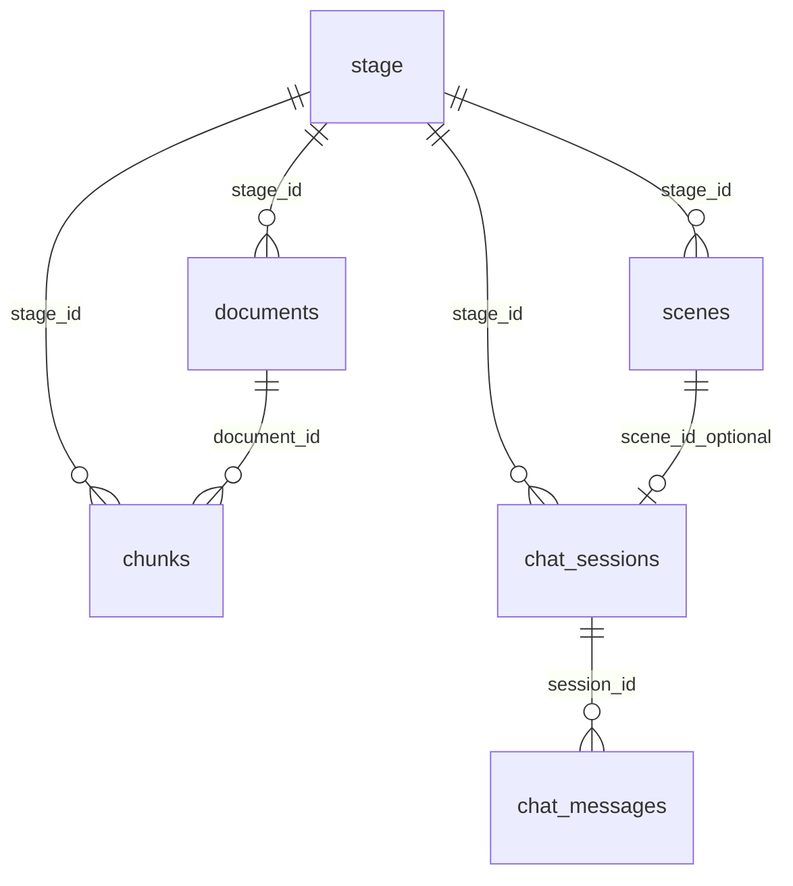

# MindFlow 数据模型（定稿 v1.7）

> 与 [PRD.md §6](./PRD.md#6-数据模型) 同步。Postgres + pgvector，Drizzle schema 见 `lib/db/schema.ts`。

## 设计原则

- **表名**：`stage`（不用 `courses`）；`chat_messages`（不用 `messages`）
- **大纲不落表**：执行稿 `stage.outlines` + Plan 蓝图 `stage.scene_outlines`，均为 JSONB
- **三态存储**：L0 `sessionStorage` 草稿 → L1 `stage` JSONB 工作副本 → L2 `scenes` 终态（见 [§6.1.4](./PRD.md#614-大纲与-plan-生命周期)）
- **不建表**：`users`、`agents`、`generation_jobs`、`chunk_embeddings`、`outlines`、`quiz_attempts`

## 表清单（6 张）

| # | 表名 | 职责 |
|---|------|------|
| 1 | `stage` | 课堂壳：需求、状态、双层大纲 JSONB、播放指针 |
| 2 | `scenes` | 已生成页：`content` + `actions` + 生成状态 |
| 3 | `chat_sessions` | 会话元数据（qa / discussion / lecture / outline） |
| 4 | `chat_messages` | 消息行 + RAG 引用 + Tool 元数据 |
| 5 | `documents` | PDF 元数据与原文摘要 |
| 6 | `chunks` | 分块文本 + pgvector `embedding` |

## 大纲与 Plan 生命周期（摘要）

| 对象 | L0 草稿 | L1 工作副本 | L2 终态 | scene ready 后 |
|------|---------|-------------|---------|----------------|
| **Plan**（P2 only） | sessionStorage | `stage.scene_outlines` | — | **长期保留** |
| **执行稿 Outline** | sessionStorage | `stage.outlines` | `scenes`（按 outline 生成） | **默认保留**；可选 `archived` |

**`outlines_status`**：`draft` → `confirmed` → `scenes_ready` → `archived`（可选）

- SSE 流式中：**不写 DB**，仅 L0
- SSE `done`：写 `stage.outlines`，`outlines_status = draft`
- 确认大纲：`POST /api/stages/[id]/outlines/confirm` → `confirmed`
- 全部 scene ready：`scenes_ready`（默认不清空 `outlines`）

## ER 关系

**逻辑关联**：`scenes.outline_id`（text）→ `stage.outlines[].id`，非 FK。

## 各表字段摘要

### `stage`

| 列 | 类型 | 说明 |
|----|------|------|
| `id` | uuid PK | |
| `name` | text | 课程标题 |
| `requirement` | text | 用户原始需求；**API 创建时必填**（≥10 字符）。DB 列可为 `DEFAULT ''`，实现待与 PRD §1.6 对齐 |
| `outlines` | jsonb | 执行稿 `SceneOutline[]`（L1 工作副本） |
| `outlines_status` | text | `draft` \| `confirmed` \| `scenes_ready` \| `archived` |
| `scene_outlines` | jsonb? | Plan 蓝图（Phase 2 only） |
| `outline_confirmed_at` | timestamptz? | Plan 冻结时间 |
| `generation_session_id` | int | 重新规划递增 |
| … | | 见 PRD §6.1 |

### `scenes`

课堂播放终态（L2）。`outline_id` 逻辑关联 `stage.outlines[].id`。

## 双层大纲

| JSONB 列 | 含义 | 生命周期 |
|----------|------|----------|
| `scene_outlines` | Phase 2 Plan | Planner `done` 写 L1；冻结后长期保留 |
| `outlines` | 执行稿 | SSE `done` 写 L1；确认后生成 scenes；默认长期保留 |

## 大纲 PATCH API

`PATCH /api/stages/[id]/outlines` — 详见 PRD §6.3。  
`POST /api/stages/[id]/outlines/confirm` — 确认大纲并开始 scene 生成。

## 相关文档

- [PRD.md](./PRD.md)
- [ARCHITECTURE-data.md](./ARCHITECTURE-data.md)
