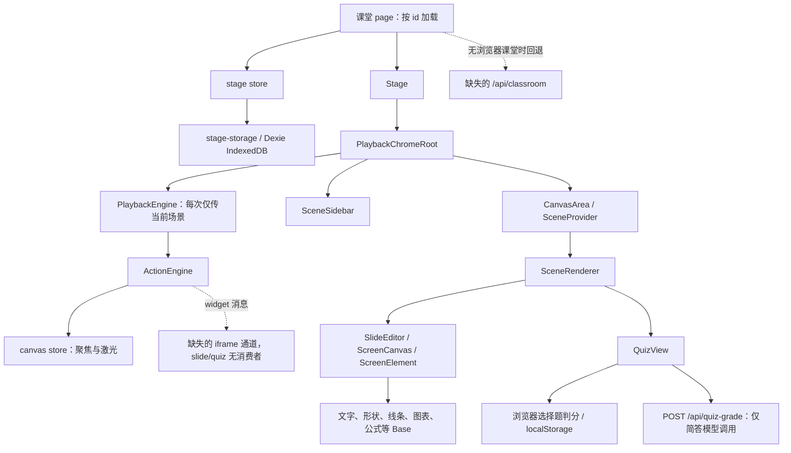

# 课堂播放与测验：源码盘点

本文件交付 [plan](./plan.md) 阶段一，供用户审阅后确定清理和适配范围。依据 [spec](./spec.md) CP-1～CP-13、[intent](../../intent.md) 及 ADR-001～005 判断；不修改需求、不展开后续 task、不表示 spec 已确认或功能已运行验收。

**结论：播放顺序、阅读计时、基础元素绘制、三类题目展示有可复用结构；数据权威、播放控制、教学动作落点、测验提交与恢复都不能按原源码直接交付。** 引入源码仍有静态断点，并没有接上现有 PostgreSQL 课堂主路径。不能通过继续整套导入编辑、音频、媒体、聊天或 IndexedDB 体系来补齐。

## 一、版本、范围与主路径

### 1.1 盘点快照

- 检查日期：2026-10-21（Asia/Shanghai）。MindFlow：`C:/Users/lxc/Desktop/MindFlow/mindflow`，HEAD 为 `cdbf5f02161be492a4c9e7944d32345b56186053`，标题“引入课堂播放源码”。
- 基线范围：该提交相对父提交的 **65 项变更：63 A、1 M、1 D；14,159 行新增、2 行删除**。逐文件目录见第二节，F 编号固定对应该提交文件顺序；行号均指本次快照，范围用 L 表示。
- 检查开始前已有改动：`docs/index.md` 已修改，`docs/features/课堂播放与测验/plan.md` 未跟踪。这两项不是本次盘点产生，不纳入本次修改。当前单元没有 tasks 文件。
- 来源快照：`C:/Users/lxc/Desktop/原项目/OpenMAIC-main`，HEAD 为 `e67b2be81396d4012f0eb244819dff22ae5a3214`；`git status --short` 无输出。下文用 **O/** 代表这个来源根目录，**M/** 代表 MindFlow 根目录；不读取密钥文件。
- 来源比对：统一 CRLF/LF 后，**62 个文件文本一致**；`ScreenCanvas.tsx` 只有缩进差异；`lib/types/action.ts` 是本项目既有类型上增补原项目的几何接口；删除项是 MindFlow 的空占位。每项来源均可在本地快照核对，没有整文件来源未定位项。相同文本证明本地对应关系，不证明实际导入时使用的上游历史版本。
- 异路径来源：M/`components/slide-renderer/hooks/useViewportSize.ts` ← O/`components/slide-renderer/Editor/Canvas/hooks/useViewportSize.ts`；其余除 M/D 特例外均为同路径来源。
### 1.2 实际引用主路径

以下为源码中的引用／调用关系，**不是已跑通的流程图**；缺失和契约不兼容详见各文件与第四节。

现有链没有连到 MindFlow 的课堂／场景读取服务。外壳还同步引用未引入的 Roundtable、ChatArea、settings、音频播放器；Stage 引用未引入的 Pro 编辑器和 iframe 宿主。讨论提示、字幕和播放控制与这些分支混在一起，需要拆职责，不能只删掉整个外壳。

### 1.3 可依托的现有 MindFlow 基础（不在 65 项内）

- `lib/types/scene.ts` 已定义 Scene、SceneContent、QuizQuestion、SlideCanvas；`lib/types/outline.ts` 定义定稿大纲。`lib/types/stage.ts` 是本项目课堂状态／建课 DTO，没有源项目 Stage、Scene、StageMode 等导出。应适配消费者，不覆盖现有类型。
- `prisma/schema.prisma` 已有 Stage、Scene 及 Stage.currentSceneId；当前没有测验提交、批改状态和结果模型。指针列存在不等于已提供播放位置保存能力，也不能与生成进度混用。
- `lib/db/queries/scenes.ts` 已有按课堂排序读场景、按课堂＋outline 读完整场景的查询；`lib/db/queries/stages.ts` 可读课堂。现有场景保存与读取校验见 `lib/validators/scenes.ts`、`lib/services/scene-generation.ts`。
- `GET /api/stages/[id]` 当前只给课堂需求／状态／文档摘要；`GET /api/stages/[id]/generation-preview` 给定稿大纲和首场状态，不是完整课堂播放／答题恢复接口。不能把任一现有 GET 直接当成所需闭环。
- `lib/ai/openai-compat.ts` 的 requireChatModel 从当次请求解析项目的 `x-mindflow-llm-…` 头；`lib/ai/llm.ts` 的 callLLM 只有两个参数。原项目简答请求头和四参数调用不兼容。
- `components/providers/theme-provider.tsx` 已导出 ThemeProvider；`lib/hooks/use-theme.ts` 只导出 useTheme。`lib/hooks/use-i18n.ts` 只返回 t，不返回 locale，多数课堂／测验文案键尚未提供。`lib/hooks/use-draft-cache.ts` 是首页已使用的 string 缓存，不是原项目的对象草稿接口。

## 二、65 项文件清单

“保留”表示职责／结构适合复用，仍受上层契约和集成验证约束；“适配”注明需要收敛或替换的职责；“排除”是本次建议，**没有执行删除**。同一文件可有多种结论。标为候选的能力不计入当前必需依赖或新增验收。

来源 SHA 为归一化换行后的 SHA-256 前 12 位，用于快速复核，完整路径以 O/ 为准。依赖列列出直接本地导入（含 re-export 和字面量动态导入）以及非 React/Next 的外部包；“缺”表示当前模块解析失败，“未声明”表示本项目 package.json 未声明。类型导入也计入静态依赖；“有文件”不代表导出或字段兼容。框架路由作为入口不要求有代码 import 消费者。

### 第一批：入口与数据状态（10 项）

#### F02 [A] `app/classroom/[id]/page.tsx`

- 来源：O/app/classroom/[id]/page.tsx；文本一致，SHA bcc72c81d403。关联 CP：1、5、10～13。接入：页面入口。
- **适配；排除媒体生成与自动 Agent 恢复分支**：保留按课堂 id 加载、加载失败重试及挂载课堂外壳的结构。39～84 行先读 IndexedDB，未命中时请求当前仓库不存在的 `/api/classroom`，所以这段入口没有接通 MindFlow 的服务端课堂读取。MindFlow 的 `Stage.outlines` 保存定稿大纲、`Scene` 表保存完整场景；但现有 `GET /api/stages/[id]` 只返回课堂元数据，`generation-preview` 只返回大纲和首个场景预览，没有供播放页读取完整场景的接口。答题来源代码把答案与判分结果保存在浏览器 `localStorage`；MindFlow 的 `/api/quiz-grade` 负责简答题判分，未保存可供恢复的答题记录。162～213 行自行启动续生成和媒体生成，前者归后台续生成单元，后者属非目标；不能为了入口可用补齐这些运行体系。ThemeProvider 应衔接现有主题提供者，不能覆盖现有 hook。证据：L37～128、L162～213、L215～246；MindFlow `prisma/schema.prisma`、`app/api/stages/[id]/route.ts`、`app/api/stages/[id]/generation-preview/route.ts`、`app/api/quiz-grade/route.ts`。
- 直接依赖：`@/components/stage`@L3；`@/lib/hooks/use-theme`@L4；`@/lib/store`@L5【缺】；`@/lib/utils/image-storage`@L6【缺】；`@/lib/hooks/use-scene-generator`@L9【缺】；`@/lib/store/media-generation`@L10【缺】；`@/lib/store/whiteboard-history`@L11【缺】；`@/lib/logger`@L12；`@/lib/contexts/media-stage-context`@L13；`@/lib/media/media-orchestrator`@L14【缺】；`@/lib/edit/slide-schema`@L15【缺】；`@/lib/types/stage`@L16；`@/lib/orchestration/registry/store`（动态）@L77【缺】；`@/lib/orchestration/registry/store`（动态）@L94【缺】；`@/lib/store/settings`（动态）@L96【缺】。

#### F42 [A] `components/stage.tsx`

- 来源：O/components/stage.tsx；文本一致，SHA 8f52ed81b17f。关联 CP：1～5。接入：主链：课堂页 → Stage。
- **适配；排除编辑切换、编辑锁与 interactive 宿主**：保留播放外壳挂载职责。80～134 行 Pro 切换、预加载和锁，159～172 行 EditChromeRoot、192～201 行冲突框及 iframe 宿主均不属于本单元；这些缺失模块不能整套补入。 证据：L47～134、L156～201。
- 直接依赖：`motion/react`@L4；`@/lib/store`@L5【缺】；`@/lib/edit/stage-mode`@L6【缺】；`@/lib/config/feature-flags`@L7【缺】；`@/components/edit/EditChromeRoot`@L8【缺】；`@/components/edit/PlaybackChromeRoot`@L9；`@/components/edit/use-edit-mode-lock`@L12；`@/components/edit/MultiTabEditConflictPrompt`@L13【缺】；`@/components/scene-renderers/InteractiveIframeHost`@L14【缺】；`@/lib/edit/transitions`@L15【缺】；`@/lib/edit/preload-editor`@L16【缺】。

#### F46 [D] `lib/actions/stages.ts`

- 来源：MindFlow 父提交 c9247ea 的同路径占位文件，原项目无同路径文件；归一化 SHA 197595636394。关联 CP：—。接入：已删除；无现存调用者。
- **排除（已在基线提交删除的占位项）**：父提交只有 TODO 注释和 export {}，不提供 Server Action 功能。删除没有移除课堂保存实现；不能把占位文件计为已实现能力或误判为丢失必须恢复的后端。 证据：cdbf5f0^ 中 L1～2；提交删除 diff。
- 直接依赖：无本地模块或非框架外部依赖。

#### F47 [A] `lib/contexts/media-stage-context.tsx`

- 来源：O/lib/contexts/media-stage-context.tsx；文本一致，SHA 013f05a2838d。关联 CP：—（非目标媒体能力）。接入：页面入口引用；当前引入文件中没有 useMediaStageId 消费者。
- **排除当前调用链**：仅为媒体渲染提供课堂 id，没有读取、播放位置或判分职责；退出媒体链时解除此 provider。不能把它误认为课堂归属校验或必需场景上下文。 证据：L12～18。
- 直接依赖：无本地模块或非框架外部依赖。

#### F48 [A] `lib/contexts/scene-context.tsx`

- 来源：O/lib/contexts/scene-context.tsx；文本一致，SHA 9fc994d3cf5e。关联 CP：2、4、12。接入：主链：CanvasArea → SceneProvider → 渲染器。
- **适配；保留只读场景订阅结构，排除播放改写内容**：保留 SceneProvider/useSceneSelector 的当前场景订阅，切换到本项目 Scene 类型。96～110 行通过 immer 和 updateScene 改写原始内容属于编辑职责；受控编辑 controller 不应成为播放依赖，需区分教学效果临时状态与保存内容。 证据：L55～130、L147～207。
- 直接依赖：`@/lib/store/stage`@L12；`@/lib/types/stage`@L13；`immer`@L14【未声明】。

#### F49 [A] `lib/hooks/use-draft-cache copy.ts`

- 来源：O/lib/hooks/use-draft-cache.ts；文本一致，SHA 2415e5e78ef7。关联 CP：10（候选缓存参考）。接入：未接入：无静态或字面量动态导入消费者。
- **排除重复副本；保留其缓存思路供参考**：来源是 OpenMAIC 的 use-draft-cache.ts，但 quiz-view 实际导入本仓库无 copy 的版本，两个契约不兼容。不能通过保留副本声称题目草稿已接通，也不能覆盖首页已使用的 string hook。CP-10 仅要求页面内切场保留输入，无须为此引入跨刷新草稿承诺。 证据：L20～110；quiz-view L23、L668～674。
- 直接依赖：无本地模块或非框架外部依赖。

#### F58 [A] `lib/store/stage.ts`

- 来源：O/lib/store/stage.ts；文本一致，SHA 58db10fdd7b8。关联 CP：1、5、8、10、12、13。接入：主链：外壳／上下文 → stage store；部分消费者的 barrel 路径尚缺。
- **适配；排除课堂编辑与生成调度职责**：保留 scenes、当前场景及定稿目录的页面状态和查询结构。新增、删除、排序和 updateScene 的内容写回不能由播放触发；保存应衔接服务端且能报告失败，不能沿用 500ms 防抖后只记日志。loadFromStorage 无数据时不清除旧课堂，存在跨课堂残留风险；addScene 在 pending 状态下自动切入新场景违反 CP-12。大纲和生成状态须作为其他单元结果消费，不能继续由此权威写入 IndexedDB。 证据：L118～225、L245～258、L297～374、L404～406。
- 直接依赖：`zustand`@L1；`@/lib/types/stage`@L2；`@/lib/utils/create-selectors`@L3；`@/lib/types/chat`@L4【缺】；`@/lib/types/generation`@L5【缺】；`@/lib/logger`@L6；`@/lib/store/canvas`@L7；`@/lib/edit/slide-schema`@L8【缺】；`@/lib/utils/database`（动态）@L250；`@/lib/utils/stage-storage`（动态）@L305；`@/lib/utils/stage-storage`（动态）@L329；`@/lib/utils/database`（动态）@L333。

#### F61 [A] `lib/utils/create-selectors.ts`

- 来源：O/lib/utils/create-selectors.ts；文本一致，SHA fdefa45cc9e9。关联 CP：2～5（共享 UI 基础）。接入：主链：stage/canvas store → 本文件。
- **保留**：纯 Zustand selector 包装，无数据库或模型依赖，可继续支撑细粒度界面订阅；不因当前消费者混有编辑职责而连带排除。 证据：L7～15。
- 直接依赖：`zustand`@L1。

#### F62 [A] `lib/utils/database.ts`

- 来源：O/lib/utils/database.ts；文本一致，SHA 7a58213934bf。关联 CP：1、5、8、10、12、13（替换边界）。接入：主链：store 动态导入／stage-storage → Dexie。
- **排除其权威存储及原项目数据库体系**：整个文件定义 MAIC-Database 的 IndexedDB 表与十版迁移，另有音频、媒体、Agent、快照和导入导出。它不是 MindFlow 的 lib/db/client；不迁入这些表来替代 PostgreSQL。缓存若后续确有需要须单独界定，不从本文件自动推导缓存需求。 证据：L196～385、L393～515。
- 直接依赖：`dexie`@L1【未声明】；`@/lib/types/stage`@L2；`@/lib/types/action`@L3；`@/lib/types/chat`@L4【缺】；`@/lib/types/generation`@L11【缺】；`ai`@L12；`@/lib/logger`@L13。

#### F65 [A] `lib/utils/stage-storage.ts`

- 来源：O/lib/utils/stage-storage.ts；文本一致，SHA ba7c825315d9。关联 CP：1、5、8、10、13（替换边界）。接入：主链：stage store 的动态导入 → 本文件。
- **适配读写边界；排除浏览器权威保存、缩略图与媒体恢复**：可参考课堂、场景、位置分组读写职责，不能沿用保存时先删全部场景再 bulkPut、吞读错误、用首场兜底但不提示的行为。聊天属于讨论单元；缩略图、媒体 object URL 恢复、浏览器历史管理不为本单元补齐。位置和内容应走现有服务端数据体系。 证据：L38～114、L120～176、L178～331。
- 直接依赖：`../types/stage`@L8；`../types/chat`@L9【缺】；`./database`@L10；`./chat-storage`@L11【缺】；`./playback-storage`@L12【缺】；`@/lib/quiz/persistence`@L13；`@/lib/logger`@L14。

### 第二批：播放与动作（12 项）

#### F03 [A] `components/canvas/canvas-area.tsx`

- 来源：O/components/canvas/canvas-area.tsx；文本一致，SHA 41d85c84d19c。关联 CP：2、3、5、12。接入：主链：播放外壳 → CanvasArea → SceneProvider → SceneRenderer。
- **适配；保留场景容器和状态展示，排除白板及生成操作**：保留画布容器、场景显示和加载／末页提示位置。当前写死外层 16:9，不能据此证明任意已保存 viewportRatio 都适配。pending 会替换当前场景；CP-5 要求未就绪目标保留当前可用场景。末页组件缺失，条件只看 isCourseComplete/pending，没有末场讲解结束门槛及未完成批改提示。 证据：L53～83、L96～171、L246～270。
- 直接依赖：`motion/react`@L4；`lucide-react`@L5；`@/lib/utils`@L6；`@/components/stage/scene-renderer`@L7；`@/lib/contexts/scene-context`@L8；`@/components/whiteboard`@L9【缺】；`@/components/canvas/canvas-toolbar`@L10；`@/components/canvas/canvas-toolbar`@L11；`@/lib/types/stage`@L12；`@/lib/hooks/use-i18n`@L13；`@/components/scene-renderers/classroom-complete`@L14【缺】。

#### F04 [A] `components/canvas/canvas-toolbar.tsx`

- 来源：O/components/canvas/canvas-toolbar.tsx；文本一致，SHA bbd1a5034012。关联 CP：3、5。接入：主链：CanvasArea 引用；playback 模式下外壳将其隐藏，控制转由未引入 Roundtable 承担。
- **适配；保留播放与前后场入口，排除音量、自动翻页、白板和真实讨论控制**：已有前后场、播放暂停及目录开关结构；onNextSlide 是下一场，不是下一段。没有独立重播本场、下一段接口。不能因工具栏文件存在就宣称所有 CP-3 控制可用；倍速／全屏不作为本次验收新增承诺。 证据：L24～71、L122～135、L278～370；外壳 L1235。
- 直接依赖：`lucide-react`@L4；`@/lib/utils`@L19；`@/lib/store`@L20【缺】；`@/lib/hooks/use-i18n`@L21；`@/components/ui/tooltip`@L22。

#### F05 [A] `components/edit/PlaybackChromeRoot.tsx`

- 来源：O/components/edit/PlaybackChromeRoot.tsx；文本一致，SHA b3008bdaf950。关联 CP：1、3～5、8、10～12。接入：主链：Stage → 本文件 → 引擎／画布／目录。
- **适配；保留播放生命周期，解除聊天、音频、编辑和生成耦合**：为单场创建引擎、字幕状态、暂停继续、切场清理可复用。autoStartRef 初始 false，普通进入／手动切场不直接 start；onComplete 的 1500ms 自动翻页／pending 行为须排除。按 currentScene 对象重建引擎需防内容更新打断播放。讨论触发不得强制真实聊天，Roundtable 当前还承载字幕和控制，不能整体删除而丢掉必需入口。未接 onProgress，未形成服务端位置保存；没有下一段控制。 无 actions 分支在停止旧引擎之前早退，后续还需核对切入异常内容时的旧播放清理。 证据：L244、L471～719、L884～978、L1169～1477。
- 直接依赖：`@/lib/store`@L12【缺】；`@/lib/store/stage`@L13；`@/lib/store/canvas`@L14；`@/lib/store/settings`@L15【缺】；`@/lib/hooks/use-i18n`@L16；`@/components/stage/scene-sidebar`@L17；`@/components/header`@L18；`@/components/canvas/canvas-area`@L19；`@/components/roundtable`@L20【缺】；`@/lib/playback`@L21；`@/lib/playback`@L22；`@/lib/action/engine`@L23；`@/lib/utils/audio-player`@L24【缺】；`@/lib/hooks/use-discussion-tts`@L25【缺】；`@/lib/store/widget-iframe`@L26【缺】；`@/components/roundtable/audio-indicator`@L27【缺】；`@/lib/types/action`@L28；`@/lib/utils`@L29；`@/components/chat/chat-area`@L32【缺】；`@/lib/orchestration/registry/store`@L33【缺】；`@/lib/orchestration/registry/types`@L34【缺】；`@/components/ui/alert-dialog`@L35【缺】；`lucide-react`@L43；`radix-ui`@L44。

#### F06 [A] `components/edit/use-edit-mode-lock.ts`

- 来源：O/components/edit/use-edit-mode-lock.ts；文本一致，SHA a3c2cbce8319。关联 CP：—（明确非目标）。接入：Stage 引用，属于 Pro 模式分支。
- **排除**：只做跨标签页幻灯片编辑锁。它不实现 CP-9 的服务端同题竞争提交，不能用本地编辑锁替代答题并发控制。锁工具缺失无需补齐。 证据：L31～79。
- 直接依赖：`nanoid`@L3；`@/lib/edit/edit-mode-lock`@L5【缺】。

#### F07 [A] `components/header.tsx`

- 来源：O/components/header.tsx；文本一致，SHA a45985eb7fb5。关联 CP：1、5。接入：主链：播放外壳 → Header。
- **适配**：标题和返回首页入口可复用；HeaderControls 缺失且承担 Pro 操作，应复用本项目合适的公共页头职责，不能引入原项目完整设置／编辑控制。 证据：L16～55。
- 直接依赖：`lucide-react`@L3；`@/lib/hooks/use-i18n`@L4；`@/lib/types/stage`@L6；`./stage/header-controls`@L7【缺】。

#### F44 [A] `components/stage/scene-sidebar.tsx`

- 来源：O/components/stage/scene-sidebar.tsx；文本一致，SHA 68f034cf2b83。关联 CP：1、5、12。接入：主链：播放外壳 → SceneSidebar。
- **适配；保留目录，排除缩略图与生成重试职责**：当前按 scenes 列已就绪页，再追加 generatingOutlines，未按定稿大纲逐项合并就绪状态。点击未就绪目录会选 __pending__，末页也可按内容数提前进入。需消费真实定稿结构与完整性；生成重试由后台续生成单元负责，ThumbnailSlide/Interactive 不为目录而补齐。 证据：L45～75、L150～205、L332～474。
- 直接依赖：`lucide-react`@L5；`@/lib/utils`@L16；`@/components/slide-renderer/components/ThumbnailSlide`@L17【缺】；`@/components/slide-renderer/components/ThumbnailInteractive`@L18【缺】；`@/lib/store`@L19【缺】；`@/lib/hooks/use-i18n`@L20；`@/lib/types/stage`@L21；`@/lib/store/stage`@L22。

#### F45 [A] `lib/action/engine.ts`

- 来源：O/lib/action/engine.ts；文本一致，SHA 725d26f86d8e。关联 CP：4、11。接入：主链：PlaybackEngine → ActionEngine。
- **适配；保留必要教学动作，排除白板、视频、音频与内容编辑**：spotlight/laser 设置及 clearEffects 有可复用结构；5 秒自动清效果与暂停保持画面的要求需一并核对。stage-api 缺失主要服务白板写入，不能整套补入。三类 widget 动作仅发 iframe 消息，当前 slide/quiz 没有对应消费；annotation 还丢弃了本项目的 content。需适配到实际元素／题目的临时教学效果，不能改答案或评分依据。异常／未知动作没有明确提示边界。 证据：L102～123、L137～254、L373～734、L740～782。
- 直接依赖：`@/lib/api/stage-api`@L22【缺】；`@/lib/api/stage-api`@L23【缺】；`@/lib/store/canvas`@L24；`@/lib/store/whiteboard-history`@L25【缺】；`@/lib/store/media-generation`@L26【缺】；`@/lib/i18n`@L27【缺】；`@/lib/utils/audio-player`@L28【缺】；`@/lib/types/action`@L29；`@/lib/types/slides`@L49；`katex`@L50；`@/lib/logger`@L51。

#### F51 [A] `lib/playback/derived-state.ts`

- 来源：O/lib/playback/derived-state.ts；文本一致，SHA 3a8eee44d0e7。关联 CP：3、4、5。接入：主链：播放外壳 → computePlaybackView。
- **适配；保留纯状态推导，收窄真实讨论状态**：纯函数把播放状态映射到字幕、角色和按钮状态，结构可复用。liveSpeech、chatIsStreaming、sessionType 等优先级来自原项目真实讨论，需收敛到讲稿播放和讨论提示；当前 completed 仅是单场完成，不代表课程完成。 证据：L77～212。
- 直接依赖：`./types`@L10。

#### F52 [A] `lib/playback/engine.ts`

- 来源：O/lib/playback/engine.ts；文本一致，SHA 888827b02046。关联 CP：1、3、4、5、10、11。接入：主链：播放外壳 → PlaybackEngine → ActionEngine。
- **适配；保留有序执行和阅读计时，排除音频、live 对话、跨场自动推进**：已有中文／词数阅读计时、剩余时间暂停恢复、顺序推进与 stop 清理。需要独立于 AudioPlayer/settings/TTS 工作；getCurrentAction 可跨场，当前外壳虽传单场，也不能沿用全课自动前进语义。缺下一段、播放中重播和失败提示／继续边界；discussion 延时显示但维持 playing，暂停后清掉 triggerDelayTimer 而未保存讨论触发，有恢复遗漏风险。异步播放／动作完成需防切场后旧回调生效。快照恢复不是服务端按场恢复。 证据：L118～253、L408～604；尤其 L473～520、L568～574。
- 直接依赖：`@/lib/types/stage`@L26；`@/lib/types/action`@L27；`./types`@L28；`@/lib/utils/audio-player`@L36【缺】；`@/lib/action/engine`@L37；`@/lib/store/canvas`@L38；`@/lib/store/settings`@L39【缺】；`@/lib/audio/provider-enablement`@L40【缺】；`@/lib/logger`@L41。

#### F53 [A] `lib/playback/index.ts`

- 来源：O/lib/playback/index.ts；文本一致，SHA 49576d79c480。关联 CP：3、4（共享导出）。接入：主链：播放外壳的 barrel 入口。
- **保留，随被导出类型适配**：仅 re-export types、engine、derived-state，无独立行为，不能把它与缺失的 lib/store/index.ts 混为同一断点。 证据：L1～3。
- 直接依赖：`./types`@L1；`./engine`@L2；`./derived-state`@L3。

#### F54 [A] `lib/playback/types.ts`

- 来源：O/lib/playback/types.ts；文本一致，SHA 8c38b6371ce0。关联 CP：3、4、5、10。接入：主链：playback 导出及引擎类型。
- **适配**：保留播放模式和字幕／效果／结束回调的类型结构。PlaybackSnapshot 指向缺失的浏览器 playback-storage；讨论回调与 Agent、倍速并非本单元契约，不应据此新增音频或聊天依赖。位置恢复以服务端当前场景为准。 证据：L5～62。
- 直接依赖：`@/lib/utils/playback-storage`@L5【缺】。

#### F59 [M] `lib/types/action.ts`

- 来源：O/lib/types/action.ts；仅增补几何接口，非整文件替换；M SHA d5e3e3fac29d，O SHA 347fe5e7821d。关联 CP：3、4。接入：已有类型基础；本次提交仅增补 PercentageGeometry。
- **保留本项目七类 Action；保留新增几何类型，适配消费者**：新增几何接口与原项目接口一致，未把原项目完整 Action 联合带入，这是应维持的边界。引擎仍引用 audioId、audioUrl、dimOpacity、agentId 及白板／视频等不存在字段或类型；应收窄引擎而非覆盖本文件来迎合源项目。 证据：提交 diff + 当前 L1～73；OpenMAIC L297～304。
- 直接依赖：无本地模块或非框架外部依赖。

### 第三批：幻灯片渲染（39 项）

#### F09 [A] `components/slide-renderer/Editor/HighlightOverlay.tsx`

- 来源：O/components/slide-renderer/Editor/HighlightOverlay.tsx；文本一致，SHA c4e3996dd388。关联 CP：4。接入：主链：ScreenCanvas → HighlightOverlay。
- **适配；保留遮罩绘制**：读取高亮 id 和 options，按元素位置／旋转绘制覆盖层。应接本项目场景类型及教学效果；它不消费 iframe 的 widget_highlight，不能据此声称组件或题目高亮已接通。线条被排除、非法目标无提示，需覆盖动作异常边界。 证据：L24～43、L47～94。
- 直接依赖：`@/lib/contexts/scene-context`@L4；`@/lib/store/canvas`@L5；`@/lib/types/stage`@L6；`@/lib/types/slides`@L7。

#### F10 [A] `components/slide-renderer/Editor/LaserOverlay.tsx`

- 来源：O/components/slide-renderer/Editor/LaserOverlay.tsx；文本一致，SHA 0b36fb5eeb7a。关联 CP：4。接入：主链：ScreenCanvas → LaserOverlay。
- **保留绘制结构；适配调用方几何输入**：纯百分比中心点动画，无存储／模型依赖，可复用。duration 参数当前被命名为 _duration、没有参与动画；不据此新增时间精度承诺，几何定位与缩放需另验。 证据：L14～82。
- 直接依赖：`motion/react`@L3；`@/lib/types/action`@L4。

#### F11 [A] `components/slide-renderer/Editor/ScreenCanvas.tsx`

- 来源：O/components/slide-renderer/Editor/ScreenCanvas.tsx；仅缩进差异；M SHA e2a0a3ae6c14，O SHA bd75db6b5f2c。关联 CP：2、4。接入：主链：SlideEditor → ScreenCanvas；视口 hook 导入断开。
- **适配**：图层、等比缩放、背景和效果叠加可复用；来源差异仅 71～74 行缩进。useViewportSize 已存在于 hooks 目录，却仍导入原 Canvas/hooks 路径。canvasScale/viewportSize/viewportRatio 需要与当前保存的画布一致；当前没有找到从场景画布同步到 store 的接线。laser 计算未传真实视口，空白背景忽略 theme.backgroundColor，须核对展示差距。 证据：L14～32、L40～58、L61～118。
- 直接依赖：`./ScreenElement`@L3；`./HighlightOverlay`@L4；`./SpotlightOverlay`@L5；`./LaserOverlay`@L6；`@/lib/hooks/use-slide-background-style`@L7；`@/lib/store`@L8【缺】；`@/lib/contexts/scene-context`@L9；`@/lib/utils/geometry`@L10；`@/lib/types/stage`@L11；`@/lib/types/slides`@L12；`@/lib/types/action`@L13；`./Canvas/hooks/useViewportSize`@L14【缺】；`motion/react`@L16。

#### F12 [A] `components/slide-renderer/Editor/ScreenElement.tsx`

- 来源：O/components/slide-renderer/Editor/ScreenElement.tsx；文本一致，SHA 0f6b4c46af0f。关联 CP：2、4。接入：主链：ScreenCanvas → 本文件 → 各 Base 元素。
- **适配；保留必需元素分发**：按保存次序分配 zIndex、读取主题可复用。未知类型返回 null 没有提示；静态引用缺失的图像和视频 Base，视频明确排除，不能连带补媒体生成。code/table 分支属于当前契约外的展示候选，不是 CP-2 必须；处理方向见 D8。 证据：L25～56、L59～69。
- 直接依赖：`@/lib/types/slides`@L3；`../components/element/ImageElement/BaseImageElement`@L6【缺】；`../components/element/TextElement/BaseTextElement`@L7；`../components/element/ShapeElement/BaseShapeElement`@L8；`../components/element/LineElement/BaseLineElement`@L9；`../components/element/ChartElement/BaseChartElement`@L10；`../components/element/LatexElement/BaseLatexElement`@L11；`../components/element/TableElement/BaseTableElement`@L12；`../components/element/VideoElement/BaseVideoElement`@L13【缺】；`../components/element/CodeElement/BaseCodeElement`@L14；`@/lib/contexts/scene-context`@L15；`@/lib/types/stage`@L16。

#### F13 [A] `components/slide-renderer/Editor/SpotlightOverlay.tsx`

- 来源：O/components/slide-renderer/Editor/SpotlightOverlay.tsx；文本一致，SHA 0bc3bc001ccc。关联 CP：4。接入：主链：ScreenCanvas → SpotlightOverlay。
- **适配；保留 DOM 测量与 SVG 遮罩**：通过 screen-element-id 查 DOM 相对位置绘制聚焦，可沿用。useLayoutEffect 只依赖 measure/elements，尚无随容器 resize 重测的接线；目标不存在返回空，需提示。不能把这些静态结构当作窗口缩放下效果已验收。 证据：L28～73、L76～170。
- 直接依赖：`motion/react`@L4；`@/lib/contexts/scene-context`@L5；`@/lib/store/canvas`@L6；`@/lib/types/stage`@L7；`@/lib/types/slides`@L8。

#### F14 [A] `components/slide-renderer/Editor/index.tsx`

- 来源：O/components/slide-renderer/Editor/index.tsx；文本一致，SHA 1a06bc847eaf。关联 CP：2。接入：主链：SceneRenderer → SlideEditor。
- **适配；仅保留展示入口**：playback 走 ScreenCanvas；autonomous 才走未引入的 Canvas。静态导入 Canvas 仍阻断解析，需要解除该非目标分支，不能以文件位于 Editor 目录为由删掉展示入口。 证据：L3～18。
- 直接依赖：`./Canvas`@L3【缺】；`@/lib/types/stage`@L4；`./ScreenCanvas`@L5。

#### F15 [A] `components/slide-renderer/components/element/ChartElement/BaseChartElement.tsx`

- 来源：O/components/slide-renderer/components/element/ChartElement/BaseChartElement.tsx；文本一致，SHA 9b35b5331879。关联 CP：2。接入：主链：ScreenElement → BaseChartElement → Chart。
- **保留静态容器；适配底层图表输入边界**：按已保存位置／旋转显示图表并传颜色、描边及数据，不承担编辑。完整可用依赖 Chart 和 chartOption 的类型收敛及依赖处理。 证据：L14～55。
- 直接依赖：`@/lib/types/slides`@L3；`../ElementOutline`@L4；`./Chart`@L5。

#### F16 [A] `components/slide-renderer/components/element/ChartElement/Chart.tsx`

- 来源：O/components/slide-renderer/components/element/ChartElement/Chart.tsx；文本一致，SHA 32eb699b11c9。关联 CP：2。接入：主链：BaseChartElement → Chart。
- **适配；保留 ECharts 展示与销毁结构**：注册图表和 SVGRenderer，ResizeObserver resize、卸载 dispose 可复用。echarts/tinycolor2 未在本项目声明；需要先界定实际保留能力，后续再处理依赖。没有有效 option 时静默不更新，需明确图表不支持／错误提示。 证据：L10～26、L51～112。
- 直接依赖：`tinycolor2`@L4【未声明】；`@/lib/types/slides`@L5；`./chartOption`@L6；`echarts/core`@L8【未声明】；`echarts/charts`@L9【未声明】；`echarts/components`@L10【未声明】；`echarts/renderers`@L11【未声明】。

#### F17 [A] `components/slide-renderer/components/element/ChartElement/chartOption.ts`

- 来源：O/components/slide-renderer/components/element/ChartElement/chartOption.ts；文本一致，SHA 63139b948fc7。关联 CP：2。接入：主链：Chart → getChartOption。
- **适配；保留纯图表 option 转换**：覆盖八类图表，数据检查失败或未知类型返回 null。当前保存 schema 的 chartType 为任意非空字符串、data 只要求非空 JSON，与 labels/legends/series 假设不一致，需显示边界校验和降级；不改生成事实来强行迎合渲染器。 证据：L24～74、L175～177、L320～354。
- 直接依赖：`echarts/core`@L1【未声明】；`echarts/charts`@L2【未声明】；`@/lib/types/slides`@L9。

#### F18 [A] `components/slide-renderer/components/element/ChartElement/index.tsx`

- 来源：O/components/slide-renderer/components/element/ChartElement/index.tsx；文本一致，SHA eeac28da1264。关联 CP：2（可用展示已在 Base）。接入：未接入当前播放链：无直接导入或 re-export 消费者。
- **排除编辑包装职责**：图表选择事件和展示，展示已由 BaseChartElement 覆盖。不为该文件补选择、历史或编辑依赖；其中 re-export 的 Base 由 ScreenElement 直接引用，不依赖这个包装入口。对 Table 不新增表格验收，见 D8。 证据：全文件；导入图反向核对。
- 直接依赖：`@/lib/types/slides`@L3；`../ElementOutline`@L4；`./Chart`@L5；`./BaseChartElement`@L7。

#### F19 [A] `components/slide-renderer/components/element/CodeElement/BaseCodeElement.tsx`

- 来源：O/components/slide-renderer/components/element/CodeElement/BaseCodeElement.tsx；文本一致，SHA 3a9096fcd2d9。关联 CP：—（当前生成／验收未要求）。接入：ScreenElement 静态引用，但本项目保存 schema 不接受 code 元素。
- **适配候选；不为其扩大当前交付范围**：这是独立静态代码展示和增量打字动画，不是 Pro 编辑器。shiki 未声明，代码内容有 escapeHtml 回退。不能因 code 名称判作编辑专属，也不能把独立展示能力自动加入 CP-2；暂按 D8 记录候选，后续清理需确认是否保留兼容分支。 证据：L10～63、L366～555、L682～713。
- 直接依赖：`motion/react`@L4；`@/lib/types/slides`@L5；`shiki`（动态）@L14【未声明】。

#### F20 [A] `components/slide-renderer/components/element/ElementOutline.tsx`

- 来源：O/components/slide-renderer/components/element/ElementOutline.tsx；文本一致，SHA 91d83dc1089d。关联 CP：2。接入：主链：文字／图表 Base → 本文件。
- **保留**：按 width、height 和 outline 绘制 SVG 描边，复用实线／虚线样式，无编辑职责。 证据：L13～39。
- 直接依赖：`@/lib/types/slides`@L3；`./hooks/useElementOutline`@L4。

#### F21 [A] `components/slide-renderer/components/element/LatexElement/BaseLatexElement.tsx`

- 来源：O/components/slide-renderer/components/element/LatexElement/BaseLatexElement.tsx；文本一致，SHA e43e2f580138。关联 CP：2。接入：主链：ScreenElement → BaseLatexElement。
- **适配；保留公式 HTML／SVG 展示**：有公式自然尺寸测量和等比缩放、HTML 与 SVG 回退分支。原始 html 直接注入且未验证内容；KaTeX 已是声明依赖，但当前全局入口未见 katex CSS 导入，样式正确性待后续浏览器验收。 证据：L18～56、L77～119。
- 直接依赖：`@/lib/types/slides`@L4。

#### F22 [A] `components/slide-renderer/components/element/LatexElement/index.tsx`

- 来源：O/components/slide-renderer/components/element/LatexElement/index.tsx；文本一致，SHA 0e668b6a9fd7。关联 CP：2（可用展示已在 Base）。接入：未接入当前播放链：无直接导入或 re-export 消费者。
- **排除编辑包装职责**：公式选择事件和展示，展示已由 BaseLatexElement 覆盖。不为该文件补选择、历史或编辑依赖；其中 re-export 的 Base 由 ScreenElement 直接引用，不依赖这个包装入口。对 Table 不新增表格验收，见 D8。 证据：全文件；导入图反向核对。
- 直接依赖：`@/lib/types/slides`@L4；`./BaseLatexElement`@L6。

#### F23 [A] `components/slide-renderer/components/element/LineElement/BaseLineElement.tsx`

- 来源：O/components/slide-renderer/components/element/LineElement/BaseLineElement.tsx；文本一致，SHA 1b06cc4b18fb。关联 CP：2。接入：主链：ScreenElement → BaseLineElement。
- **保留线条展示与资源清理结构**：复用 SVG 路径、虚实线、箭头及阴影；animate 只控制本地描线，计时器有清理，不写原始场景。需由上层完成类型衔接，不将其依赖的 element 工具整体排除。 证据：L17～145。
- 直接依赖：`@/lib/types/slides`@L4；`@/lib/utils/element`@L5；`../hooks/useElementShadow`@L6；`./LinePointMarker`@L7。

#### F24 [A] `components/slide-renderer/components/element/LineElement/LinePointMarker.tsx`

- 来源：O/components/slide-renderer/components/element/LineElement/LinePointMarker.tsx；文本一致，SHA a04c8e724a1b。关联 CP：2。接入：主链：BaseLineElement → 本文件。
- **保留**：按元素 id、端点和类型生成箭头／圆点 SVG marker，纯展示共享基础。无编辑、存储、网络行为。 证据：L13～45。
- 直接依赖：`@/lib/types/slides`@L1。

#### F25 [A] `components/slide-renderer/components/element/LineElement/index.tsx`

- 来源：O/components/slide-renderer/components/element/LineElement/index.tsx；文本一致，SHA a92a0d0ecb3b。关联 CP：2（可用展示已在 Base）。接入：未接入当前播放链：无直接导入或 re-export 消费者。
- **排除编辑包装职责**：线条选择及宽透明命中路径，展示已由 BaseLineElement 覆盖。不为该文件补选择、历史或编辑依赖；其中 re-export 的 Base 由 ScreenElement 直接引用，不依赖这个包装入口。对 Table 不新增表格验收，见 D8。 证据：全文件；导入图反向核对。
- 直接依赖：`@/lib/types/slides`@L4；`@/lib/utils/element`@L5；`../hooks/useElementShadow`@L6；`./LinePointMarker`@L7；`./BaseLineElement`@L9。

#### F26 [A] `components/slide-renderer/components/element/ProsemirrorEditor.tsx`

- 来源：O/components/slide-renderer/components/element/ProsemirrorEditor.tsx；文本一致，SHA 56a17dfefb35。关联 CP：—（幻灯片编辑非目标）。接入：仅被未接入的 Text/Shape 编辑包装引用。
- **排除**：包括富文本命令、格式刷、焦点、热键、selection 同步和文档写回，静态展示不需要。不要为了它补 prosemirror 包、编辑 store、emitter、commands 或 hotkey。canvas store 对 prosemirror/utils 的初始化依赖须解除，不能误判本组件是播放必需。 证据：L76～127、L172～433、L468～554。
- 直接依赖：`lodash`@L4【未声明】；`@/lib/store`@L5【缺】；`prosemirror-view`@L6【未声明】；`prosemirror-commands`@L7【未声明】；`@/lib/prosemirror`@L8【缺】；`@/lib/prosemirror/utils`@L9【缺】；`@/lib/utils/emitter`@L18【缺】；`@/lib/prosemirror/commands/setTextAlign`@L23【缺】；`@/lib/prosemirror/commands/setTextIndent`@L24【缺】；`@/lib/prosemirror/commands/toggleList`@L25【缺】；`@/lib/prosemirror/commands/setListStyle`@L26【缺】；`@/lib/prosemirror/commands/replaceText`@L27【缺】；`@/lib/prosemirror/active-editor-registry`@L28【缺】；`@/lib/prosemirror/selection-sync`@L32【缺】；`@/lib/types/edit`@L33【缺】；`@/configs/hotkey`@L34【缺】。

#### F27 [A] `components/slide-renderer/components/element/ShapeElement/BaseShapeElement.tsx`

- 来源：O/components/slide-renderer/components/element/ShapeElement/BaseShapeElement.tsx；文本一致，SHA 4ad7fae5b915。关联 CP：2。接入：主链：ScreenElement → BaseShapeElement。
- **适配；保留 SVG 形状及文字展示**：复用 fill/outline/shadow/flip 及 SVG 路径。viewBox 必须核对与当前可为字符串的保存形状的兼容；内嵌文字同样使用原始 HTML，需受控显示，不能连带引入形状编辑器。 证据：L17～33、L75～87、L111。
- 直接依赖：`@/lib/types/slides`@L3；`../hooks/useElementOutline`@L4；`../hooks/useElementShadow`@L5；`../hooks/useElementFlip`@L6；`../hooks/useElementFill`@L7；`./GradientDefs`@L8；`./PatternDefs`@L9。

#### F28 [A] `components/slide-renderer/components/element/ShapeElement/GradientDefs.tsx`

- 来源：O/components/slide-renderer/components/element/ShapeElement/GradientDefs.tsx；文本一致，SHA fec18ea4abed。关联 CP：2。接入：主链：BaseShapeElement → 本文件。
- **保留**：定义线性／径向 SVG 渐变和色标，属于形状填充共享基础；无需编辑器。 证据：L12～35。
- 直接依赖：`@/lib/types/slides`@L1。

#### F29 [A] `components/slide-renderer/components/element/ShapeElement/PatternDefs.tsx`

- 来源：O/components/slide-renderer/components/element/ShapeElement/PatternDefs.tsx；文本一致，SHA d84992d4c30d。关联 CP：2（兼容样式候选）。接入：BaseShapeElement 在已有 pattern 字段时引用。
- **保留为样式基础；不新增图片生成能力**：只定义图案填充的 SVG image；资源来源与受控 URL 要在展示边界核对。现行 shape schema 允许扩展字段，不应因“图片生成不做”就把所有已有图案填充直接删掉。 证据：L6～18。
- 直接依赖：无本地模块或非框架外部依赖。

#### F30 [A] `components/slide-renderer/components/element/ShapeElement/index.tsx`

- 来源：O/components/slide-renderer/components/element/ShapeElement/index.tsx；文本一致，SHA 5fa6c570cad6。关联 CP：2（可用展示已在 Base）。接入：未接入当前播放链：无直接导入或 re-export 消费者。
- **排除编辑包装职责**：双击修改形状文字、历史快照、画布写操作和 ProseMirror。不为该文件补选择、历史或编辑依赖；其中 re-export 的 Base 由 ScreenElement 直接引用，不依赖这个包装入口。对 Table 不新增表格验收，见 D8。 证据：全文件；导入图反向核对。
- 直接依赖：`@/lib/types/slides`@L4；`@/lib/store`@L5【缺】；`@/lib/hooks/use-canvas-operations`@L6【缺】；`@/lib/hooks/use-history-snapshot`@L7【缺】；`../hooks/useElementShadow`@L8；`../hooks/useElementFlip`@L9；`../hooks/useElementFill`@L10；`../hooks/useElementOutline`@L11；`./GradientDefs`@L12；`./PatternDefs`@L13；`../ProsemirrorEditor`@L14；`./BaseShapeElement`@L16。

#### F31 [A] `components/slide-renderer/components/element/TableElement/BaseTableElement.tsx`

- 来源：O/components/slide-renderer/components/element/TableElement/BaseTableElement.tsx；文本一致，SHA 03ace4f7ad18。关联 CP：—（当前生成／验收未要求）。接入：ScreenElement 静态引用，但保存 schema 不接受 table 元素。
- **适配候选；不扩大当前范围**：纯表格容器，没有编辑行为；能力是否保留须与表格候选一起核对，不能为了渲染器齐全自动扩大验收。 证据：L14～35。
- 直接依赖：`@/lib/types/slides`@L3；`./StaticTable`@L4。

#### F32 [A] `components/slide-renderer/components/element/TableElement/StaticTable.tsx`

- 来源：O/components/slide-renderer/components/element/TableElement/StaticTable.tsx；文本一致，SHA 70623b596f5d。关联 CP：—（表格候选共享基础）。接入：仅 BaseTableElement／表格包装引用。
- **保留候选展示结构；适配受控内容**：复用单元格、合并单元格、主题、边框的只读展示，非编辑器；formatText 后直接注入 HTML，并未转义。若不保留表格入口，只随该专属依赖退出当前链，不影响图表或线条。 证据：L16～76、L90～116。
- 直接依赖：`@/lib/types/slides`@L4；`@/lib/utils/element`@L5；`./tableUtils`@L6。

#### F33 [A] `components/slide-renderer/components/element/TableElement/index.tsx`

- 来源：O/components/slide-renderer/components/element/TableElement/index.tsx；文本一致，SHA e7b5f24c7a74。关联 CP：—（当前非必需元素）。接入：未接入当前播放链：无直接导入或 re-export 消费者。
- **排除编辑包装职责**：表格选择事件和 StaticTable 包装。不为该文件补选择、历史或编辑依赖；其中 re-export 的 Base 由 ScreenElement 直接引用，不依赖这个包装入口。对 Table 不新增表格验收，见 D8。 证据：全文件；导入图反向核对。
- 直接依赖：`@/lib/types/slides`@L3；`./StaticTable`@L4；`./BaseTableElement`@L6。

#### F34 [A] `components/slide-renderer/components/element/TableElement/tableUtils.ts`

- 来源：O/components/slide-renderer/components/element/TableElement/tableUtils.ts；文本一致，SHA 3f6de795866e。关联 CP：—（表格候选共享基础）。接入：仅 StaticTable 引用。
- **保留纯计算候选；适配文字处理**：getHiddenCells 与 getTextStyle 是只读布局工具；formatText 只替换空格／换行，不是清洗函数。是否纳入当前链随 D8 的表格结论，不提前删除或补功能。 证据：L4～67。
- 直接依赖：`@/lib/types/slides`@L2。

#### F35 [A] `components/slide-renderer/components/element/TextElement/BaseTextElement.tsx`

- 来源：O/components/slide-renderer/components/element/TextElement/BaseTextElement.tsx；文本一致，SHA d69366de5452。关联 CP：2。接入：主链：ScreenElement → BaseTextElement。
- **适配；保留静态布局与样式**：直接展示已保存文字，保留位置、字体、阴影与描边。L57 直接插入 content HTML，当前验证器只要求非空；需要受控 HTML 边界，不能以 React 默认转义推定安全，也无需引入 ProseMirror 来实现静态展示。 证据：L16～63，尤其 L57。
- 直接依赖：`@/lib/types/slides`@L3；`../hooks/useElementShadow`@L4；`../ElementOutline`@L5。

#### F36 [A] `components/slide-renderer/components/element/TextElement/index.tsx`

- 来源：O/components/slide-renderer/components/element/TextElement/index.tsx；文本一致，SHA 06ed71f2057d。关联 CP：2（可用展示已在 Base）。接入：未接入当前播放链：无直接导入或 re-export 消费者。
- **排除编辑包装职责**：富文本编辑、测量后写回尺寸、删空文字及历史快照，均不属于播放。当前没有直接消费者；ScreenElement 直接导入 BaseTextElement，不需要该包装。不能为其补 lodash、ProseMirror、canvas-operations 或 history-snapshot。 证据：全文件；导入图反向核对。
- 直接依赖：`lodash`@L4【未声明】；`@/lib/store`@L5【缺】；`@/lib/hooks/use-history-snapshot`@L6【缺】；`@/lib/types/slides`@L7；`../hooks/useElementShadow`@L8；`../ElementOutline`@L9；`../ProsemirrorEditor`@L10；`@/lib/hooks/use-canvas-operations`@L11【缺】。

#### F37 [A] `components/slide-renderer/components/element/hooks/useElementFill.ts`

- 来源：O/components/slide-renderer/components/element/hooks/useElementFill.ts；文本一致，SHA faae8f6b3c55。关联 CP：2。接入：主链：基础元素渲染器 → 样式 hook。
- **保留**：按 pattern／gradient／fill 选 SVG 填充，并带来源前缀避免 id 混用；纯样式计算，无编辑、保存或模型行为，是必需展示共享基础。 证据：全文件。
- 直接依赖：`@/lib/types/slides`@L2。

#### F38 [A] `components/slide-renderer/components/element/hooks/useElementFlip.ts`

- 来源：O/components/slide-renderer/components/element/hooks/useElementFlip.ts；文本一致，SHA 2f837e275123。关联 CP：2。接入：主链：基础元素渲染器 → 样式 hook。
- **保留**：把 flipH/flipV 转换为 CSS 变换；纯样式计算，无编辑、保存或模型行为，是必需展示共享基础。 证据：全文件。
- 直接依赖：无本地模块或非框架外部依赖。

#### F39 [A] `components/slide-renderer/components/element/hooks/useElementOutline.ts`

- 来源：O/components/slide-renderer/components/element/hooks/useElementOutline.ts；文本一致，SHA aa388900f19c。关联 CP：2。接入：主链：基础元素渲染器 → 样式 hook。
- **保留**：把描边宽度、颜色、虚实线转换为 SVG 属性；纯样式计算，无编辑、保存或模型行为，是必需展示共享基础。 证据：全文件。
- 直接依赖：`@/lib/types/slides`@L2。

#### F40 [A] `components/slide-renderer/components/element/hooks/useElementShadow.ts`

- 来源：O/components/slide-renderer/components/element/hooks/useElementShadow.ts；文本一致，SHA 9e02777e5c44。关联 CP：2。接入：主链：基础元素渲染器 → 样式 hook。
- **保留**：把偏移、模糊和颜色转换为阴影样式；纯样式计算，无编辑、保存或模型行为，是必需展示共享基础。 证据：全文件。
- 直接依赖：`@/lib/types/slides`@L2。

#### F41 [A] `components/slide-renderer/hooks/useViewportSize.ts`

- 来源：O/components/slide-renderer/Editor/Canvas/hooks/useViewportSize.ts；文本一致，SHA 637f17995336。关联 CP：2。接入：未接入：ScreenCanvas 引用的是另一不存在路径。
- **适配；保留缩放与 ResizeObserver，排除编辑拖拽职责**：源文件在 OpenMAIC 的 Editor/Canvas/hooks/useViewportSize.ts，文本一致。已有等比适配算法，应该修调用而非复制第二份。需要解除缺失 barrel 并接保存的视口；dragViewport 和编辑缩放状态不应成为基础播放必需能力。 证据：L15～44、L79～113、L116～165。
- 直接依赖：`@/lib/store`@L2【缺】。

#### F43 [A] `components/stage/scene-renderer.tsx`

- 来源：O/components/stage/scene-renderer.tsx；文本一致，SHA a3d39e4a6f7e。关联 CP：2、6、7。接入：主链：CanvasArea → 本文件。
- **适配；保留 slide/quiz 分发，排除 interactive/PBL**：场景类型及 content.type 守卫可复用。SlideEditor 实际走展示画布；interactive/PBL 的静态导入即使不执行也造成缺失依赖，不应补齐。非法／未知内容目前仅英文文本，需满足可理解提示并保留其余可用内容。 证据：L5～40。
- 直接依赖：`@/lib/types/stage`@L4；`../slide-renderer/Editor`@L5；`../scene-renderers/quiz-view`@L6；`../scene-renderers/interactive-renderer`@L7【缺】；`../scene-renderers/pbl-renderer`@L8【缺】。

#### F50 [A] `lib/hooks/use-slide-background-style.ts`

- 来源：O/lib/hooks/use-slide-background-style.ts；文本一致，SHA 15161248c226。关联 CP：2。接入：主链：ScreenCanvas → 本文件。
- **保留纯样式转换；适配缺省主题与可接受数据**：solid/gradient 背景转换符合已有画布。image 背景分支不等同图片生成，但本项目现行保存 schema 只接受 solid/gradient；不新增图片来源。无 background 时返回白色，需由展示边界核对保存 theme.backgroundColor。 证据：L7～54。
- 直接依赖：`@/lib/types/slides`@L2。

#### F57 [A] `lib/store/canvas.ts`

- 来源：O/lib/store/canvas.ts；文本一致，SHA 93e25c4b368f。关联 CP：2～4。接入：主链：视口、引擎和覆盖层共享状态。
- **适配；保留视口与教学效果，排除编辑、白板、视频状态**：保持临时 UI 状态的思路，选取 canvasScale/viewport、spotlight/highlight/laser 与 clearAllEffects。当前初始 viewport 是 1000/0.5625，richTextAttrs 的运行时初始化还导入缺失 prosemirror/utils；必须解除这种编辑依赖，不能把整个 canvas store 连带删除。 证据：L17～214、L217～469。
- 直接依赖：`zustand`@L1；`@/lib/utils/create-selectors`@L2；`@/lib/prosemirror/utils`@L3【缺】；`@/lib/prosemirror/utils`@L4【缺】；`@/lib/types/edit`@L5【缺】；`@/lib/types/action`@L6。

#### F60 [A] `lib/types/slides.ts`

- 来源：O/lib/types/slides.ts；文本一致，SHA a91f2340052d。关联 CP：2、4。接入：Base 渲染器与工具的类型基础。
- **适配；保留显示所需字段，避免第二套领域事实类型**：含完整 PPTElement 联合、样式、表格／代码／媒体、动画与模板。当前 MindFlow Scene/SlideCanvas 的权威类型在 lib/types/scene.ts；例如 shape.viewBox 可为字符串而源渲染器按元组下标计算。需确认兼容映射，不覆盖当前领域类型或因完整联合而扩展产品范围。 证据：L25～36、L130～138、L380～397、L704～868。
- 直接依赖：无本地模块或非框架外部依赖。

#### F63 [A] `lib/utils/element.ts`

- 来源：O/lib/utils/element.ts；文本一致，SHA 6e160161dc4f。关联 CP：2。接入：主链：BaseLine → getLineElementPath；表格候选 → 配色。
- **适配；保留线条路径等实际展示工具，排除复制／对齐编辑职责**：线段／折线／曲线与阴影范围等几何纯函数可复用；createSlideIdMap/createElementIdMap 产生新 id 的复制逻辑、对齐辅助非播放必需。getTableSubThemeColor 用 tinycolor2；不能因为工具文件有编辑方法就删掉线条所需函数。 证据：L21～172、L179～215、L222～258。
- 直接依赖：`tinycolor2`@L1【未声明】；`nanoid`@L2；`@/lib/types/slides`@L3。

#### F64 [A] `lib/utils/geometry.ts`

- 来源：O/lib/utils/geometry.ts；文本一致，SHA 39b98ab2b461。关联 CP：4。接入：主链：ScreenCanvas → findElementGeometry。
- **适配；保留定位计算**：从元素计算百分比可复用，但默认宽度 1000、高度固定宽度×0.5625；调用方没有带实际视口，另有 5% 内边距。CP-4 需要效果与对应元素一致，须按保存画布坐标核对，不能直接保留常量假设；找不到目标不能静默当成功。 证据：L11～85；ScreenCanvas L40～58、L105。
- 直接依赖：`@/lib/types/slides`@L1；`@/lib/types/action`@L2。

### 第四批：测验（4 项）

#### F01 [A] `app/api/quiz-grade/route.ts`

- 来源：O/app/api/quiz-grade/route.ts；文本一致，SHA 83ed3f2ded63。关联 CP：7～9、11、13。接入：独立 HTTP 入口：quiz-view → POST /api/quiz-grade。
- **适配服务端批改职责；排除客户端评分依据与失败给分**：当前只收客户端 question/userAnswer/points/commentPrompt，没有课堂、场景、题目 id，不查数据库也不保存答案／状态／结果，不能校验归属。解析失败回退半分并返回成功，NaN 也未被有限数校验排除。callLLM 当前只有两个参数，本文件传四个；模型解析／响应工具缺失，后续应接本项目 requireChatModel 和错误边界，而非导入原项目服务端体系。 证据：L15～47、L67～107。
- 直接依赖：`@/lib/ai/llm`@L9；`@/lib/logger`@L10；`@/lib/server/api-response`@L11【缺】；`@/lib/server/resolve-model`@L12【缺】。

#### F08 [A] `components/scene-renderers/quiz-view.tsx`

- 来源：O/components/scene-renderers/quiz-view.tsx；文本一致，SHA b7c74aa38b17。关联 CP：6～11、13。接入：主链：SceneRenderer → QuizView → 本地判分／批改 API。
- **适配；保留三类题目与反馈展示，排除整场交卷和本地正式判分**：三个题型、禁用和解析展示可复用，未提交解析受 isReview 控制。但 allAnswered+handleSubmit 是整场提交，choice 在浏览器判分；简答失败返回半分，评分中切场仅 cancelled 标记不取消或持久跟踪服务端批改。重做立即清除整场记录且无取消恢复，不能满足逐题、保存后替换、并发和旧结果隔离。实际导入现有 string 草稿 hook，却传 Record 泛型并使用不存在的 clearCache；还假定 useI18n 有 locale。语音按钮不补入。 证据：L45～106、L650～779、L820～823、L923～975。
- 直接依赖：`motion/react`@L4；`lucide-react`@L5；`@/lib/utils`@L16；`@/lib/hooks/use-i18n`@L17；`@/lib/utils/model-config`@L18【缺】；`@/lib/logger`@L19；`@/lib/types/stage`@L22；`@/lib/hooks/use-draft-cache`@L23；`@/components/audio/speech-button`@L24【缺】；`@/lib/quiz/grading`@L25；`@/lib/quiz/persistence`@L26。

#### F55 [A] `lib/quiz/grading.ts`

- 来源：O/lib/quiz/grading.ts；文本一致，SHA 9470e3884a9b。关联 CP：6、11、13。接入：主链：QuizView → gradeChoiceQuestions（当前运行在浏览器）。
- **保留比较算法；适配题型判定并由服务端持库内依据调用**：arraysEqual 对副本排序后全等判断可支撑多选顺序无关、完全正确满分，否则零分。isShortAnswer 依赖原项目 hasAnswer 等字段，不能泛化成“无答案就是简答”；题型以本项目鉴别联合为准。算法复用不等于认可客户端算出的分数，也不替代选项归属／去重校验。 证据：L11～46。
- 直接依赖：`@/lib/types/stage`@L1。

#### F56 [A] `lib/quiz/persistence.ts`

- 来源：O/lib/quiz/persistence.ts；文本一致，SHA 0c16bff7e5bd。关联 CP：8～10、13（替换边界）。接入：主链：QuizView；stage-storage 清理也引用。
- **适配提交状态读写职责；排除 localStorage 的正式记录权威**：当前按 sceneId 分三个 key 保存草稿、答案、结果，safeSet 吞异常且不回报成功；答案和结果分开写，没有逐题提交身份、版本、处理中／失败状态、原子替换或竞争保护。readAnswersForSummary 会把草稿当摘要回退，不能作为本项目“已成功提交”或待批改判断的依据；不引入原项目整课统计。可参考状态封装，正式保存与恢复必须走服务端。 证据：L18～78、L85～126。
- 直接依赖：`@/lib/quiz/grading`@L1。

## 三、CP-1～CP-13 能力与缺口

本节全部为静态映射，**没有任何 CP 在本阶段被标为运行通过**。

### CP-1 课堂进入与恢复

- 对应能力／证据入口：页面入口、stage store、SceneSidebar；现有 stage/scene 查询与 generation-preview。
- 尚需解决：入口仍以浏览器课堂为准，回退接口不存在；没有完整课堂＋答题读取闭环。首次和恢复场景自动开播、草稿／首场未就绪分流、位置失效提示均需适配。

### CP-2 幻灯片与窗口适配

- 对应能力／证据入口：ScreenCanvas、ScreenElement、各必需 Base、背景 hook、视口 hook、图表与样式工具。
- 尚需解决：有六类必需元素的源码结构，但视口 hook 断链、编辑 Canvas 静态导入、类型／图表数据契约和受控 HTML 未对齐。真实视口同步、异常局部提示、KaTeX 样式和主题／窄屏表现尚未验收。

### CP-3 播放控制与字幕

- 对应能力／证据入口：PlaybackEngine 的 reading timer、pause/resume/stop；外壳与工具栏的播放入口。
- 尚需解决：下一场不能当下一段；没有下一段顺序执行闭环或播放中重播控制。首次／手动切场未自动开始，存在场末自动翻页和 TTS 分支。需保留中间动作、暂停画面字幕与计时语义，补明确异常恢复。

### CP-4 教学效果与讨论提示

- 对应能力／证据入口：ActionEngine、canvas effects、三种 Overlay；本项目七类 Action。
- 尚需解决：spotlight/laser 有绘制链，widget 消息只对缺失 iframe 通道发送，slide/quiz 无高亮／状态／标注消费。annotation.content 未发送；讨论进入聊天而非单纯提示暂停。清理、暂停时效果、无效目标提示与异步旧回调须适配。

### CP-5 切场、就绪与末页

- 对应能力／证据入口：外壳前后场、SceneSidebar、CanvasArea、Stage.currentSceneId 列。
- 尚需解决：未就绪点击进入 pending 替换当前场景；目录未按定稿结构逐项合并就绪。无服务端位置保存。课程完成仅比较数量，未与末场讲解结束联合；缺课程末页组件和待批改定位。

### CP-6 选择题逐题提交

- 对应能力／证据入口：三类题目中的选择题展示、gradeChoiceQuestions/arraysEqual。
- 尚需解决：纯比较顺序无关、满分或零分结构可复用，但当前浏览器整场交卷、整场判分、本地结果权威。缺服务端按已保存题目判分、选项校验、逐题成功保存后反馈。

### CP-7 简答批改

- 对应能力／证据入口：QuizView 的简答输入／评语展示，quiz-grade 的模型评分职责；现有 requireChatModel/callLLM。
- 尚需解决：缺按课堂／场景／题目读取依据、先保存答案再跟踪批改及持久结果。客户端可指定题面／满分／评分点，未取库内参考解析；请求配置与调用签名不兼容，非法结果回退半分。

### CP-8 失败区分和重试

- 对应能力／证据入口：页面读取重试、评分 phase、保存封装可参考。
- 尚需解决：没有“未保存／已保存待批改／批改失败／完成”的完整持久状态。store 和 localStorage 吞保存错误；服务端与前端的半分兜底把失败伪装结果，必须排除，已有结果也不能靠本地 key 认定。

### CP-9 幂等、重做与并发

- 对应能力／证据入口：QuizView 的 grading 禁用及 reviewing 展示可参考。
- 尚需解决：当前整场重做先删旧记录，没有逐题取消／恢复。后端没有提交身份、竞争保存、批改占用／结果归属或旧结果隔离；客户端 cancelled 只是取消 setState，不能当服务端幂等或并发控制。编辑锁与本条无关。

### CP-10 答题与位置恢复

- 对应能力／证据入口：stage store 的 currentSceneId、QuizView 本地 hydration、quiz persistence 的封装。
- 尚需解决：没有 PostgreSQL 答案／状态／结果读回和位置保存 API。实际草稿 hook 契约不匹配；未提交输入页面内切场保留需另接页面级状态，不能靠副本或刷新缓存代替。重播不可清答题记录。

### CP-11 基础能力独立于模型／知识库

- 对应能力／证据入口：已有 stage/scene 查询、纯选择题比较逻辑本身不调用模型。
- 尚需解决：基础页面仍静态耦合原 settings、音频、媒体、真实讨论等缺失模块，不能据纯算法宣称无模型整页可用。简答必须独立错误边界，不能把模型配置或 RAG 设置变成所有读取／判分的前置条件。

### CP-12 后续场景更新不打断

- 对应能力／证据入口：store 场景列表、目录生成状态展示可参考；后台续生成是独立单元。
- 尚需解决：入口自行调度生成、store pending 自动切到新场景均需解除。外壳依赖 currentScene 对象重建引擎，需核对内容刷新时对象／状态保留。未就绪／生成失败应继续消费已有完整内容，本次不实现真实续生成或重试。

### CP-13 服务端归属与评分依据

- 对应能力／证据入口：现有 scene 查询／创建校验已按课堂和 outline 做边界；播放专用接口尚缺。
- 尚需解决：quiz-grade 没有课堂／场景／题目 id，信任客户端题面、评分点、满分；位置无服务端保存与归属校验。浏览器 addScene 的 stageId 检查不能代替服务端。需校验位置、题目、选项都属于当前课堂，拒绝客户端指定分数或依据。

## 四、待解决问题与验证边界

### D1：现有类型与原项目类型不兼容（适配前置）

大量文件仍从 M/`lib/types/stage.ts` 导入不存在的 Stage、Scene、StageMode、SlideContent、QuizQuestion 等。已有领域 Scene/QuizQuestion 在 `lib/types/scene.ts`，大纲在 `lib/types/outline.ts`，不能把原项目 stage/chat/generation 类型整套导入来消除报错。本项目 Action 只有七类，引擎中白板、视频、音频字段和类型应按功能边界收敛。

类型适配还包含数据形状：当前 shape.viewBox 允许字符串或元组，BaseShape 按元组算比例；chartType/data 的保存校验宽于 ChartType/ChartData；Scene 时间是 ISO 字符串，源浏览器表用时间戳。这些需要在接入边界对照真实保存内容，盘点不替后端阶段决定 DTO 或迁移。

### D2：路径、barrel 和现有导出差距（先分清补齐与替换）

- 多处 `@/lib/store` 无入口文件，但 stage/canvas 的具体文件已经存在。源 barrel 还会带入 keyboard/settings 等，应按实际职责衔接已有 store，不能为修路径带入全部模块。
- ScreenCanvas 的 `./Canvas/hooks/useViewportSize` 引错目录；正确候选已在 M/`components/slide-renderer/hooks/useViewportSize.ts`，没有再复制的必要。
- `ThemeProvider` 是已有提供者的导出，非 use-theme hook 的导出；locale 不在现有 useI18n 返回值中。课堂／测验文案缺少时当前 t 会直接显示 key，后续静态阶段需补本项目文案。
- QuizView 导入现有 string 草稿 hook，同时期待对象缓存与 clearCache；带 copy 的副本没有被引用。不能覆盖首页 hook 或新增不必要的刷新保存承诺来“修通”。

### D3：读取、位置与存储权威（后端适配前置）

65 项中的 db 是 **Dexie 的 MAIC-Database**，与本项目 Prisma/PostgreSQL 不是同一层。loadStageData 错误与不存在都返回 null；saveToStorage 只记日志；setCurrentSceneId 先更改页面再防抖保存。后续必须按 CP-8 区分保存失败，按 CP-10 恢复服务端已保存场景，不恢复暂停或精确 action 索引。

入口没有完整课堂读取闭环；库已有 currentSceneId 并未被播放保存接口使用。现有元数据 GET、首屏预览 GET 和 scene 查询可以参考职责，但需后端阶段明确完整读取与保存边界。这里不新增 Route、表或 HTTP 结构。

### D4：播放语义与生命周期（核心适配）

- 保留阅读计时与顺序执行，解除 audio-player/settings/provider-enablement 的运行依赖；不依赖 TTS 降级才能读字幕。
- 自动开始、下一段、随时重播、场末停留、讨论提示暂停是待适配行为；当前没有 nextSegment，onNextSlide 只是切场，engine.start 只允许 idle。
- 外壳的自动翻页、pending 自动切入、讨论确认启动 SSE 都不沿用。尚未就绪不能换掉当前内容；全部就绪也不能在末场讲解未结束时宣称课程末页。
- 引擎有 stop/clearEffects 和计时器清理结构，但效果 5 秒自动清除、讨论触发暂停恢复、空 actions 的早退及异步旧回调仍需核对。start 也未清空 consumedDiscussions，重播时讨论动作可能被旧消费状态跳过。不得因有 stop 方法就声称切场／重播清理已验收。
- 更新后续内容时不应重建当前播放或清答题；当前 effect 按 currentScene 对象变化重建，数据接入需验证稳定性。

### D5：widget 动作的实际落点缺失（CP-4 必需）

ActionEngine 的 widget_highlight/setState/annotation 只发送 HIGHLIGHT_ELEMENT、SET_WIDGET_STATE、ANNOTATE_ELEMENT。外壳绑定的是按场景查找的 iframe sender，当前库没有该 store，QuizView／ScreenCanvas 也没有对应消息消费者。已有 HighlightOverlay 只读 canvas store，不自动等于 widget 动作已实现；annotation 没有把本项目 content 传下去。

**不能因此导入 interactive 场景或执行生成脚本。** 后续应让动作落在已有元素／题目上的临时效果，不修改定稿内容、答案或判分结果。state JSON 如何映射可理解状态提示、annotation 的可接受内容与目标覆盖范围，需要在适配任务中对照现有保存动作样例明确；规范无法裁定的部分再与用户对齐。

### D6：测验提交和批改闭环缺失（后端先行）

- 当前整场 allAnswered 才可交卷，整场 grade/clear；应按既有 spec 改为逐题，允许跳过继续观看，不新增整课总分／学习统计。ScoreBanner 的整场汇总不是新验收依据。
- 服务端必须从库内题目读正确答案、参考解析、评分依据及满分；现 quiz-grade 没有这些实体 id，不能通过继续信任 body 解决。当前 choice 比较算法可由服务端复用，但浏览器结果不作为权威。
- 前后端“失败给半分”必须排除。批改解析失败、非有限得分、配置失败应保留真实失败状态；现 route 的 clamp 不能证明结果有效。
- 当前没有答案／批改记录模型、逐题提交和恢复 API，没有多页面先成功保存胜出、重复请求不重复批改、旧结果不覆盖新提交的约束。需在后端阶段设计，不能留给 UI phase 或浏览器编辑锁处理。
- 模型配置应接 requireChatModel 与两参数 callLLM；现 `x-model/x-api-key` 及缺失 resolve-model 不作为本项目协议。Key 不进入课堂或答题记录。
- 重做时保留旧成功提交，取消可恢复；新提交成功前不替换。这与现 handleRetry 立即清整场结果相反。批改中禁改／失败可重试需要真实持久状态支撑。

### D7：受控内容与展示完整性（已有非功能约束）

BaseText、BaseShape、BaseLatex 以及表格候选 StaticTable 直接使用 dangerouslySetInnerHTML。当前 scene validator 只校验这些文本为非空／JSON，未见完整清洗边界；formatText 仅转换空格／换行，不能当成 HTML 转义。此处是静态边界缺口，未进行浏览器攻击复现。后续需满足“不执行生成脚本”且保留可接受排版，不能以引入完整富文本编辑器代替受控展示。

视口 hook、主题背景缺省、图表无效数据提示、未知元素回退、聚焦 resize 重测及 KaTeX 样式都需要真实展示验证。本阶段未测键盘、窄屏和深浅主题，也没有证明它们不合格；后续静态及联调阶段按 spec 检查。

### D8：范围清理时必须区分的能力

- **明确排除**：Pro/autonomous 编辑、跨标签页编辑锁、白板、TTS/ASR、视频播放、interactive/PBL、缩略图、导入导出、媒体生成、Agent 自动生成人设。它们的专属缺失依赖不补齐。
- **其他单元负责**：真实 Agent 讨论／聊天、后台续生成和生成重试。保留本单元的讨论提示、已保存后续场景就绪状态及消费边界，解除运行耦合；本次没有交付其他单元。
- **共享基础不能连带排除**：基础元素样式 hooks、SVG defs、线条路径、视口与教学效果状态；canvas store 和 element 工具里混有编辑职责，应按职责拆分判断。
- **代码块、表格**：BaseCode、BaseTable/StaticTable 是只读显示，不是 Pro 编辑器，但当前 Scene 类型／保存校验没有 code/table，CP-2 也未承诺它们。不为它们新增 shiki、表格数据或生成范围。盘点保留适配候选结论；后续清理范围需明确是否仅保留参考源码或保留不启用的兼容展示分支，未经审阅不删除。
- **已有图片显示与图片生成要区分**：当前生成校验明确拒绝无媒体来源的 image/video；保存内容校验仍认识 image/video。视频播放明确不做；不能由“图片生成不做”推成“一律不显示已有图片”。BaseImage 当前缺失，按已有保存内容与 CP-2 的无法展示提示边界决定是否替换／最小补齐，不导入生成或媒体缓存体系。

### D9：依赖缺口全集与处理方向

TypeScript 模块解析检查覆盖 64 个仍存在文件的 import、re-export、字面量 import()：有 **89 个本地模块导入点无法解析，涉及 63 种模块写法**（写法数量不是独立能力数量，别名与相对路径可能指同一缺口）。每个点都列在对应文件的依赖行并标“缺”；这使编辑包装等未接入文件的编译依赖也可核对，不只看主链。

- **需用本项目能力衔接／适配**：store 入口、现有类型、视口路径、model-config、resolve-model/api-response、主题与文案、场景完整读取、位置和测验保存；“有同名工具”不代表协议兼容。
- **不为非目标补齐**：Canvas/EditChromeRoot/编辑锁及 transitions、预加载、InteractiveIframeHost/interactive/PBL、ThumbnailSlide/Interactive、ProseMirror 与命令／编辑类型／热键、canvas-operations/history-snapshot、媒体生成／图像缓存、白板、音频与语音按钮／discussion TTS。
- **不为其他单元补齐**：use-scene-generator、registry、ChatArea、真实讨论执行；Roundtable 混有字幕和播放控制，需要先保留必需职责，不能整套导入或一刀删除。
- **需按保留职责取最小边界**：stage-api（现动作引擎的白板用途应解除）、widget-iframe（改实际动作落点）、playback-storage（当前权威持久化不沿用）、chat-storage/types、generation types（换本项目类型）、header-controls、alert-dialog、classroom-complete（只保留当前承诺的 UI 状态／入口）。

本项目未声明的外部包为 **8 个**：`echarts`、`tinycolor2`、`immer`、`dexie`、`shiki`、`lodash`、`prosemirror-view`、`prosemirror-commands`。ECharts／颜色转换支撑必需图表；immer 对应当前上下文写内容；Dexie 是被替换的权威存储；其余分别对应候选代码显示或被排除的编辑包装。**此清单不是安装清单**，本次没有安装包。KaTeX、Zustand、motion 等已在 package.json 声明，但不据声明推定显示或兼容性通过。

### D10：来源和静态检查的证据边界

- 62 项做了归一化文本比对；ScreenCanvas 的 git diff 只有缩进；action.ts 检查了本项目父提交 diff，新增接口与 O/lib/types/action.ts L297～304 一致。删除项父提交只有 TODO 和 export {}，不来源于原项目。文件名、目录名不用于推定功能去留。
- 使用仓库 TypeScript **5.9.3** 读取当前 tsconfig，在内存 createProgram/getPreEmitDiagnostics（noEmit=true、incremental=false）。得到 **286 条诊断**，全部定位在这批仍存在的文件内；其中 TS2307 104 条、TS2305 40 条、TS2339 29 条、TS7006 77 条。大量报错为缺失依赖造成的连带诊断，数量不等于需要 286 个独立修复，更不是新增需求数。
- 已明确的契约诊断：ThemeProvider 不存在于 hook 导出；Scene/StageMode/QuizQuestion 等导出错位；locale/clearCache 不存在、Record 泛型不满足 string；callLLM 四参数不匹配当前两参数；引擎引用源项目动作字段。没有靠安装包来压过这些边界冲突。
- 反向导入检查包含本批字面量动态导入。六个元素 index 编辑包装、视口 hook 新路径、带 copy 的草稿 hook 没有直接消费引用；页面和 Route 是框架入口，不判为孤立废文件。stage-storage 虽无静态 import 消费者，确实被 stage store 动态导入，不能漏记。
- 当前 MindFlow 跟踪文件未发现 tests/__tests__/e2e 目录或 .test/.spec 命名的测试文件；没有为盘点新增测试。未运行 pnpm build、开发服务、数据库操作、模型请求、浏览器或 API 集成验证，也未修改实现来让检查通过。

### 4.1 交付核对

- 65 项均有来源、职责、关联 CP（或非目标说明）、直接依赖、接入状态、结论与理由；修改和删除项单独说明。四批分别为 10、12、39、4 项。
- CP-1～CP-13 均有对应能力及明确缺口；没有以文件存在或类型检查代替运行验收。
- 未解决的清理选择主要是代码／表格候选边界，以及 widget 状态／标注的实际展示映射；它们已记录，未擅自新增流程或改写保存契约。简答处理中断／失败恢复与并发机制须在后端阶段具体设计，本次不替它规定超时或重试次数。
- 本次只新增本盘点文件；既有 index、plan 改动保留，spec 与实现不变。用户审阅这份清单后，才据此对齐阶段二清理范围；“排除”尚未执行。
